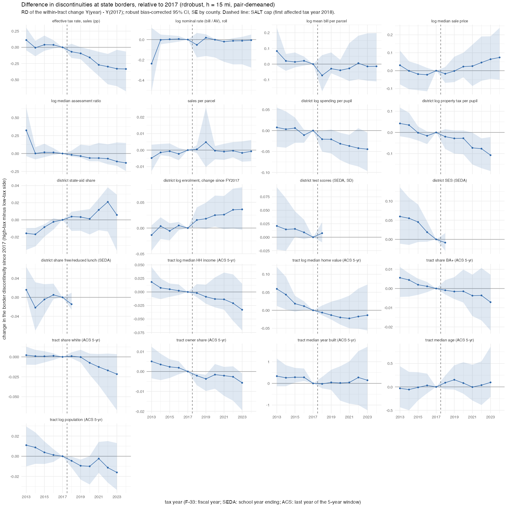

## Answer
- **The rate jumps at the line, demographics don't.** The effective rate jumps +0.75 to +0.77 pp (≈ 0.9 SD) at state borders (rdrobust, p < 0.001). No covariate jumps significantly. Tract income, education, race and housing are within ±0.2 SD, and Holm-adjusted p = 1 for all 11.
- **School districts are the exception.** District SES, FRL and test scores sit at about ±0.3 SD (p ≈ 0.1). Profiles out to 100 mi show this is a dip on the *low-tax* side near the line, not an advantage on the high side.
- **After the cap the gap narrowed** (difference in discontinuities, change since 2017):
  - effective rate −0.07 pp (2018) → −0.33 pp (2023–24), significant from 2020; the pre-period is flat;
  - this came through prices (+0.07 log, n.s.) and assessment ratios (−0.13 log), not tax bills or nominal rates (≈ 0).
- **District property tax per pupil** on the high side fell up to 11%, but with a pre-trend.
- **What the border variation is:**
  - The RD varies the *tax rate itself*: state regimes cause a ≈ 0.8 pp jump.
  - The instrument (near × high side, with pair × side FE) varies the *choice set*: access to a cheaper cross-state tract within 30 min (first stage +0.33).
  - After the cap, the cheaper side is worth only a few hundred dollars a year to an itemizer, and most pairs have few capped households. So the instrument carries a weak SALT treatment.

## How
- **Outline:** tracts (2010) with CoreLogic 2017–19 sale medians → nearest ranked state-border pair and side (`code/build/geo/06_tract_border_side.R`, formerly local_juris
  R/26) → signed distance (low side negative) → rdrobust per covariate and per year.
- **Choices:**
  - Local linear, triangular kernel, SE clustered by county.
  - Outcome demeaned by border pair (or pair dummies as covariates; same results).
  - Yearly RDs use a fixed h = 15 mi. Difference in discontinuities = RD of the within-tract change since 2017.
  - ACS 5-year releases from 2020 on are mapped from 2020 to 2010 tracts by land-area shares (Census relationship file).
  - ACS median year built is coded 0 for "1939 or earlier" from the 2018 release; recoded to 1939.
  - SEDA 4.1 long files end in 2018.
- **Inputs:**
  - `data/built/geo/iv_tract_side.rds`, `data/built/corelogic/tract_year.rds`, `data/built/census_finances/district_finance.rds`.
  - `data/external/acs/acs5_tract_2013..2023.csv`, `data/external/tract_rel/tab20_tract20_tract10_natl.txt`, `data/external/seda41/*long*.csv`.
  - All gitignored, local only.
- **Scripts:** `code/designs/border_rd/01_side_selection_levels.R` (c13), `02_profiles_by_distance.R` (c14), `03_covariate_rd.R` (c15), `04_rd_by_year_and_diff_in_disc.R` (c16), `code/build/acs/06_tract_year_panel.R` (c18); paths after the 2026-10-27 restructuring.
- **Check:**
  - 44,524 tracts within 100 mi.
  - Tax-rate RD +0.747 pp (pair-demeaned); effective-rate gap level 0.915 pp (2013) and 0.434 pp (2024).
  - Difference in discontinuities 2023: −0.331 pp.

## Open
Switch the instrument to the own-state nearest-border assignment (60,982 tracts vs 57,350; c9) and rerun.
