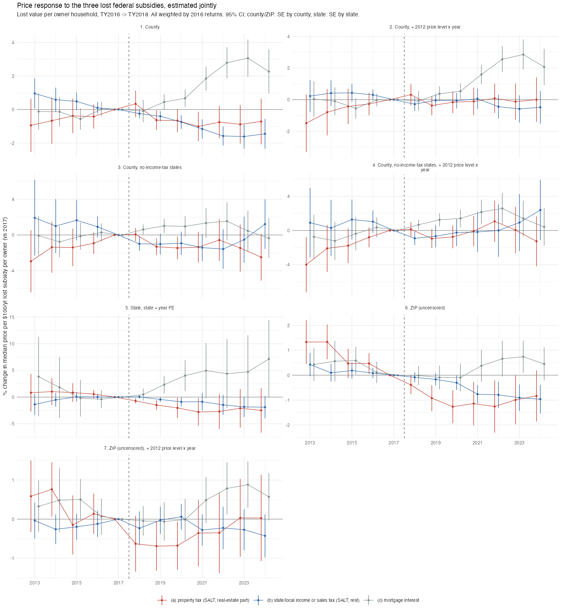

## Answer
Prices fell somewhat in exposed places, but only the property-tax part behaves like capitalisation, and its size is
uncertain. All estimates are return-weighted, in % price change per $100/yr of lost subsidy per owner household, vs 2017.

| Spec | Property-tax part | Income/sales-tax part | Mortgage interest |
|---|---|---|---|
| County (county + state x year FE) | 2019 −0.64, 2021 −1.01; rising pre-trend | 2019 −0.40 → 2024 −1.45; pre-trend | +0.45 → +3.07 (wrong sign) |
| County, all of SALT (one measure) | — | — | total: 2019 −0.32, 2021 −0.64, 2024 −0.65 (factor 0.45 → 0.9) |
| State (state + year FE, 48 states) | **2018 −0.71, 2019 −1.50** (significant) | 2019 −0.45 → −1.9 | +2 to +7 |
| No-income-tax states (county design) | 2019 −1.31, 2020 −1.45; noisy pre | −1.0 | +0.6 → +1.5 |
| ZIP (uncensored, zip + state x year FE) | −0.4 → −1.3, **pre-trend** | −0.8 to −1.0 from 2021 | +0.4 to +0.7 |

What it means:
- **Within states,** the decline loads on the income-tax part, which moving within the state can't avoid. That points to a
  demand effect among high-income buyers, or confounding, not location-specific capitalisation.
- **Exposure tracks price level** (correlation ≈ 0.6 with 2012 prices at ZIP and county level). With 2012 price × year as a
  control, everything goes to ≈ 0 except the ZIP property-tax part (2019–20 ≈ −0.7%). That control absorbs much of the
  treatment, so it was **dropped as a bad control**: the result is unresolved, not refuted.
- **The ZIP pre-trend** is a within-county price-tier gradient (cheaper areas caught up after 2012). It is not sample
  selection: the ZIP sample with county exposure has a flat pre-period.
- **Mortgage-interest loss has the wrong sign everywhere.** It marks the post-2020 boom in mortgage-heavy suburbs.

## How
- **Outline:** SOI county/ZIP × AGI-stub files TY2016 and TY2018 → lost federal value of SALT and mortgage-interest
  deductions per stub → split into components, attribute to owners, divide by ACS owner households → event study of log
  median arm's-length sale price (CoreLogic) on component × year, ref 2017.
- **Choices:**
  - Lost value = τ16(1−AMT share)·SALT claimed 2016 − τ18(1−AMT share)·SALT deducted 2018 (A18460).
  - Assumed MFJ marginal rates by stub (2016/2018): $10–25k 10/10; $25–100k 15/12; $100–200k 25/22; $200k+ 33/32.
  - AMT share = N09600/N04470. AMT payers get no SALT value; mortgage interest is not AMT-adjusted.
  - TY2016 is the base, not TY2017, because of the Dec-2017 property-tax prepayment spike.
  - Property part: the 2018 deducted amount is allocated pro rata to real-estate taxes (A18500 / SALT claimed).
  - Owner attribution: the stub's share of itemizers claiming real-estate tax (N18500/N04470). Per owner = ACS 2013–17 owner households.
  - Exposures winsorised p1/p99. Weights: 2016 returns.
  - Samples: counties with ≥ 50 sales in every year 2012–2024 (1,322–1,496); ZIP price = sales-weighted mean of tract log
    medians (tracts with ≥ 5 sales every year, tract → modal ZIP).
  - "Uncensored" ZIPs: every stub populated and itemizers in the top two stubs in both years. SOI zeroes counts below 20.
  - No-income-tax states: FL, NV, SD, TX, WA, WY, NH, TN.
  - Trap: state-total rows have COUNTYFIPS "0" in the 2016 county file and "000" later.
- **Inputs:**
  - `data/SOI/county_returns_w_agi/{16,18}incyallagi.csv` and `data/SOI/zipcode_returns_w_agi/{16,18}zpallagi.csv` (IRS SOI
    downloads).
  - `data/built/corelogic/county_year.rds` and `tract_year.rds` (CoreLogic full-roll panel built on SOM/Bouchet, k_panel*.sql).
  - `data/external/acs/acs5_tract_2017.csv`, `acs5_zcta_2017.csv` (tidycensus).
  - `data/built/exposure/salt_exposure_tract_zip2016.csv`.
  - **All of `data/` is gitignored and lives only on this laptop.**
- **Scripts:** `code/build/exposure/04_delta_deduction_value.R` (c24), `05_components_county_state_zip.R` (c26), `code/archive/2026-10-superseded/c27_prices_levels_components.R`,
  `code/designs/exposure_did/06_zip_pretrend_diagnostics.R` (c28), `05_prices_by_component.R` (c29); paths after the 2026-10-27 restructuring.
- **Check:**
  - National SALT claimed $559bn (2016) vs $130bn deducted (2018); 59% of $200k+ itemizers on the AMT in 2016.
  - Owner-attributed share of the lost value 0.875; property-tax share 0.372.
  - County single-measure 2019 coefficient −0.32 per $100.

## Open
- ZIP design on repeat sales instead of medians (the earlier b8 repeat-sales design had a flat pre-period).
- Trend-break test and Rambachan–Roth bounds in place of the price-level control.
- Exposure that varies independently of price: tax-rate differences across lines within a county.
- Expected cap duration in the capitalisation factor (the cap was legislated to expire after 2025).
