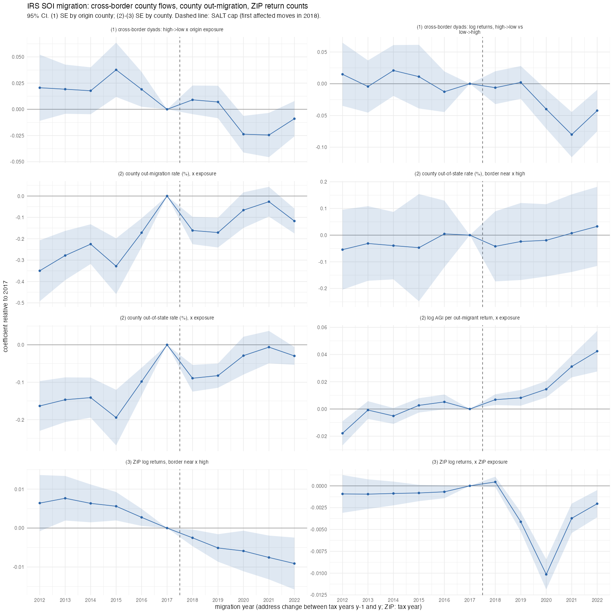

## Answer
No detectable migration response before COVID, in five independent sources:

| Source | Result |
|---|---|
| IRS SOI cross-border county flows (478 county pairs, 53 borders) | high→low vs low→high: flat 2018–19; **−4% to −8% in 2020–22** (opposite of escape) |
| IRS SOI county out-migration rate × exposure | upward trend from 2012, no break at 2018 |
| IRS SOI leavers' vs stayers' AGI × exposure | leavers relative to stayers ≈ 0 in 2018–19; +0.9%, +2.2%, +1.0% per SD in 2020–22 |
| Pupils per district (F-33), border RD / difference in discontinuities | 2018–23 −0.2 to −0.6 log points × 100, CIs ±3.5; nothing |
| Data Axle move-outs and family moves; CoreLogic sales turnover | flat (earlier entries in `text/data_exploration/dataaxle.md` §4.20–4.35) |

- **The rise in leavers' AGI is not a migration signal.** It is mostly general income growth in exposed counties: stayers' AGI also rose 0.6–3.2% per SD.
- **The dip in ZIP return counts** (−1% per SD in 2020) is larger than any net migration (≈ 0.3–0.5% by 2021), so it is mostly filing composition, e.g. stimulus filers.

## How
- **Outline:** SOI county outflow/inflow files 2011–12 … 2021–22 → county and dyad panels → event studies on 2016 county
  exposure (SD units) or border sides.
- **Choices:**
  - Flow year = the year of the second tax year (file "1718" = 2018, moves during ≈ 2018); ref 2017.
  - Dyads with < 20 returns are suppressed by SOI; only dyads unsuppressed in both directions in all 11 years are kept.
  - Cross-border spec: log returns ~ i(year, from-high-side) | directed dyad + undirected dyad × year.
  - County/border sides come from the majority of the county's tracts (local_juris R/26 side ranking).
  - Enrolment RD: one observation per district; running variable = median signed distance of its tracts; h = 19.4 mi.
- **Inputs:**
  - `data/SOI/migration_county/county{in,out}flowYYYY.csv`, `data/database.db` (returns_zipcode).
  - `data/local_juris/district_finance.rds` (F-33 elsec files), `iv_tract_side.rds`.
  - All gitignored, local only.
- **Scripts:** `code/analysis/salt_local/c19_enrolment.R`, `c20_enrolment_rd.R`, `c22_soi_migration.R`, `c23_soi_agi_in_out.R`.
- **Check:** 3,128 balanced counties; mean out-migration rate 6.69% of returns (2.25% out of state); cross-border dyad
  coefficient 2021 −0.080 (SE 0.018).

## Open
Nothing pressing. County is the finest public SOI flow level; ZIP files have return counts only.
