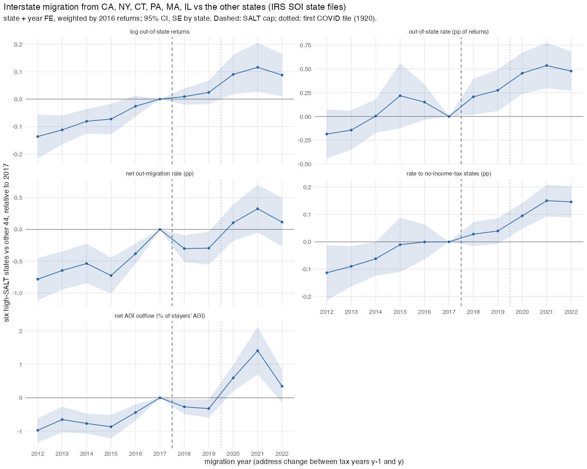

## Answer
No conflict: same raw files, different variation, and their post period includes the first COVID year.

1. **Their variation is what our designs absorb.** They compare six states (CA NY CT PA MA IL) with the other 44 in
   state-to-state flows. Every exposure regression of ours has state × year FE, and our cross-border dyads are within
   50 mi of a border, so a New York → Florida move never enters. We had not estimated their comparison.
2. **Estimated on our files it is a trend, not a break.** Six states vs rest, state + year FE, 2016-return weights, SE by
   state, ref 2017:

   | Year | log out-of-state returns | net out-migration rate (pp) | rate to no-income-tax states (pp) | net AGI outflow (% of stayers' AGI) |
   |---|---|---|---|---|
   | 2012 | −0.136 (0.041) | −0.78 (0.17) | −0.11 (0.05) | −0.97 (0.18) |
   | 2014 | −0.081 (0.023) | −0.54 (0.16) | −0.06 (0.03) | −0.77 (0.15) |
   | 2016 | −0.026 (0.019) | −0.38 (0.08) | −0.00 (0.03) | −0.44 (0.13) |
   | 2018 | +0.009 (0.015) | −0.30 (0.11) | +0.03 (0.02) | −0.27 (0.11) |
   | 2019 | +0.024 (0.022) | −0.30 (0.13) | +0.04 (0.02) | −0.32 (0.14) |
   | 2020 | +0.090 (0.036) | +0.11 (0.15) | +0.10 (0.02) | +0.59 (0.20) |
   | 2021 | +0.116 (0.045) | +0.33 (0.19) | +0.15 (0.03) | +1.41 (0.36) |

   Relative out-migration from the six states rises smoothly from 2012 and stays on that slope through 2019; the
   break is in file 1920 and later. A 2×2 DiD (post 2018–19) on log out-of-state returns gives +0.088 (0.031) with a
   2012–17 pre-period and +0.030 (0.025) with 2016–17: a long pre-period averaged across the trend is the "effect".
3. **Their post period is files 1819 and 1920.** Their Table A.2 post-TCJA emigration per destination × 49: CA 336k,
   NY 248k. Our files excl. DC: CA 317k (1718+1819) vs 341k (1819+1920); NY 228k vs 251k. File 1920 is the address
   change between the TY2019 and TY2020 returns, i.e. moves during 2020. Their largest coefficient (their "2019") is
   that file, where our series jumps too.
4. **Inference.** Levels of households (CA and NY dominate), White SEs on 46,256 dyad-years with no state clustering,
   six treated states; their own year-by-year ΔSALT coefficients (Table 7) are significant already in 2016 and strongly
   negative 2007–11, i.e. the housing cycle of CA out-migration. The placebo is one random draw. Their SALT measure
   is itemized SALT / AGI (PA in, NJ out), not exposure to the cap.
5. **Magnitude.** Their +0.633k per dyad-year ≈ 167k extra out-migrant households per year from the six states ≈ +13%
   of their out-of-state rate. Our 2018–19 upper CI bound is ≈ +7%, so an effect that size in the pre-COVID years is
   rejected in the same data.

What agrees: the outflow goes long-distance to no-income-tax states, not across the nearest border (our cross-border
null), and leavers' AGI and net AGI outflows from high-SALT states rise sharply from 2020 (our county results).

## How
- **Outline:** `SOI state{out,in}flow 1112…2122 -> state-year panel (out-of-state, in, non-migrants, flows to AK FL NV NH SD TN TX WA WY, AGI) -> y ~ i(year, high, ref 2017) | state + year`.
- **Choices:** year = second year of the file (file 1718 = 2018); rates in % of non-migrants + out-migrants; weights =
  2016 returns (project rule); SE clustered by state (50 states, 6 treated, so the CIs are rough); the match of the
  paper's years uses "Total Migration-US" minus the flow to DC; files 1112/1213 spell "Total Migration US" without the
  hyphen (regex `Migration.US$`). File 1617 (our 2017, the reference year) has out-of-state rates ≈ 30% above adjacent
  years in every state; proportional, so year FE absorb it in logs, but it is in rate levels.
- **Inputs:** `data/SOI/migration_state/state{outflow,inflow}YYYY.csv` (IRS SOI downloads, gitignored, laptop only);
  paper numbers from `papers/DiopGreen2026_SALT_HouseholdRelocation_SSRN.pdf` Tables 9 and A.2.
- **Scripts:** `code/designs/exposure_did/13_soi_state_six.R` → `output/designs/exposure_did/13_soi_state_six.{csv,txt}`, `figures/13_soi_state_six.png`.
- **Check:** log out-of-state returns 2019 +0.024 (0.022), 2021 +0.116 (0.045); 2×2 DiD pre 2012–17 +0.088 (0.031); CA files 1819+1920 excl. DC = 341k.

## Open
- The paper's series starts in 2001; our state files before 1112 are zipped and in a different layout. Unzipping them
  would allow the full pre-trend and the GFC cycle to be shown in one figure.
- Randomisation inference over which six states are "treated" would make point 4 concrete.
