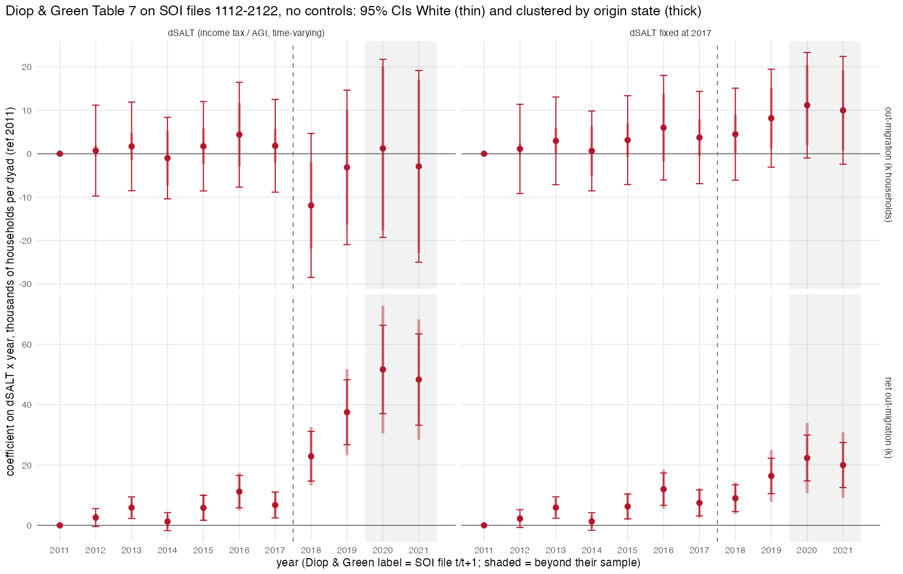
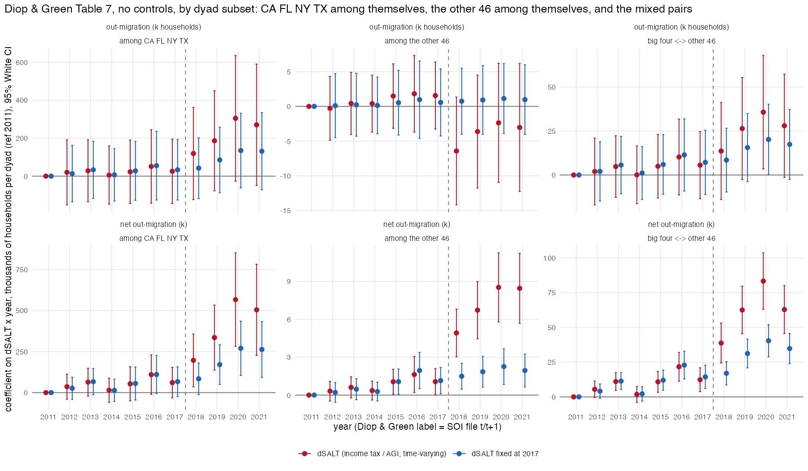

## Answer
Their SALT variable is itemized **state and local income tax** deductions / AGI (our moments 2011–19: mean 0.0245,
SD 0.0149, max 0.068, ΔSALT SD 0.0195; their Table 1: 0.026, 0.015, 0.068, 0.020). Files 1112–1920 are their years
2011–2019 (their label = first file year); 50 states × 49 destinations × 9 years = 22,050 dyad-years, nothing
suppressed. Coefficients in thousands of households per dyad per unit ΔSALT, reference 2011 (theirs 2001; their 2011
net coefficient is −4.8, so add ≈ 5 to their net column to compare).

| ΔSALT × year | 2014 | 2016 | 2017 | 2018 | 2019 | 2020 | 2021 |
|---|---|---|---|---|---|---|---|
| **Net**, their time-varying ΔSALT, ours (White SE) | 1.3 (1.5) | 11.2 (2.7) | 6.8 (2.2) | **22.9 (4.2)** | **37.5 (5.5)** | 51.5 (7.4) | 48.4 (7.7) |
| ... D&G Table 7 (with controls, ref 2001) | −3.2 (2.1) | 8.1 (3.1) | 2.8 (2.6) | 16.3 (4.4) | 31.4 (5.7) | | |
| **Net**, ΔSALT fixed at 2017 | 1.3 (1.5) | 12.0 (2.7) | 7.5 (2.2) | 9.0 (2.3) | 16.4 (3.0) | 22.3 (3.8) | 20.0 (3.7) |
| **Gross out**, time-varying ΔSALT | −1.0 (4.7) | 4.5 (6.2) | 2.0 (5.5) | −10.1 (8.5) | −1.4 (9.1) | 1.3 (10.5) | −2.8 (11.3) |
| ... D&G Table 7 | −1.1 (4.0) | 4.5 (5.4) | 1.2 (4.7) | 16.9 (7.5) | 23.7 (8.2) | | |
| **Gross out**, ΔSALT fixed at 2017 | 0.6 (4.7) | 6.0 (6.2) | 3.7 (5.4) | 4.5 (5.4) | 8.2 (5.8) | 11.2 (6.2) | 10.1 (6.3) |

(2020–21 from the 2011–2021 sample; clustered SEs below.)

- **Net out-migration reproduces without controls.** Their column 2 is essentially our no-control regression: 2016
  +11 vs their +8 (+13 after the reference shift), 2018 +23 vs +16 (+21), 2019 +37 vs +31 (+36). Their Table 6
  Post × ΔSALT for net, 24.5 (3.4) with controls, is 25.4 (3.5) here without. The controls do nothing for the net
  result.
- **Gross out-migration does not.** Without controls the ΔSALT main effect is −5.6 (3.9) and the 2018–19 interactions
  are −10 and −1 (SE 8–9): in a levels regression on dyads, destination size dominates (CA, NY are big, high-SALT
  destinations, so ΔSALT < 0 where flows are large), and their population / income controls are what turn the gross
  coefficients positive. Their gross result is a controls result; the net result is not, because the reverse flow
  nets the destination-size effect out.
- **Half of the post-2017 jump is the regressor shrinking, not flows changing.** TCJA cut the itemizer share from
  31% to 11%, so SALT/AGI measured on itemizers halves for every state in 2018 (mean 0.028 → 0.013, ΔSALT SD
  0.022 → 0.012) while the flows do not; a coefficient per unit ΔSALT doubles mechanically. With ΔSALT held at its
  2017 value the net interactions are 2018 +9.0, 2019 +16.4 (ref 2011), i.e. relative to 2017: 2018 +1.5 (2.9),
  2019 +8.9 (3.5), 2020 +14.9 (4.3), 2021 +12.5 (4.2). So there is a real rise in net out-migration from high-SALT
  states, significant from file 1920 (moves during 2020), about a quarter of what their table shows for 2019.
- **Pre-trend.** Relative to 2017, the fixed-ΔSALT net coefficients are 2011 −7.5 (2.2), 2012 −5.2, 2014 −6.2,
  2015 −1.2, 2016 +4.6: a steady drift up through the 2010s, which their 2001 reference and GFC-era negative
  coefficients hide. The 2016 value (file 1617) sits above the line, the file whose mover counts are 30% too high
  (log §4.40), so their only significant pre-TCJA net coefficient is the file artifact.
- **Standard errors.** White SEs on 22,050 dyad-years vs clustered by origin state (50 clusters) vs two-way origin +
  destination: for net 2019 (time-varying) 5.5 / 7.5 / 10.4, so the net result survives clustering; for gross the
  clustered SEs are smaller than White (2–4 vs 5–6) because the heteroskedasticity across dyads of different size
  dominates the within-origin correlation. Clustering is not what separates us from them; the specification is.
- Check: net 2019 time-varying ΔSALT 37.48 (5.52), fixed-2017 16.37 (3.02); gross 2018 time-varying −10.10 (8.47);
  Post × ΔSALT net 25.44 (3.53); dyad-years 2011–2019 = 22,050.

### By dyad subset: CA FL NY TX among themselves, the other 46 among themselves, the mixed pairs (same day)
Same specification, ref 2011, 2011–2021, ΔSALT fixed at 2017 (time-varying in the csv); thousands of households per
dyad per unit ΔSALT, White SE (clustered-by-origin SE in brackets where there are enough clusters).

| Net out-migration | dyads / yr | 2014 | 2016 | 2017 | 2018 | 2019 | 2020 | 2021 |
|---|---|---|---|---|---|---|---|---|
| among CA FL NY TX | 12 | 14 (35) | 110 (59) | 67 (46) | 84 (49) | 171 (62) | 270 (84) | 263 (87) |
| big four ↔ other 46 | 368 | 2.2 (2.7) | 22.8 (5.1) | 14.4 (4.3) | 17.0 (4.3) [5.1] | 31.2 (5.3) [6.7] | 40.4 (5.9) [8.0] | 34.8 (5.5) [7.7] |
| among the other 46 | 2,070 | 0.28 (0.38) | 1.94 (0.73) | 1.15 (0.53) | 1.49 (0.52) [0.50] | 1.85 (0.62) [0.63] | 2.26 (0.72) [0.85] | 1.94 (0.66) [0.73] |
| (all 50, from above) | 2,450 | 1.3 | 12.0 | 7.5 | 9.0 | 16.4 | 22.3 | 20.0 |

- **The ΔSALT result is CA/NY versus FL/TX.** Among the other 46 states the net coefficient is a tenth of the
  full-sample one and does not move after 2017: relative to 2017, 2018 +0.3 (0.7), 2019 +0.7 (0.8), 2020 +1.1 (0.9),
  2021 +0.8 (0.9); the gross coefficient is zero throughout (0.1 to 1.1, SE 2.5). With the time-varying ΔSALT the
  other-46 net coefficients double after 2017 (4.9, 6.7, 8.5) exactly as in the full sample, the mechanical halving of
  the regressor again.
- The 12 dyads among the big four carry it: net 2019 +171 (62) vs 2017 +67, 2020 +270, with gross out-migration
  +85 to +135 (SE 90–100). The mixed pairs (each big state with the 46) show the same timing at a fifth of the size:
  relative to 2017, 2019 +17 (6), 2020 +26 (7), on a pre-trend from +2 (2014) to +23 (2016).
- Scaled by the flows (2017 mean dyad flow 19.3k among the big four, 4.1k mixed, 0.85k among the other 46; ΔSALT SD
  0.051, 0.033, 0.019): one SD of ΔSALT raises net out-migration in 2019 relative to 2017 by 27% of the dyad flow among
  the big four, 13% in the mixed pairs and 1.5% (SE 1.8) among the other 46.
- So Diop & Green's continuous-ΔSALT regression is their six-state DiD in another form: the identifying variation is
  the gap between CA/NY and FL/TX, and the post-2017 rise is the acceleration of the CA/NY → FL/TX flow from the 2020
  moves, which the reconciliation entry already attributes to the pandemic years. For the 46 other states, whose SALT
  differences span the same range (ΔSALT SD 0.019 vs 0.022 overall), differences in SALT predict net flows weakly and
  the cap changed nothing.
- Check: other-46 net fixed-2017 2019 1.85 (0.62); big-four net fixed-2017 2019 170.6 (61.6); mixed net 2019 31.2 (5.3).

## How
- **Outline:** `SOI stateoutflow csv -> dyads (build/soi/10) + Historic Table 2 state files -> SALT = A18425 / A00100
  (build/soi/11) -> emig_ijt = n1 / 1000, net = emig_ij - emig_ji, dSALT = SALT_i - SALT_j -> feols(y ~ dSALT +
  i(year, dSALT, ref) | year + origin)`, vcov hetero / ~o / ~o + d.
- **Choices:** 50 states (no DC, no foreign); their year t = file t(t+1); income taxes only in SALT (the variant with
  real estate taxes gives the same picture, in the csv); no weights (their levels regression); reference 2011 and
  2017; samples 2011–19 (theirs) and 2011–21; Post = years ≥ 2018 for the Table 6 form; ΔSALT fixed at TY2017.
- **Inputs:** `data/built/soi/state_dyads.csv`, `data/built/exposure/soi_state_salt_panel.csv`.
- **Scripts:** `code/build/soi/10_state_dyads_panel.R`, `code/build/soi/11_state_salt_panel.R`,
  `code/designs/exposure_did/16_diop_green_table7.R` → `output/designs/exposure_did/c16_diop_green_table7.{csv,txt}`,
  `figures/c16_diop_green_table7.png`.
- Pre-2011 files (per-state xls, Excel 4 state tables) were not used; the sample starts with their 2011.

## Open
- Add destination FE (not in their specification) to see whether the gross result appears without their controls.
- Their controls are state-year aggregates; the net result with the fixed-2017 ΔSALT is the number to carry
  (+9 per unit ΔSALT in 2019 relative to 2017 ≈ 9.5k households per SD of ΔSALT per origin state per year, about 2% of
  a state's gross out-migration), and it dates from the 2020 moves, as the state-level simulated-instrument result.
