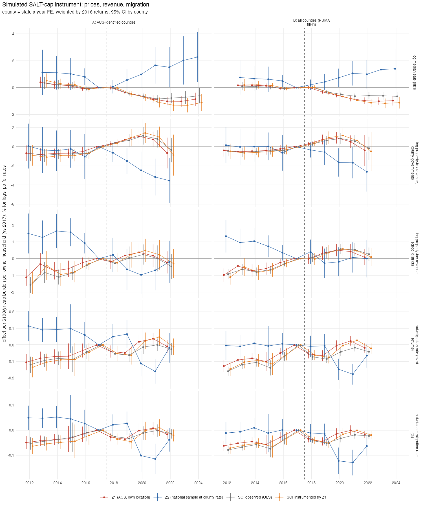
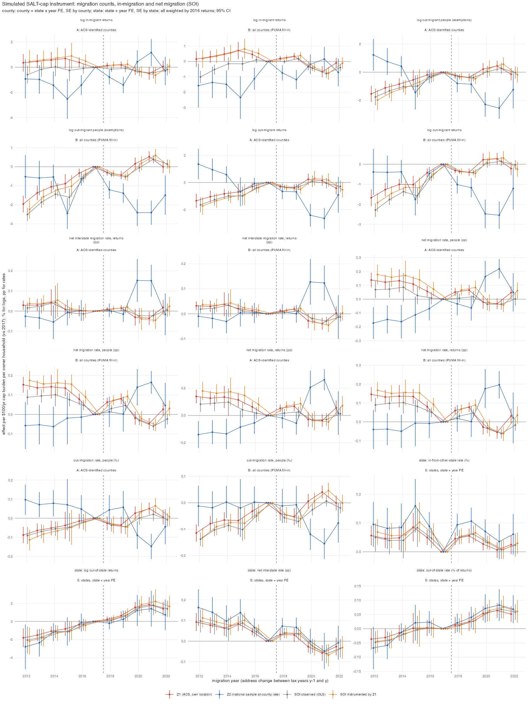

## Answer
County variation (outcomes exist there; 51 states are too few; PUMAs have no outcomes). Effects per $100/yr of
simulated cap burden per owner household, county + state × year FE, weighted by 2016 returns, SE by county, vs 2017.
Four exposures on the same sample: Z1 (ACS households at their own location), Z2 (national sample at the county's
effective rate), the observed SOI loss per owner (OLS), and SOI instrumented by Z1 (2SLS, the Currie–Gruber form).

| Outcome (sample A, 425 ACS-identified counties, 66% of returns) | Z1 | SOI OLS | SOI IV by Z1 | Z2 (rate instrument) |
|---|---|---|---|---|
| log median price, 2019 / 2021 / 2022 (%) | −0.37 / −0.86 / −1.02 (SE 0.1–0.2) | −0.45 / −0.84 / −0.78 | −0.47 / −1.11 / −1.31 | +0.6 / +1.7 / +1.5 (SE 0.4–0.8), pre-trend +1.1 in 2013 |
| log revenue, county governments, 2019–22 mean (%) | +0.58 (0.47); pre −0.69 | +0.66 (0.46) | +0.78 (0.62) | **−2.59 (0.95)**; pre −0.46 |
| log revenue, school districts, 2019–22 mean (%) | +0.16 (0.31); pre −0.49 | −0.01 (0.36) | +0.21 (0.41) | −0.67 (0.61); pre +1.39 |
| out-migration rate, 2019–22 mean (pp) | 0.00 (0.02); pre −0.07 | −0.02 (0.02) | 0.00 (0.03) | −0.06 (0.04): −0.11/−0.16 in 2020–21 only |
| out-of-state rate, 2019–22 mean (pp) | −0.01 (0.01) | −0.02 (0.01) | −0.01 (0.02) | −0.06 (0.03): 2020–21 only |

First stage (cross-section, return-weighted): SOI loss per owner on Z1 has slope 0.82 (t = 12), 0.77 with state FE
(t = 17), R² 0.76; on Z2 the within-state slope is 0.14 (t = 0.6). Sample B (all 3,058 counties with PUMA fill-in)
gives the same picture with tighter SEs (prices −0.32 / −0.82 / −0.97; county revenue Z2 −1.54 (0.81)).

What it means:
- **Prices:** the simulated instrument reproduces the SOI result (c29): about −0.4% per $100 in 2019, −1% by 2021–22.
  The IV coefficient is a third larger than OLS (attenuation in the observed SOI measure, or the 2017 responses
  diluting it). The flat 2014–16 pre-period holds; 2013 is +0.4 (SE 0.2). Z2, the rate instrument, goes the other way
  and has a pre-trend of its own: high-rate counties were on a rising relative price path since 2013, so the rate
  dimension does not identify a price effect of the cap.
- **Revenue:** nothing on Z1 or the IV. School-district and county revenue were on a rising relative trend in exposed
  counties before 2017 (−1% in 2012 to 0 in 2017) and the post coefficients (+0.2 to +0.8%) continue it. The only new
  number is Z2 for county governments: −1.5% to −2.6% per $100 (an SD of Z2 is $219, so −3 to −6% per SD) from 2020,
  a mild pre-trend, present in both samples. With state × year FE, Z2 at the county level is a monotone function of
  the county's effective rate, so this says high-rate counties' revenue grew slower after 2019 within their state. It is
  consistent with the cap biting through rates, but equally with mean reversion in rates; it needs the rate panel
  (`designs/exposure_did/04`) before it is a finding.
- **Migration:** nothing, in any version, before 2020; Z2 shows −0.1 to −0.16 pp in 2020–21 only, the COVID years,
  which the migration-nulls entry already attributes to the pandemic.
- **Z1 vs SOI:** the two are near-identical (correlation 0.96 at the county level), so the simulated instrument confirms
  rather than changes the SOI-based results. Its value is the clean first stage and the dollar-per-owner scale.

### Migration counts, in-migration and net migration (`15_simulated_instrument_migration.R`, same day)
SOI inflow + outflow files 2012–22; counts of returns (n1) and people (exemptions, n2); net = in − out over the base.
Per $100/yr cap burden per owner household; county specs as above, state specs = counties summed, state + year FE,
weighted by 2016 returns (population weights), SE by state, 50 states.

| Outcome, Z1 | 2012 | 2016 | 2019 | 2020 | 2021 | 2022 |
|---|---|---|---|---|---|---|
| County log out-migrant returns (%, A) | −1.7 (0.3) | −0.3 (0.2) | −0.2 (0.2) | +0.1 (0.2) | +0.1 (0.3) | −0.3 (0.3) |
| County net migration rate, returns (pp, B) | +0.15 (0.02) | +0.08 (0.02) | +0.08 (0.01) | −0.03 (0.02) | −0.06 (0.02) | +0.03 (0.02) |
| State out-of-state rate (pp) | −0.04 (0.02) | 0.00 (0.02) | +0.03 (0.02) | **+0.05 (0.01)** | **+0.06 (0.01)** | **+0.05 (0.01)** |
| State in-from-other-state rate (pp) | +0.06 (0.02) | +0.05 (0.01) | +0.06 (0.01) | +0.03 (0.01) | +0.01 (0.01) | +0.03 (0.02) |
| State net interstate rate (pp) | +0.09 (0.02) | +0.05 (0.01) | +0.03 (0.02) | −0.03 (0.02) | −0.06 (0.02) | −0.03 (0.02) |
| State log out-of-state returns (%) | −1.8 (0.5) | −0.4 (0.3) | +0.6 (0.2) | +1.5 (0.3) | +1.9 (0.4) | +1.4 (0.4) |

- **Counties:** counts and net migration add nothing to the rates. Exposed counties were on a steady path of rising
  out-migration and falling net in-migration from 2012 to 2017 (log out-migrants −1.7% in 2012 → 0; net rate +0.15 pp
  → 0), and the post-2017 coefficients sit at zero: no break at the cap. People (exemptions) and returns move together.
  Z2 shows −2% out-migrants in 2020–21 only.
- **States (population-weighted):** the out-of-state rate of exposed states rises after 2017, +0.05 pp per $100 by
  2020–22 (mean rate about 2.5%; an SD of state Z1 is roughly $400, so +0.2 pp, 8% of the base), and log out-of-state
  returns rise +1.5 to +1.9%. But the series is a near-linear trend from 2012 (−1.8%) through 2021 (+1.9%), with the
  largest step in 2020. In-migration from other states does not change. The state-level result is the same
  pre-existing drift away from high-SALT states that the Diop & Green reconciliation entry documents, with a COVID
  acceleration; it is not a break at 2018. The IV and OLS versions agree with Z1 throughout; Z2 agrees at the state level.
- Check: state out-of-state rate 2021 Z1 +0.064 (0.013); county log out-migrant returns 2012 Z1 (A) −1.7 (0.3) and
  2021 +0.1 (0.3); balanced counties 2,964.

## How
- **Outline:** `build/exposure/06 county + PUMA values -> county exposure (ACS county where identified, else tract-weighted
  mean of its PUMAs) -> y ~ i(year, X/100, ref 2017) | county + state x year, X in {Z1, Z2, SOI}; 2SLS SOI x year on Z1 x year`.
- **Choices:**
  - Sample A: ACS-identified counties (425 with all three measures); sample B: all counties, PUMA fill-in from the 2010
    tract–PUMA relationship file (tract counts as weights).
  - Exposures winsorised at p1/p99 within the county sample, then per $100; weights = 2016 returns (SOI); SE by county.
  - Prices: CoreLogic county panel, n_sales ≥ 50, balanced 2013–2024. Revenue: CoG school districts by county
    (FY2012–22) and county governments (balanced 11 years), log property-tax revenue. Migration: SOI county outflow
    files 2012–22, out-migrants / (non-migrants + out-migrants), balanced counties.
  - IV: fixest `out ~ 1 | fips + st^y | i(y, soi) ~ i(y, z1)`; first stage reported as the cross-sectional regression.
- **Inputs:** `data/built/exposure/simulated_instrument_{county,puma}.csv` (`build/exposure/06`),
  `exposure_components_county.csv` (`build/exposure/05`, `d_salt_own`), `data/built/corelogic/county_year.rds`,
  `data/census_finances_test.db`, `data/SOI/migration_county/countyoutflowYYYY.csv`,
  `data/external/puma_rel/2010_Census_Tract_to_2010_PUMA.txt`.
- **Scripts:** `code/designs/exposure_did/14_simulated_instrument.R` → `output/designs/exposure_did/c14_simulated_instrument.{csv,txt,png}`.
- **Check:** sample A price 2021: Z1 −0.86 (0.15), IV −1.11 (0.19); first stage Z1 slope 0.820 (SE 0.067); county
  government revenue 2022 Z2 −2.62 (1.05).

## Open
- Z2 county-revenue decline: rerun with nominal rates and assessed values as outcomes (`exposure_did/04` panel) and with
  a rate pre-trend control, to tell cap-induced restraint from mean reversion.
- A within-state Z2 first stage is nil, so the rate instrument cannot be used as an IV for the observed SOI loss; it is
  a reduced form only.
