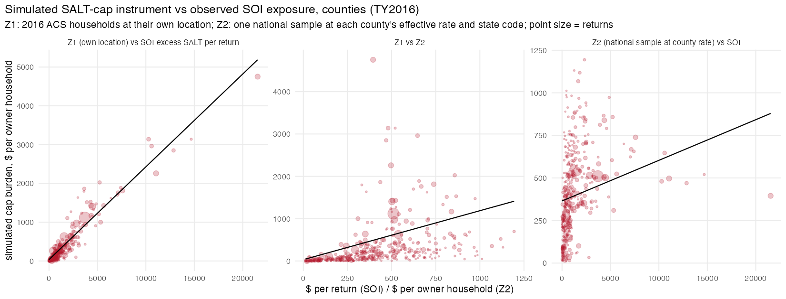

## Answer
Yes. A simulated instrument needs a frozen pre-reform cross-section, not a panel: the 2016 ACS owner-occupier heads
(861,635) are run through TAXSIM under 2017 law, 2018 law, and 2018 law with the cap removed. The cap burden per owner
household (`dcap`, federal tax with cap minus without, holding the rest of TCJA at 2018 law) averages **$332** nationally;
**10.0%** of owner households are bound. Itemisation falls from 40% (2017 law) to 13% (2018 law; 16% without the cap).
The whole TCJA cuts the average owner's federal + state tax by $1,924, so the cap is a small offset to a large cut.

| | Z1: own location | Z2: national sample at local rate |
|---|---|---|
| What varies | 2016 composition, state law, own property tax | state law and the local effective rate only |
| Top states ($/owner hh) | DC 1,863; CT 1,167; NJ 1,038; CA 1,015; NY 945 | CT 763; NJ 744; NY 735; VT 731; OR 687 |
| No-income-tax states | FL 47; TX 116; WA 20; TN 2 | identical by construction: 47 at 1%, 195 at 2%, 414 at 3% |
| Top counties | Manhattan 4,754; SF 3,140; Marin 3,139; Fairfield 2,961 | Essex NJ 858; Nassau 739; Bergen 668 |
| corr with SOI excess SALT per return (430 counties, return-weighted) | **0.963** (0.968 within state) | 0.298 (−0.21 within state) |
| SD across PUMAs (hh-weighted) | $701 | $226 |

What it means:
- **Z1 is the SOI exposure measure rebuilt from the tax code**: correlation 0.96 with `excess_pp` at the county level,
  0.87 between the bound share and the SOI capped share. It adds nothing new as cross-sectional variation, but it is
  free of 2017+ behaviour (prepayment, itemisation switching, moves) and gives a dollar burden per owner household
  rather than per return. It is available at PUMA level (2,351 PUMAs) where SOI county/ZIP cells are censored.
- **Z2 is a rate instrument, not a bill instrument.** With one national sample and property tax = rate × own house
  value, the places with the largest observed exposure (Manhattan, SF, Marin: effective rates 0.7–0.9%) get low Z2,
  and high-rate, moderate-price counties (Essex NJ 3.0%, Cook 1.9%) get high Z2. Within states the correlation with
  SOI is negative because effective rates fall with price levels. Z2 is therefore the "price-independent exposure"
  the synthesis asked for: it isolates the part of the cap that works through local tax rates and state income tax
  law, and discards the part that comes from local house prices and incomes. Whether that is the right exposure
  depends on the question: for capitalisation and migration, bills (Z1) are what households face; for a design that
  must avoid price-level confounding, Z2 is the candidate, at the cost of much less variation.
- Z2 by state at a given rate is a clean ranking of how state income-tax law interacts with the cap: at a 1% rate
  OR 673, HI 611, CA 537, MN 523, DC 518 … NJ 345, PA 180, no-income-tax states 47.

## How
- **Outline:** `ACS 2016 owner heads (database.db) -> TAXSIM 35 (usincometaxes, wasm) x {2017 law, 2018 law, 2018 law
  without cap} -> dcap per household -> hhwt-weighted means by county / PUMA / state (Z1); national subsample x 51 states
  x rate grid -> g_s(r) -> interpolated at local 2016 effective rate (Z2) -> compare with build/exposure/01`.
- **Choices:**
  - Sample: `year = 2016, pernum = 1, ownershp = 1, gq in (1,2)`, 50 states + DC; weights `hhwt`.
  - "Cap removed" = add max(0, proptax + state income tax − 10k) to TAXSIM's uncapped non-preference deduction field
    (`mortgage`); verified on a NJ example (itemised 40,800 = 10k cap + 30,800; taxable income falls by the excess).
    AMT treats that excess as non-preference; immaterial under the 2018 AMT exemption.
  - TAXSIM inputs: `mstat` married jointly / head of household (unmarried with children) / single; `page`, `sage`
    (spouse age, head's age if missing); `depx = nchild`, children assumed age 10; `pwages`, `swages`; non-wage income
    (head + spouse `inctot − incwage`) as `otherprop`; `mortgage = imp_mort_interest` (build/acs/03); no charity.
  - Z1 property tax: `imp_proptx` (PROPTX99 midpoints); top-coded (code 69, $10,000+, 41,893 heads) replaced by
    max(10k, PUMA effective rate × `valueh`).
  - Rates: county = median of CoreLogic `eff50` over 2015–17 (`county_year.rds`); PUMA = n-weighted median of tract
    medians (`tract_eff.parquet`, sales 2017–19) via the Census 2010 tract→PUMA relationship file; missing PUMA rate
    → state median.
  - Z2: 8,000 heads drawn with probability ∝ `hhwt` (seed 20261027), grid r = 0, 0.25%, …, 4% (17 points), linear
    interpolation; rates outside the grid clamped.
  - `dtcja` = 2018-law minus 2017-law federal + state tax, context only.
- **Inputs:** `data/database.db` (`acs_microdata` with `imp_*` columns from `code/build/acs/01–03`, IPUMS extract
  `usa_00004`); `data/built/corelogic/county_year.rds` (`code/build/corelogic/10`, from the SOM/Bouchet `kpanel`);
  `data/built/corelogic/tract/tract_eff.parquet` (SOM `som/j_tract_eff.sql`); `data/external/puma_rel/2010_Census_Tract_to_2010_PUMA.txt`
  (www2.census.gov/geo/docs/maps-data/data/rel/); `data/built/exposure/salt_exposure_county2016.csv` (`build/exposure/01`).
- **Scripts:** `code/build/exposure/06_simulated_instrument.R` (about 25 minutes; TAXSIM results cached in
  `data/built/exposure/taxsim_z{1,2}.parquet`). Outputs `data/built/exposure/simulated_instrument_{county,puma,state}.csv`,
  `simulated_z2_grid.csv`; `output/build/exposure/06_simulated_instrument.{txt,png}`.
- **Check:** national weighted `dcap` 331.6, bound share 0.1004; county corr(Z1, SOI) 0.963, corr(Z2, SOI) 0.298;
  Z2 grid NJ at 2% = 584, no-income-tax states at 2% = 195.

## Open
- Use Z1 (county / PUMA) in `designs/exposure_did` in place of the SOI measure to check that the price and revenue
  event studies are unchanged, and Z2 as the price-independent exposure the synthesis listed.
- Z1 county coverage is 430 ACS-identified counties; PUMA is the geography for anything wider.
- A finer IPUMS extract (INCINVST, INCRETIR, INCSS) would improve non-wage income and state tax; charity is unobservable.
