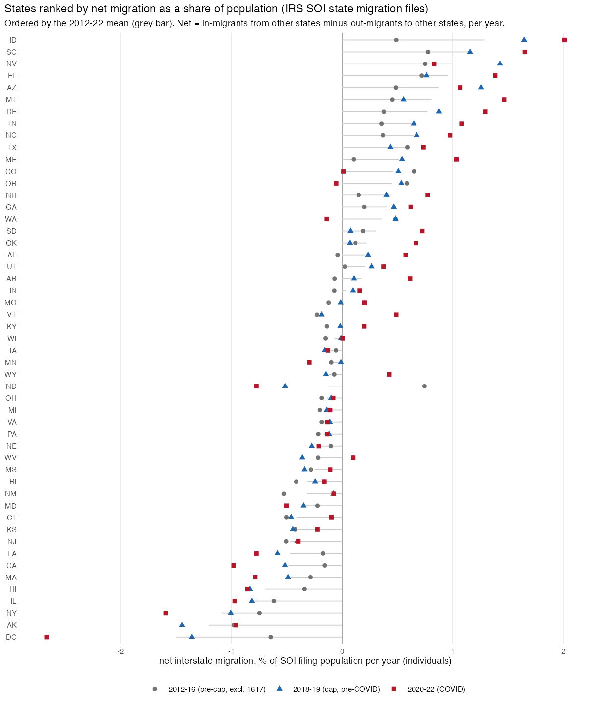

## Answer
Net interstate migration per year, in % of the state's SOI filing population (individuals on returns), mean 2012–2022:

| Rank | State | 2012–22 | 2012–16 | 2018–19 | 2020–22 | | Rank | State | 2012–22 | 2012–16 | 2018–19 | 2020–22 |
|---|---|---|---|---|---|---|---|---|---|---|---|---|
| 1 | ID | +1.29 | +0.49 | +1.65 | +2.01 | | 42 | KS | −0.41 | −0.42 | −0.45 | −0.22 |
| 2 | SC | +1.18 | +0.78 | +1.16 | +1.65 | | 43 | NJ | −0.47 | −0.51 | −0.41 | −0.40 |
| 3 | NV | +0.99 | +0.75 | +1.43 | +0.83 | | 44 | LA | −0.47 | −0.17 | −0.58 | −0.77 |
| 4 | FL | +0.96 | +0.72 | +0.77 | +1.38 | | 45 | CA | −0.49 | −0.16 | −0.52 | −0.98 |
| 5 | AZ | +0.87 | +0.49 | +1.26 | +1.07 | | 46 | MA | −0.49 | −0.28 | −0.49 | −0.79 |
| 6 | MT | +0.81 | +0.45 | +0.56 | +1.47 | | 47 | HI | −0.69 | −0.34 | −0.83 | −0.86 |
| 7 | DE | +0.77 | +0.38 | +0.88 | +1.30 | | 48 | IL | −0.81 | −0.62 | −0.81 | −0.97 |
| 8 | TN | +0.66 | +0.36 | +0.65 | +1.08 | | 49 | NY | −1.09 | −0.75 | −1.01 | −1.60 |
| 9 | NC | +0.65 | +0.37 | +0.67 | +0.98 | | 50 | AK | −1.21 | −0.98 | −1.45 | −0.96 |
| 10 | TX | +0.59 | +0.59 | +0.44 | +0.74 | | 51 | DC | −1.50 | −0.65 | −1.36 | −2.67 |

The full 51-row table (with foreign flows, returns instead of individuals, AGI, cumulative 2012–22 change) is in
`output/designs/exposure_did/20_soi_state_net_migration.txt`. What it shows:

1. **The ranking is stable.** Spearman rank correlation of the 2012–16 and 2018–19 period means is 0.83, of 2018–19 and
   2020–22 0.89. Individuals vs returns 0.99; adding foreign flows changes nothing (1.00). The Sun Belt and Mountain
   West gain (ID SC NV FL AZ MT TN NC TX), the Northeast, IL, CA, HI, AK and DC lose. The cumulative 2012–22 net is
   +15% of 2012 filers for ID, +11% for FL, −12% for NY, −18% for DC.
2. **Magnitudes.** Per year, ±1% of population at the extremes, ±0.2% for most states. Net rates are small differences
   of gross rates of about 3% in and 3% out.
3. **Around the SALT cap.** Between 2012–16 and 2018–19 the six high-SALT states move by −0.36 pp (CA), −0.26 (NY),
   −0.20 (MA and IL), +0.04 (CT) and +0.10 (PA), and CA's net outflow was already rising year by year from 2012.
   The largest changes are elsewhere: ND −1.26 (the oil boom unwinding), ID +1.16, AZ +0.77, NV +0.68, DC −0.71.
   The high-SALT losers deepen in 2020–22 (CA −0.98, NY −1.60, MA −0.79) while FL, ID, SC, MT, TN gain more.
4. **File 1617 (our 2017).** The mover-coding artifact inflates in- and out-flows by ~30% in every state, so net rates
   in 2017 are scaled up too (mean |net| across states 0.81 vs 0.5 in adjacent years). The pre-cap column above
   excludes it; file 1415 (2015) is ~25% low in the same way and is kept.

Check against Census: FL 2022 net interstate +1.50% of filers here vs Census net domestic migration +1.43% of
population (July 2021–22); the SOI filing population is about 80% of the Census estimate (CA 31.1m vs 39.5m in 2019).

## How
- **Outline:** `SOI state{out,in}flow 1112…2122 -> per state-year: non-migrants, out to US / foreign, in from US / foreign (n1, n2, AGI) -> net rate = 100 (in_US − out_US) / (non-migrants + out US + foreign), period means, ranks`.
- **Choices:** year = second year of the file (file 1718 = 2018); individuals (n2 = exemptions) as the headline, returns
  as a check; population = non-migrants + all out-migrants of year y−1 (same-state movers, ~3% of filers, are not
  reported in files 1112/1213 and are left out in every year for consistency); DC included (no same-state row);
  periods 2012–16 (file 1617 dropped), 2018–19, 2020–22; the "all" ranking is the 2012–22 mean including 2017.
  Files 1112/1213 spell "Total Migration US" without the hyphen (regex `Migration.US$`); the "Same State" row shares
  code 97 with "Total Migration-US" and is told apart by name.
- **Inputs:** `data/SOI/migration_state/state{outflow,inflow}YYYY.csv` (IRS SOI downloads, gitignored, laptop only).
- **Scripts:** `code/designs/exposure_did/20_soi_state_net_migration.R` → `output/designs/exposure_did/20_soi_state_net_migration.{csv,txt}`,
  `20_soi_state_net_migration_panel.csv` (state × year), `figures/20_soi_state_net_migration.png`.
- **Check:** FL 2022 net interstate +1.505% ((702,615 − 457,281) / 16,303,542); ID 2012–22 mean +1.29; DC −1.50;
  Spearman(pre 2012–16, cap 2018–19) = 0.83.

## Open
- Dividing by Census population estimates instead of the filing population would make the rates comparable with
  Census net domestic migration; the difference is a near-constant ~0.8 factor and does not change the ranking.
- The pre-2012 zipped files would extend the series through the housing cycle.
