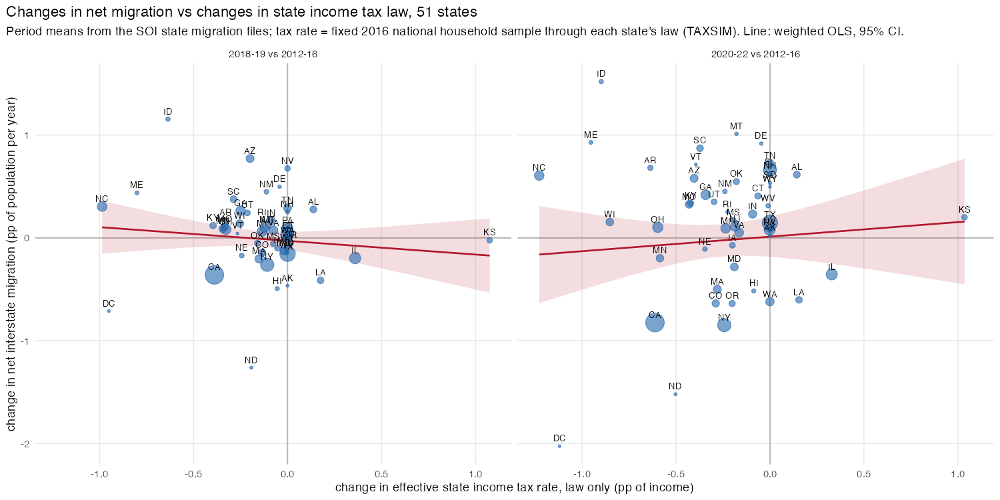

## Answer
Not within states. Across states the familiar gradient is there (higher-tax states lose people), but when a state changes
its income tax law its net migration rate does not move with it, in a state × year panel 2012–2022 or around the five
large reforms of the period.

1. **Levels across states:** mean net interstate migration 2012–22 on the mean law-only effective rate, 51 states,
   weighted: −0.19 (0.04) pp of population per year per 1 pp of effective rate (corr −0.21); net AGI inflow on the
   top-10% rate −0.26 (0.09).
2. **Changes within states**, net rate (pp of population) per 1 pp of effective rate, weights = 2016 filers, SE by state:

   | Tax measure | state + year FE | first differences | long diff. 2018–19 vs 2012–16 | long diff. 2020–22 vs 2012–16 |
   |---|---|---|---|---|
   | law only, fixed 2016 sample | +0.11 (0.22) | −0.02 (0.08) | −0.13 (0.20) | +0.14 (0.38) |
   | law only, top-10% households | +0.07 (0.15) | +0.01 (0.06) | −0.14 (0.13) | +0.08 (0.28) |
   | collections / AGI (Census STC) | −0.31 (0.18) | −0.06 (0.10) | −0.18 (0.18) | −0.78 (0.23); unweighted −0.12 (0.27) |
   | TAXSIM on each year's ACS households | −0.26 (0.14) | −0.01 (0.05) | | |

   The law-only measures, which move only when a state changes its tax code, show nothing; the first-difference CI
   excludes the cross-sectional slope, the FE and long-difference CIs do not (the law changes are small: SD of the
   yearly change 0.16 pp, only 14% of state-years move by more than 0.1 pp). The realised measures (collections / AGI,
   ACS households × law) are negative in levels with FE and in the COVID long difference, but they rise with the income
   mix, not only with law: the weighted −0.78 is CA and NY, whose collections / AGI jumped with 2021 capital gains
   while their net out-migration deepened; unweighted it is −0.12 (0.27). Net AGI inflow and the in- and out-rates
   separately give the same picture (`21_soi_state_migration_taxes.txt`).
3. **Reforms:** law-only effective rate change and the net rate (pp) in the two years before and after:
   - KS 2013 cut, −2.0 pp: −0.32, −0.43 → −0.48, −0.24; KS 2017 reversal, +1.3 pp: −0.64, −0.78 → −0.43, −0.46.
   - NC 2014 cut, −1.2 pp: +0.35, +0.34 → +0.26, +0.25. IL 2015 expiry, −1.2 pp: −0.62, −0.75 → −0.46, −0.80; IL 2017
     increase, +0.6 pp: −0.80, −1.27 → −0.84, −0.79. ME 2016 cut, −0.6 pp: +0.15, −0.11 → +0.29, +0.96.
   Net migration improves after the Kansas and Illinois increases and does not improve after the Kansas and North
   Carolina cuts; the tax changes are an order of magnitude smaller than the level gaps that produce the cross-sectional
   gradient (Sun Belt gainers vs the Northeast, CA, IL).

## How
- **Outline:** `14 panel (net interstate rate, net AGI, in/out rates by state-year) + 07 tax rates -> net_sy ~ eff_sy | state + year; d net ~ d eff | year; period-mean long differences across 51 states; reform listing`.
- **Choices:** three tax measures (build/exposure/07): `eff_law` = one fixed sample of 3,000 2016 ACS households
  (all tenures, head + spouse wages, other income as property income, no itemised deductions, seed 20261027) through
  every state's law for every year 2012–22 with TAXSIM 35 (usincometaxes 0.7.1, WebAssembly), tax / income;
  `eff_law_top` the same for the top 10% of sample households (income ≥ $152k); `eff_stc` = Census State Tax
  Collections T40 averaged over FY t and FY t+1 (most FYs end June 30; NY March, AL/MI Sept, TX Aug) over SOI AGI of TY t
  (state returns files, A00100, all stubs), DC missing from the STC; `eff_acs` = TAXSIM-imputed `stateinctax` on
  each year's ACS households (acs_salt, build/acs/02) over their total income. Migration year y (file y−1, y) is paired
  with tax year y; lags and the 2017 (file 1617) exclusion are in the txt. Weights = 2016 SOI filing population; SE
  clustered by state (panel) or heteroskedasticity-robust (long differences).
- **Inputs:** `data/external/stc/STC_Historical_DB_2025.xlsx` (Census STC, April 2026 release; download URL in the
  script), `data/SOI/state_returns/*`, `data/database.db` (acs_salt, acs_microdata 2016),
  `output/designs/exposure_did/20_soi_state_net_migration_panel.csv`; all laptop-only except the output CSV.
- **Scripts:** `code/build/exposure/07_state_income_tax_rates.R` → `data/built/exposure/state_income_tax_rates.csv`,
  `output/build/exposure/07_state_income_tax_rates.txt`; `code/designs/exposure_did/21_soi_state_migration_taxes.R` →
  `output/designs/exposure_did/21_soi_state_migration_taxes{,_longdiff}.csv`, `.txt`, `figures/21_soi_state_migration_taxes{,_levels}.png`.
- **Check:** levels cross-section slope −0.192 (0.042); law-only FE +0.105 (0.216); long difference 2018–19 vs 2012–16
  on `eff_law` −0.133 (0.199); KS 2013 `eff_law` 4.72 → 2.69; corr of yearly changes `eff_law` vs `eff_stc` 0.26.

## Open
- The law-only rate is for a national household mix; a state-specific mix (its own ACS households at fixed 2016
  incomes) would weight each state's brackets as its residents do, but the TAXSIM sample would be 51× larger.
- Top-income migration is where income tax should bite (Young & Varner; Moretti & Wilson): SOI's AGI ≥ $200k stub by
  state-year in the migration files would give a rate for that group; not done here.
- Legislated changes are small and mostly cuts in states already gaining people (ID, AZ, NC, IA, KY); only KS and IL
  raised rates. A design on announced reforms with leads would show whether the null is anticipation or power.
