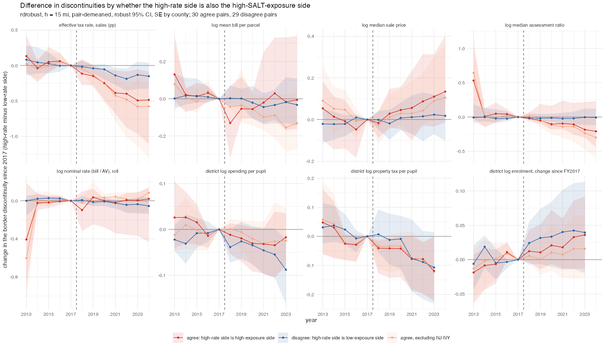

## Answer
No. The narrowing is larger, not smaller, where the high-rate side is also the high-exposure side, so it is not
capitalisation of the cap with the sign hidden by side labels. It is a relative price gain on the high-rate side that runs
against the cap.

- **Sides by exposure.** Of 59 ranked pairs, 30 "agree" (the high-rate side also has the larger lost subsidy per owner
  household) and 29 "disagree". 13 of the 59 high-rate sides are no-income-tax states (TX, NH, FL, TN, WA, SD, NV), almost
  all in the disagree group. Largest disagreements: CT-NY (NY side −$587/owner vs CT), DC-MD, AL-TN, IL-MO, IA-NE, MA-NH.
  Largest agreements: AR-MO (+$683), NJ-NY (+$609), KS-MO, CT-MA, DE-PA, NC-VA.
- **Difference in discontinuities by group** (change since 2017, high-rate minus low-rate side):

  | Outcome, 2023 | agree (30 pairs, 10,346 tracts) | agree excl. NJ-NY (29, 7,570) | disagree (29, 4,981) |
  |---|---|---|---|
  | effective rate (pp) | **−0.49** [−0.96, −0.05] | **−0.58** [−1.13, −0.20] | −0.13 [−0.33, 0.05]; 2022 **−0.19** [−0.36, −0.05] |
  | log sale price | +0.11 [−0.03, 0.31] | +0.09 [−0.01, 0.30]; 2024 **+0.11** [0.01, 0.36] | +0.02 [−0.07, 0.12] |
  | log assessment ratio | −0.19 [−0.30, 0.22] | −0.23; 2024 **−0.30** [−0.59, −0.05] | −0.00 [−0.11, 0.12] |
  | log bill per parcel | −0.02 | −0.16 [−0.28, 0.02] | −0.02 |
  | district tax per pupil | **−0.12** [−0.22, −0.00] | −0.12 [−0.22, 0.00] | −0.11 [−0.23, 0.02] |
  | district spending per pupil | −0.02 | −0.03 | **−0.09** [−0.16, −0.02] |
  | district enrolment since FY2017 | +0.04 [−0.01, 0.09] | +0.02 | +0.04 [−0.02, 0.11] |

- **Reading.** Capitalisation predicts the gap widens in agree pairs and narrows in disagree pairs. Observed: it narrows
  in both, three to four times more in agree pairs, through prices (+9 to +13 log points on the high side, borderline)
  and assessment ratios (−0.2 to −0.3). NJ-NY (2,776 tracts, NYC suburbs vs the city) is not what drives it. The
  pre-period is flat in all three groups. So the high-exposure side of a border gained value relative to its neighbour
  after 2019, whatever its property-tax rank: the same places (NJ suburbs, CT vs MA, DE vs PA, NC vs VA) that the
  county exposure design, with state × year FE, shows losing value relative to less-exposed counties in their own state.
  The two designs compare different counterfactuals: within-state (prices fell in exposed counties) vs across the line
  (the exposed state's border tracts gained on the neighbouring state's). Both are post-2019 and both are consistent
  with the 2020–22 boom favouring suburbs of the big exposed metros over their cross-border neighbours.
- **Per-pupil outcomes** fall on the high-rate side in both groups alike (tax per pupil −11 to −12%), so they do not track
  exposure either; the enrolment increase on the high-rate side is the same +4% n.s. in both.

## How
- **Outline:** `iv_tract_side.rds` (pair, high side by 2017–19 effective rate, signed distance) + county `d_salt_own`
  (`build/exposure/05`) → per pair-side median of tract-level exposure within 20 mi → agree/disagree → diff-in-disc of
  `designs/border_rd/04` (rdrobust, h = 15 mi, within-tract change since 2017, pair-demeaned, SE by county) per group.
- **Choices:** exposure = total lost subsidy per owner household (property + income/sales parts); the property part alone
  (`d_prop_own`) agrees with the rate ranking in more pairs (not run as a split). 11 pairs with tracts within 20 mi on one
  side only (AR-MS, AR-TN, AZ-CA, AZ-NV, CA-OR, DE-NJ, IA-SD, IL-KY, MA-VT, MI-WI, MN-ND) have no exposure ranking and
  are dropped. Third group = agree pairs without NJ-NY.
- **Inputs:** `data/built/geo/iv_tract_side.rds`, `data/built/exposure/exposure_components_county.csv`,
  `data/built/corelogic/tract_year.rds`, `data/built/census_finances/district_finance.rds`. All gitignored.
- **Scripts:** `code/designs/border_rd/08_pair_exposure_split.R` → `output/designs/border_rd/c21_pair_exposure_sides.{csv,txt}`,
  `c21_diff_in_disc_by_exposure_side.csv`, `figures/c21_diff_in_disc_by_exposure_side.png`.
- **Check:** agree 2023 effective rate −0.493 [−0.964, −0.053]; disagree 2022 −0.188 [−0.356, −0.046]; NJ-NY d_salt +609.

## Open
- Same split for the pair × year parcel panel (`designs/border_twfe/04`) and for the choice-set instrument.
- Weight pairs equally (rdrobust weights = 1 / tracts in pair) so NJ-NY and NJ-PA do not carry the agree group.
- A direct test: interact the within-tract change with the pair's exposure difference (continuous) instead of two groups.
