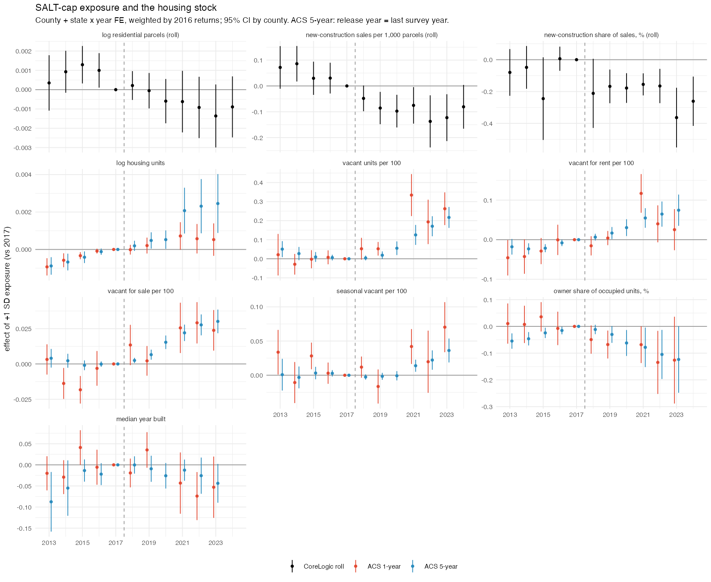

## Answer
Small and mostly late. Per SD of county SALT exposure (county + state × year FE, weighted by 2016 returns, 2017 = 0):

| Outcome (2017 mean) | 2018 | 2019 | 2021 | 2023 | Read |
|---|---|---|---|---|---|
| log residential parcels, roll (1,633 counties) | 0.000 | −0.000 | −0.001 (0.001) | −0.001 (0.001) | nothing |
| new-construction sales per 1,000 parcels, roll (3.35) | −0.05 (0.03) | −0.09 (0.03) | −0.08 (0.04) | −0.12 (0.05) | −1.5 to −4% of the mean, but 2013–14 were +0.07/+0.09: a pre-trend |
| new-construction share of sales, % (6.3) | −0.21 (0.11) | −0.17 (0.05) | −0.16 (0.04) | −0.36 (0.10) | −3%, noisy pre-period (2015 −0.24) |
| log housing units, ACS 1-yr (844 counties) | 0.000 | 0.000 | 0.001 (0.000) | 0.001 (0.000) | nothing |
| vacant per 100 units, ACS 1-yr (10.2) | +0.05 (0.03) | +0.05 (0.02) | +0.33 (0.06) | +0.26 (0.04) | 2018–19 tiny; COVID-era rise |
| vacant for sale per 100, ACS 1-yr (0.86) | +0.013 (0.007) | +0.002 (0.005) | +0.026 (0.009) | +0.024 (0.007) | +3% of the mean from 2021 |
| owner share of occupied units, %, ACS 1-yr (62.3) | −0.05 (0.03) | −0.07 (0.03) | −0.07 (0.04) | −0.13 (0.08) | −0.1 pp; flat pre-period |
| log housing units, ACS 5-yr (3,108 counties) | 0.000 | 0.001 (0.000) | 0.002 (0.001) | 0.003 (0.001) | +0.2% by 2021–23 |
| vacant per 100 units, ACS 5-yr (11.2) | 0.00 (0.01) | +0.02 (0.01) | +0.13 (0.03) | +0.22 (0.03) | rises from 2020 windows |
| owner share, %, ACS 5-yr (63.7) | −0.01 (0.01) | −0.03 (0.02) | −0.08 (0.04) | −0.12 (0.06) | −0.1 pp; 2013 was −0.05, so a reversal |
| median year built, ACS 1-yr / 5-yr | −0.02 / 0.00 | +0.04 / −0.01 | −0.04 / −0.01 | −0.05 / −0.04 (0.02) | nothing |

- **Stock:** no response. Roll parcel counts and ACS units move by at most 0.1–0.2% per SD, in either direction, and not before 2021.
- **New construction:** new-build sales fell 1.5–4% per SD relative to the stock after 2017, but exposed counties were already on a relative decline (2013–14 above 2017), so this is not a clean break. A year-built count on the full roll (`som/l_yearbuilt.sbatch`) is written but not run (clusters unreachable on 2026-10-28).
- **Vacancy:** +0.05 vacant units per 100 per SD in 2018–19 (half a percent of the mean, borderline), then +0.2–0.3 from 2021, where exposed (urban, expensive) counties' vacancy rose during COVID. The for-sale component carries a small, steady rise (+3% of its mean by 2021–23).
- **Ownership:** owner share of occupied units falls by about 0.1 pp per SD by 2023 (on 62–64%), significant at 2019 in the 1-year data; a tenth of a percent, with a mild pre-period reversal in the 5-year data.
- **At state borders (difference in discontinuities, high-tax minus low-tax side, change since 2017):** ACS housing units −0.4% (2018, p = 0.06) and −0.8% (2019, p = 0.01) on the high-tax side, tracking tract population (−0.5%, −0.9%), then −1 to −3% with wide CIs, but the series slopes down across the whole window (+1% in 2013 → −3% in 2023), a trend rather than a break; roll residential parcels nothing (−2%, −8%, CIs ± 20%); tract vacancy share nothing (−0.03 pp, p ≈ 0.3 every year); new-construction sales per 1,000 parcels *higher* on the high-tax side by +0.6 (2018, p = 0.05), +0.9 (2019, p = 0.01), +0.5 (2020, p = 0.03), but 2015 was already +0.6 (p = 0.09); owner share −0.2 and −0.4 pp in 2018–19 as in the 2026-10-21 entry.

So: the effects that are precisely estimated are tiny (tenths of a percent of the mean) and the larger ones (vacancy, new construction) arrive with COVID or sit on pre-trends. Nothing here looks like a supply or tenure response to the cap in 2018–19.

Longer write-up: `output/reports/housing_stock_2026-10-28.md`.

## How
- **Outline:** `county_year.rds` (CoreLogic roll + sales, `build/corelogic/10`, now with new-construction sale counts) and `acs_county_year.rds` (`build/acs/07`: ACS 1-year and 5-year county tables B25001/2/3/4/35) → `designs/exposure_did/17_housing_stock.R`: `y ~ i(year, ex_z, ref = 2017) | county + state × year`, SE by county, weighted by 2016 returns. Border: `build/acs/06` now adds tract log units and vacancy share (B25002) → `designs/border_rd/04` (rdrobust, h = 15 mi, pair-demeaned, within-tract change since 2017).
- **Choices:** exposure = 2016 SALT above $10k per return, SD units (`build/exposure/01`); weighted only. Roll outcomes: counties with residential parcels ≥ 80% of their max in every year 2013–24; new-construction sales = arm's-length residential sales with the CoreLogic new-construction flag, price > 10k, per 1,000 residential parcels (county-years with ≥ 50 sales) and as a share of all such sales. ACS 1-year: counties ≥ 65k, no 2020 release; ACS 5-year: release year = last survey year, so 2018–2021 windows straddle the cap. Vacancy = vacant / all units × 100; "for rent / for sale / seasonal" from B25004. Owner share = owner-occupied / occupied. Median year built recoded 0 → 1939, outside 1900–2025 → NA. Tract vacancy from 2020 releases mapped to 2010 tracts by land-area shares, like the other ACS counts.
- **Inputs:** `data/built/corelogic/kpanel/{roll_tract,sales}_YYYY.parquet` (SOM `k_panel.sbatch`), `data/built/exposure/salt_exposure_county2016.csv`, `data/external/acs/acs{1,5}_county_YYYY.csv` and `acs5_tract_hs_YYYY.csv` (tidycensus, downloaded 2026-10-28), `data/built/geo/iv_tract_side.rds`, `data/built/corelogic/tract_year.rds`. All gitignored, laptop only.
- **Scripts:** `code/build/acs/07_housing_stock.R`, `code/build/acs/06_tract_year_panel.R`, `code/build/corelogic/10_county_tract_year_panels.R`, `code/designs/exposure_did/17_housing_stock.R`, `code/designs/border_rd/04_rd_by_year_and_diff_in_disc.R`; outputs `output/designs/exposure_did/17_housing_stock.{csv,txt}`, `figures/17_housing_stock.png`, `output/designs/border_rd/c16_border_diff_in_disc.{csv,txt}`.
- **Check:** ACS 5-year vacant per 100, 2023: +0.217 (0.028), 3,108 counties; new-construction sales per 1,000 parcels, 2019: −0.086 (0.032), 1,490 counties; ACS 1-year owner share 2019: −0.068 (0.027), 844 counties. Border diff-in-disc 2019: ACS log units −0.0079 [−0.0183, −0.0028], new-construction sales per 1,000 +0.873 [0.399, 2.638]; the 21 earlier outcomes reproduce to the digit.

## Open
- Run `code/build/corelogic/som/l_yearbuilt.sbatch` on SOM (year-built and roll-entry counts per county × tract × year), copy `roll_built_*.parquet` to `data/built/corelogic/kpanel/`, rerun `build/corelogic/10` and `designs/exposure_did/17` (picks up `built_pk`, `entered_pk`); the SOM `permits*` tables are another untested source.
- Vacancy by type at tract level (B25004) for the border design, if the county for-sale result is worth following.
