## Answer
Locally the gradient is flat, but the near-border bin is not like its neighbours. On the low-tax side of the 59 ranked
border pairs (20,473 tracts, 34 states), linear slopes in distance within 0-30 mi are small (median |slope| 0.05 SD per
10 mi; 1 of 22 covariates significant, district SES +0.17 SD/10 mi), and the state-wide slopes are smaller still per
mile (0.01-0.03 SD/10 mi) but significant for 5 covariates. The problem is the 0-10 mi bin: with pair FE and tracts
unweighted, the 10-20 mi bin differs from it by +0.36 SD in owner share, +0.36/+0.37 in district test scores/SES, +0.24
in income, household size, year built and itemiser share, −0.24 in Data Axle move-outs and −0.27 in density, while the
20-30 and 30-50 bins are back within 0.1-0.15 SD of 0-10 for most of these. Joint tests of the bin dummies reject at 5%
for 12 of 21 covariates within 0-30 mi. The reason is composition: the near bin is the river-city cores of the low-tax
side (New York City is 1,707 of its 6,181 tracts; Philadelphia 717, St. Louis 359, Kansas City 243), whose suburbs sit
at 10-20 mi.

| spec (pair FE, SE by county) | rejected at 5%, 0-30 mi | rejected, 0-50 mi | typical 10-20 vs 0-10 difference |
|---|---|---|---|
| tracts unweighted (main) | 12 / 21 | 13 / 21 | 0.2-0.37 SD on tenure, schools, family size |
| pairs weighted equally | 5 / 21 | 6 / 21 | ≤ 0.13 SD except test scores +0.20, SES +0.14 |
| + log population density | 7 / 21 | 6 / 21 | ≤ 0.2 SD; schools +0.28/+0.30 |

What survives both corrections is family composition (household size, share under 18, households with children: the
20-50 mi bins have about 0.1 SD fewer children than 0-10) and district test scores/SES (+0.1 to +0.3 SD further in).
Home values, sale prices, turnover, race, education, SALT exposure and the effective rate itself are flat within 50 mi
(differences ≤ 0.1 SD, p > 0.2). Balance degrades mildly out to 100 mi (median largest |difference| 0.19 → 0.22 SD) and
sharply beyond: the 100+ mi bin is +0.4 to +0.6 SD on income, BA+ and test scores and −0.4 to −0.5 on children and
household size. So "10 vs 30 miles" is defensible with pair weights or a density control and family-composition
controls; "0-10 vs the rest" is a city-vs-suburb comparison in the big pairs.

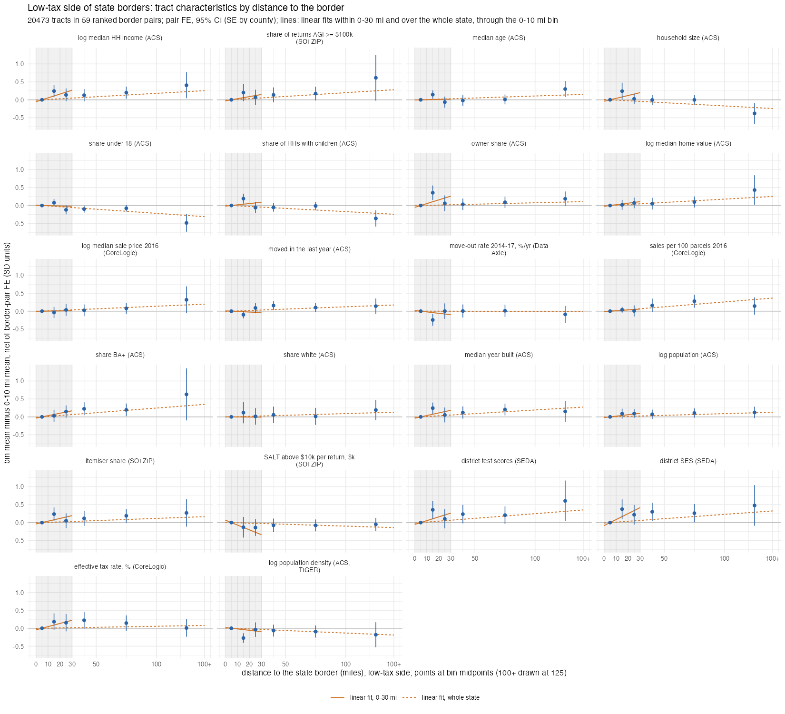

## Profiles to 50 miles, and a rural subset
Same low side, 5-mile bins to 50 mi, relative to 0-5 mi, pair FE (`09_low_side_profiles_50mi.R`). The rural subset drops
the 19 pairs where a metropolitan CBSA of 0.5m+ has 30%+ of its population on the low side within 50 mi (NJ-NY, NJ-PA,
IL-MO, KS-MO, MN-WI, MA-NH, MA-RI, MD-PA, MI-OH, KY-TN, IL-WI, IA-NE, CT-NY, CT-MA, NC-VA, NC-SC, GA-TN, OH-PA, NY-PA;
list with shares in `c22_low_side_metro_pairs.csv`), leaving 40 pairs and 4,526 tracts of 15,440.

| within 0-50 mi, pair FE | all pairs (59) | rural pairs (40) |
|---|---|---|
| outcomes: sale price, home value, move-outs, turnover | flat (slopes ≤ 0.02 SD/10 mi, 30-50 vs 0-10 ≤ 0.07 SD) | flat (≤ 0.012 SD/10 mi, ≤ 0.04 SD) |
| effective rate | +0.03 SD/10 mi, 30-50 vs 0-10 +0.24 SD | −0.04 SD/10 mi (p 0.007), −0.12 SD |
| income, SES, test scores, owner share | hump at 5-20 mi (+0.3 to +0.6 SD), SES +0.34 SD at 30-50 | flat; SES/scores ≤ +0.1 SD |
| controls with joint p < .05 (of 21) | 8 | 8 (density −0.24 SD, population +0.14, year built +0.11, white +0.15 at 30-50 vs 0-10) |
| median slope (SD/10 mi), median 30-50 vs 0-10 | 0.022, 0.08 SD | 0.014, 0.04 SD |

In the rural pairs the remaining distance gradients are the rural density gradient itself (density falls, population and
year built rise inland) and the tax rate, which falls slightly with distance from the border; the socio-economic hump
of the all-pairs profiles is gone. ACS "moved in the last year" rises inland in both samples (+0.05 SD/10 mi, rural).

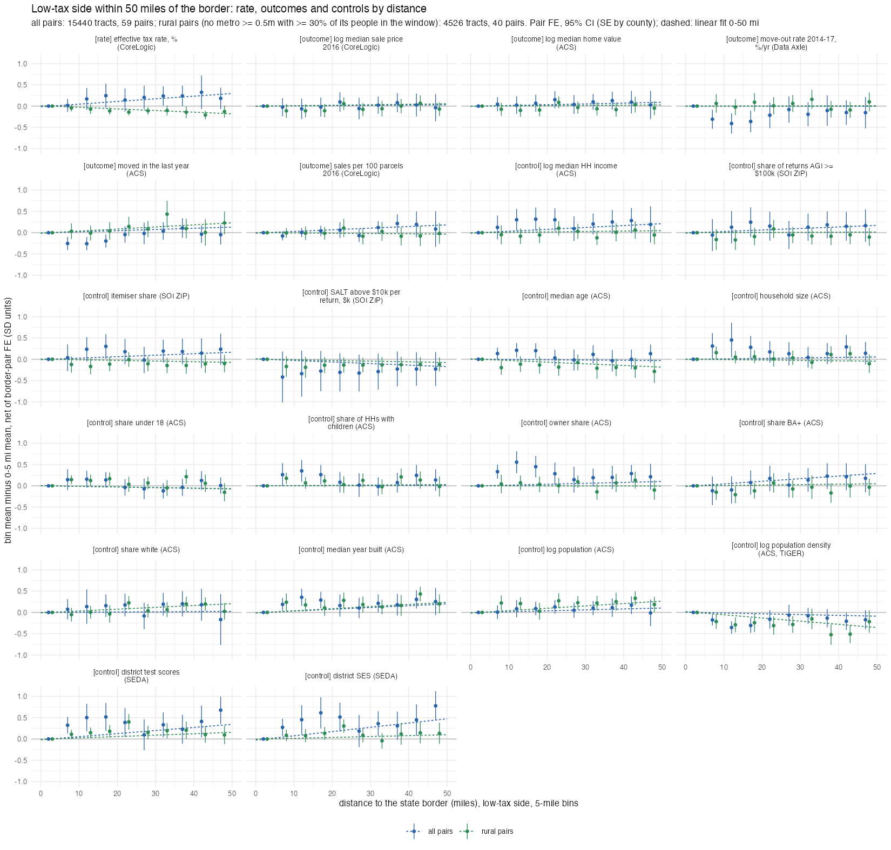

Where the sample is (`10_low_side_sample_map.R`): low side within 50 mi in green (rural pairs) and blue (metro pairs), low side beyond 50 mi light blue, the high side of the same pairs grey.

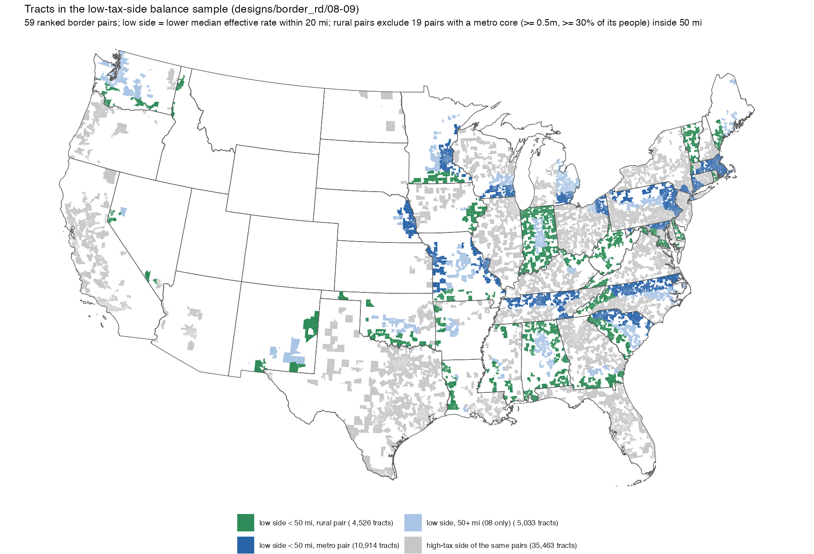

## How robust is the rural subset to the metro rule? (`11_rural_rule_sensitivity.R`)
Three ways to drop metro pairs (a metro of 0.5m+ has at least c of its population within 50 mi of the line on the LOW
side, the HIGH side, or EITHER side), c from 10% to 90%, plus a residualising variant that keeps all pairs and adds
distance-to-nearest-metro-centre bins to the regressions. Balance metric: for the 21 outcomes/controls, the gap between
the 30-50 mi and the 0-10 mi bins (SD units, pair FE) and the joint test of the 5-mi bins.

| rule | pairs | tracts | joint p < .05 | gaps > 0.1 SD | median gap | max gap | rate slope / 10 mi |
|---|---|---|---|---|---|---|---|
| none (all pairs) | 59 | 15,440 | 8 | 9 | 0.08 | 0.34 | +0.06 |
| low side ≥ 30% (the subset of 09) | 40 | 4,526 | 8 | 6 | 0.04 | 0.24 | −0.04 |
| low side ≥ 20% … 70% | 39–49 | 4,343–10,030 | 8–19 | 6–7 | 0.04–0.08 | 0.15–0.24 | −0.05 to +0.01 |
| low side ≥ 80–90% | 52–57 | 11,310–14,223 | 15–19 | 9–11 | 0.09–0.12 | 0.30–0.34 | +0.01 to +0.05 |
| high side ≥ 30% | 34 | 9,532 | 17 | 15 | 0.16 | 0.52 | +0.08 |
| high side, any c | 24–53 | 4,021–13,869 | 11–17 | 13–15 | 0.15–0.25 | 0.37–0.58 | |
| either side ≥ 30% | 23 | 2,291 | 10 | 14 | 0.13 | 0.33 | −0.03 |
| all pairs + metro-distance control | 59 | 15,440 | 10 | 9 | 0.10 | 0.35 | +0.07 |
| low 30% + metro-distance control | 40 | 4,526 | 9 | 6 | 0.06 | 0.16 | −0.04 |
| high 30% + metro-distance control | 34 | 9,532 | 15 | 16 | 0.14 | 0.46 | +0.08 |

- **Keying the rule on the high side does not work.** It drops Cincinnati, Louisville, Chicago, Portland and Charlotte
  pairs (metro core on the high side) but keeps New York, Philadelphia, St. Louis and Minneapolis (core on the low side),
  so 15 of 21 covariates have gaps above 0.1 SD at every cutoff. The city-core problem sits on the low side.
- **The low-side cutoff can go up to about 70%** before the gaps deteriorate: the median gap stays 0.04–0.08 SD and
  the max 0.15–0.24 SD for c between 20% and 70% (39–49 pairs); at 80% and above the big pairs come back (NJ-NY enters
  at 50%: NYC share 48%; IL-MO at 80%: St. Louis 73%; MN-WI only with no rule: Minneapolis 91%) and the max gap returns to 0.3 SD. The joint-test
  count is noisy across cutoffs (8 at 30%, 15–19 at 40–70%) because single pairs flip it; the gap metrics are the
  steadier reading. The 30% point of 09 is the best case, not a typical one.
- **The "either side" rule removes too much**: 19–29 pairs and 1,800–5,100 tracts at c ≤ 50%, with gaps no better than
  the low-side rule (median 0.13 SD), because the small sample makes the bin means noisy.
- **Residualising on distance to the nearest metro centre does not substitute for dropping pairs.** On all pairs it leaves
  the gaps unchanged (median 0.10 SD, max 0.35), because inside a metro pair distance to the border and distance to the
  metro centre are nearly the same variable (the centre is on the line), so the control absorbs the variation it is meant
  to clean. On the 30% subset it trims the max gap from 0.24 to 0.16 SD.
- **Straddling metros** (≥ 10% of the metro's population on each side): 16 metro-pair combinations, listed in
  `c24_straddling_metros.csv`. The current rule evaluates each side's share separately, so a metro that straddles is
  dropped under the low-side rule only when its low-side share clears the cutoff: New York (48% low / 29% high),
  Philadelphia (56 / 21), St. Louis (73 / 23), Kansas City (57 / 41), Providence (33 / 55) are dropped; Washington
  (16 / 35), Cincinnati (16 / 59), Louisville (17 / 76), Portland (19 / 79), Charlotte (14 / 82), Memphis (13 / 39) are
  kept, i.e. their suburbs on the low side stay in the sample. A border between two separate metros (e.g. Chattanooga on
  the TN side and nothing comparable on the GA side) is handled the same way, metro by metro; nothing special is done
  when two different metros face each other across a line, each is just tested on its own side.

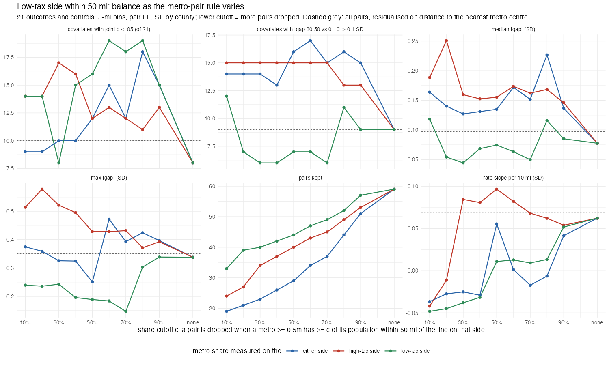

## Distance to the border as an instrument: balance at the 50% cutoff (`12_balance_coefplot_c50.R`)
Low side within 50 mi, pairs dropped when a metro of 0.5m+ has at least 50% of its population in the window: 44 pairs,
8,132 tracts. At 50% the NJ-NY pair is back in (New York City's low-side share is 48%), so everything is shown with and
without it (43 pairs, 5,937 tracts). Each covariate, in SD units, on the instrument with pair FE, SE by county.

| | near (< 10 mi vs 10-50), with NJ-NY | near, without NJ-NY | linear per 10 mi, with | linear, without |
|---|---|---|---|---|
| rate (first stage) | −0.16 (0.14) | +0.08 (0.03) | +0.01 (0.03) | −0.03 (0.02) |
| controls with \|coef\| > 0.1 SD (of 16) | 9 | 2 | 0 | 0 |
| controls with p < .05 / Holm | 2 / 1 | 0 / 0 | 1 / 0 | 0 / 0 |
| largest control imbalances | owner share −0.35, household size −0.26, density +0.25, SES −0.19 | density +0.11, test scores −0.10 | all ≤ 0.03 | all ≤ 0.03 |
| outcomes | sale price +0.16, home value +0.10, move-outs +0.10 | moved last year −0.11, move-outs −0.06 | ≤ 0.05 | ≤ 0.05 |

With New York in, the near-border dummy is a city-core dummy: within the NJ-NY pair the < 10 mi tracts are the five
boroughs and the 10-50 mi tracts their suburbs, and NJ-NY alone is 2,195 of the 8,132 tracts. Without it, the near dummy
is balanced to within 0.11 SD on all 16 controls and the first stage is the right sign (near tracts have a 0.08 SD
higher rate, i.e. the low side's rate rises towards the line). The linear form is balanced in both samples but has a
weak first stage. For a near-border instrument the cutoff should sit below 48% (45% drops NJ-NY) or NJ-NY should be
excluded by name.

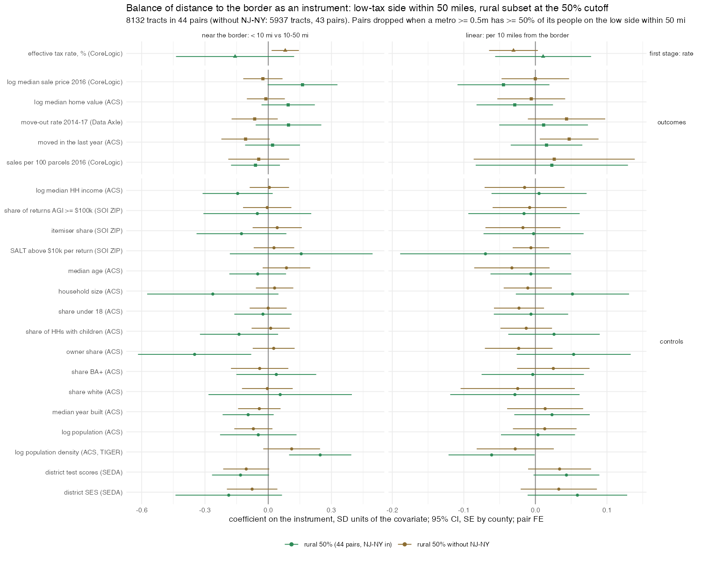

## The 45% rural subset, and does anything change after 2017? (`13_near_border_event_study.R`)
The rural subset now uses a 45% cutoff (42 pairs, 5,742 tracts within 50 mi, 1,977 within 10 mi; the near dummy is
balanced: 2 of 16 controls above 0.1 SD, none after Holm, first stage +0.09 SD; `c25_balance_coefplot_c45`). On this
sample the near-border dummy is interacted with year, 2017 = 0, unit FE + border-pair × year FE, SE by county. Local
public finances come from the Census of Governments (`govt_finances_sd_by_county`: school districts aggregated by
county, complete every year 2012-22; `govt_finances_county_area`: all local governments, census years 2012 / 2017 / 2022
only, because the survey years sample out small units) and the F-33 district panel (FY2012-23); districts and counties
get the population share of their tracts within 10 mi as the instrument and enter when at least half their population
is in the sample (890 districts, 332 counties).

Nothing interesting moves after 2017. Mean of the yearly near coefficients 2018+ minus 2013-16:

| outcome (unit) | post − pre | SE | note |
|---|---|---|---|
| log median sale price (tract, CoreLogic) | −0.006 | 0.015 | flat |
| log tax bill per parcel (tract) | −0.010 | 0.011 | −1.5% in 2020-22, back to 0 in 2023 |
| log assessed value per parcel (tract) | −0.022 | 0.011 | pre-period +2.5% (2014-15 spike), post 0 |
| effective tax rate, pp (tract) | −0.019 | 0.020 | drifts down from 2020 to −0.06 in 2024, on a 2012-16 decline |
| sales per 100 parcels (tract) | +0.06 | 0.11 | +0.2 in 2020 only |
| log income, home value, population, owner share (tract, ACS) | ≤ 0.012 | ≤ 0.006 | home value −1.4% by 2023 |
| move-out rate (tract, Data Axle) | +0.08 | 0.11 | |
| log property tax per pupil (F-33 district) | −0.037 | 0.019 | a straight decline from +0.04 in 2012 to −0.02 in 2022, no break at 2017 |
| log local / state revenue, spending per pupil, enrolment (district) | ≤ 0.008 | ≤ 0.037 | state revenue +2% in 2019-21, n.s. |
| log property tax, total tax of school districts in county (CoG) | −0.02 | 0.03 | |
| all local governments in county, 2022 vs 2017 (CoG) | +0.02 ptax, +0.01 tax, −0.02 spend | 0.03 | 2012 vs 2017 the same size |

Only two yearly coefficients have |t| > 2 after 2017 (effective rate 2024 −0.056 pp; sales 2020 +0.20 per 100
parcels), out of 20 outcomes × 5-7 post years. So near-border low-side tracts did not see higher prices, more sales,
more in-movers, more revenue or more pupils than tracts 10-50 mi in after the SALT cap, within ±2% for the finance
outcomes and ±1% for prices.

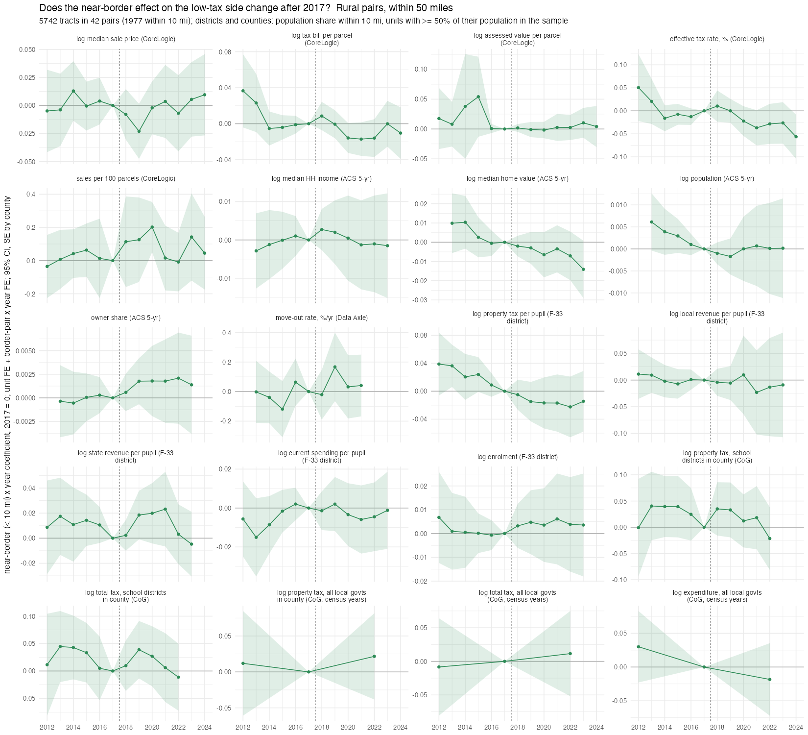

**Yearly levels instead of an event study.** If the instrument is valid there is no need for unit FE or a reference
year: the near coefficient estimated separately in each year's cross-section (outcome on near, pair FE, SE by county) is
the level difference between near-border and inland tracts that year (`c26_near_border_yearly_levels`). The levels are
stable: mean 2013-16 vs 2018+, with RMS standard errors:

| outcome (unit) | 2013-16 | 2018+ | change |
|---|---|---|---|
| log median sale price (tract) | −0.02 (0.04) | −0.03 (0.04) | −0.01 |
| log tax bill per parcel (tract) | +0.04 (0.05) | +0.04 (0.05) | 0.00 |
| effective tax rate, pp (tract) | +0.05 (0.04) | +0.05 (0.02) | 0.00 |
| log population (tract, ACS) | −0.04 (0.02) | −0.04 (0.03) | 0.00 |
| move-out rate, %/yr (tract, Data Axle) | −0.25 (0.25) | −0.17 (0.24) | +0.08 |
| log property tax per pupil (F-33 district) | +0.09 (0.05) | +0.05 (0.05) | −0.04 |
| log state revenue per pupil (district) | +0.04 (0.02) | +0.04 (0.02) | 0.00 |
| log enrolment (district) | +0.18 (0.09) | +0.19 (0.09) | 0.00 |
| log property tax, school districts in county (CoG) | +0.28 (0.15) | +0.26 (0.15) | −0.02 |
| log property tax, all local govts in county (CoG) | 2012: +0.25 (0.15) | 2017: +0.30, 2022: +0.29 (0.14) | |

Near-border tracts on the low side have a slightly higher effective rate (+0.05 pp) and bills (+4%), the same prices,
smaller populations (−4%), and sit in larger districts and counties (enrolment +18%, county school property tax +28%,
the size effect of the near share being population-weighted). None of these levels moves after 2017.

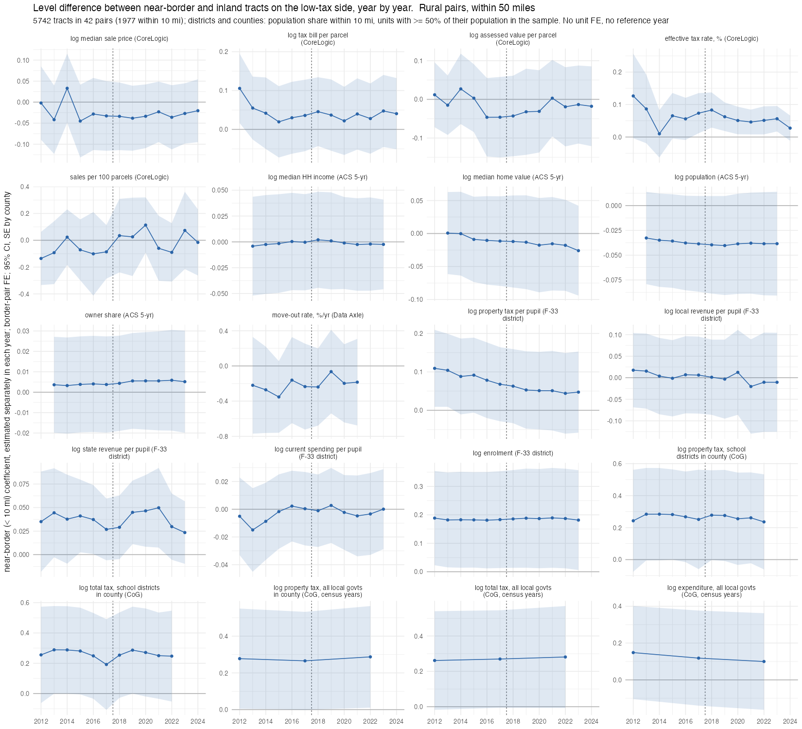

**Are the nulls an artefact of the metro cutoff or of the instrument's form?** No (`14_null_robustness.R`). The
post − pre change (mean of the yearly coefficients 2018+ minus 2013-16, SD units of the outcome's 2016 cross-section)
for 11 outcomes × 4 samples (all 59 pairs, rural at 30 / 45 / 70%) × 5 instrument forms (near < 5 / 10 / 20 mi, linear
distance, log distance): 12 of 220 cells have |t| > 1.96 (5.5%, the chance rate), the median |change| is 0.006-0.015 SD
in every sample and for every form, and no sample or form stands out (significant cells by sample 5 / 4 / 3 / 0; by form
1 / 1 / 5 / 2 / 3). The two consistent signs are the district property-tax-per-pupil decline (−0.04 to −0.08 SD, t −1.6
to −2.1 in the rural samples, the 2012-22 trend) and population (−0.01 to −0.02 SD, t up to −2.9), both pre-trends.

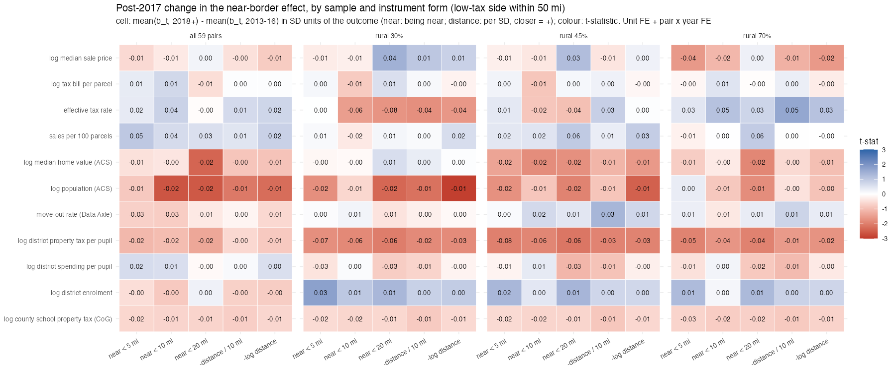

**Interacting distance with SALT exposure.** near × year × exposure added to the event study, exposure = (i) the high
side facing the pair (population-weighted over the high side's tracts within 10 mi, standardised across pairs) or (ii) the
tract's own exposure (standardised; own exposure × year as a control), for three ZIP measures read at the tract's modal
sales ZIP: excess SALT per return (SOI 2016, build/exposure/02), the lost federal subsidy per owner household 2016-18
(ΔSALT deducted × assumed bracket marginal rate, net of AMT, build/exposure/05, clean ZIPs only) and its property-tax
part. The three correlate 0.70-0.89 across pairs on the high side and give the same answer. Post − pre change of the
interaction, SD of the outcome per SD of exposure, cells with |t| > 1.96 out of 11 outcomes:

| measure | rural 45%, high side | rural 45%, own tract | all pairs, high side | all pairs, own tract |
|---|---|---|---|---|
| excess SALT per return | 0 (median 0.035) | 4 | 4 | 1 |
| lost subsidy per owner HH | 0 (0.019) | 4 | 5 | 5 |
| property-tax part | 0 (0.018) | 1 | 2 | 2 |

- *High-side exposure, rural pairs:* nothing, for any measure (rate +0.02 to +0.035, price −0.02, home value ≤ +0.03
  SD per SD, all |t| < 2).
- *High-side exposure, all pairs:* effective rate +0.11 SD per SD (t 4-5), sale price −0.03 (t −3 to −4), home value
  +0.02, population +0.01 with the total measure; the property-tax part halves these. This is one pair: CT-NY's high side
  (Fairfield County) has excess SALT 15.4 vs a mean of 1.1 (SD 2.0) and lost subsidy $3,100 per owner vs $624 (SD 449),
  five to seven SDs out, with NJ-NY next; the interaction is "CT-NY and NJ-NY after 2017 vs the rest", the New York
  metro again.
- *Own-tract exposure, rural pairs:* the same four cells for the two SALT measures: effective rate −0.29 / −0.30 SD per
  SD (t −2.3 / −2.9), population −0.04 / −0.05 (t −2.5), home value −0.03 / −0.05 (t −2.3 / −2.4), sale price +0.08 /
  +0.10 (t 1.9 / 2.0); with the property-tax part only the rate survives (−0.15, t −2.6). The rate and bill interactions
  have wild 2012-13 values (+0.9 SD) and own exposure varies little in rural pairs (SD 2.7, p90 2.1 vs 6.3 in metro
  pairs), so these rest on a few high-exposure near-border tracts. Signs are mixed (prices up, ACS home values and
  population down) and the population series is a drift from 2018 to 2023 rather than a break.

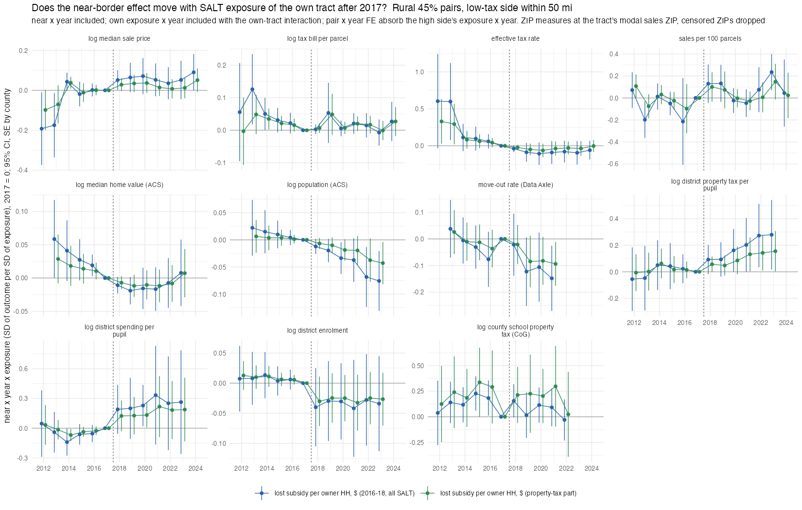

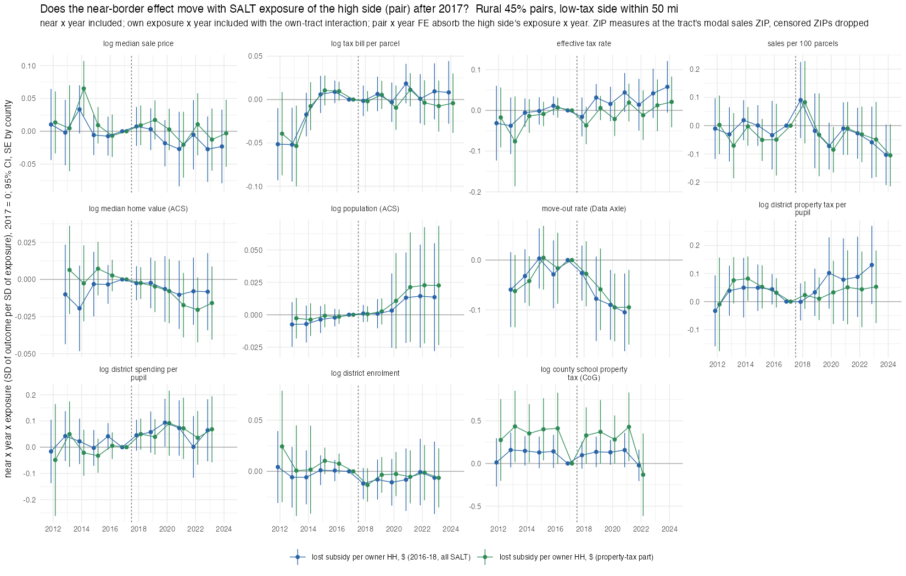

**Both coefficients of the interacted model, levels vs DiD** (`15_near_and_exposure_by_year.R`, exposure = lost
subsidy per owner household, SD units). Levels = a cross-section per year with pair FE only (the near-far level
difference that year and its loading on exposure); DiD = unit FE + pair × year FE, 2017 = 0. Mean 2013-16 → mean 2018+:

| | near × year, levels | near × year, DiD | near × exposure, levels | near × exposure, DiD |
|---|---|---|---|---|
| **own-tract exposure** | | | | |
| log sale price | −0.07 → −0.07 | 0.00 → −0.02 | −0.25 → −0.09 (se 0.12) | −0.02 → +0.03 (se 0.02) |
| effective rate | +0.07 → +0.06 | +0.02 → +0.01 | +0.23 → −0.01 (se 0.03) | +0.14 → −0.05 (se 0.05) |
| log population | −0.06 → −0.08 | +0.01 → −0.01 | 0.00 → −0.03 | +0.01 → −0.02 (se 0.01) |
| district property tax per pupil | +0.03 → +0.02 | +0.04 → +0.03 | −0.18 → −0.10 | +0.02 → +0.09 (se 0.05) |
| district spending per pupil | −0.09 → −0.07 | −0.01 → +0.01 | −0.33 → −0.17 (se 0.08) | −0.04 → +0.12 (se 0.10) |
| **high-side exposure** | | | | |
| log sale price | −0.01 → −0.03 | 0.00 → 0.00 | +0.16 → +0.12 | +0.01 → −0.01 |
| log tax bill | +0.07 → +0.05 | 0.00 → −0.01 | +0.18 → +0.14 | −0.01 → +0.01 |
| effective rate | +0.07 → +0.07 | −0.01 → −0.03 | −0.02 → −0.02 | −0.01 → +0.03 |
| district property tax per pupil | +0.26 → +0.20 | +0.05 → 0.00 | +0.43 → +0.46 | +0.05 → +0.07 |

- **The near × year coefficient does not move** in either version or either exposure model: near tracts at mean
  exposure keep the same level difference (rate +0.07 SD, bills +0.05, population −0.06 to −0.08, prices −0.01 to
  −0.07) through 2024, and the DiD series stay within ±0.03 SD.
- **The loading on exposure is a level, not a change.** In the levels, near tracts with higher own exposure have
  lower prices (−0.25 SD per SD in 2013-16), lower bills, lower district property tax and spending per pupil, and a
  higher effective rate; near tracts facing a higher-exposure high side have higher prices (+0.16), bills (+0.18) and
  district property tax per pupil (+0.43) in every year. These are stable before and after 2017.
- **The only moving piece** is the own-exposure × effective-rate interaction, +0.23 → −0.01 in the levels and +0.14 →
  −0.05 in the DiD, a decline that starts in 2012-14 (wide intervals then) and flattens from 2016, so not a 2017 break.
  Own-exposure × population drifts to −0.03/−0.05 by 2023; own-exposure × district spending rises after 2017 in the DiD
  (+0.12, se 0.10) while its level stays negative.

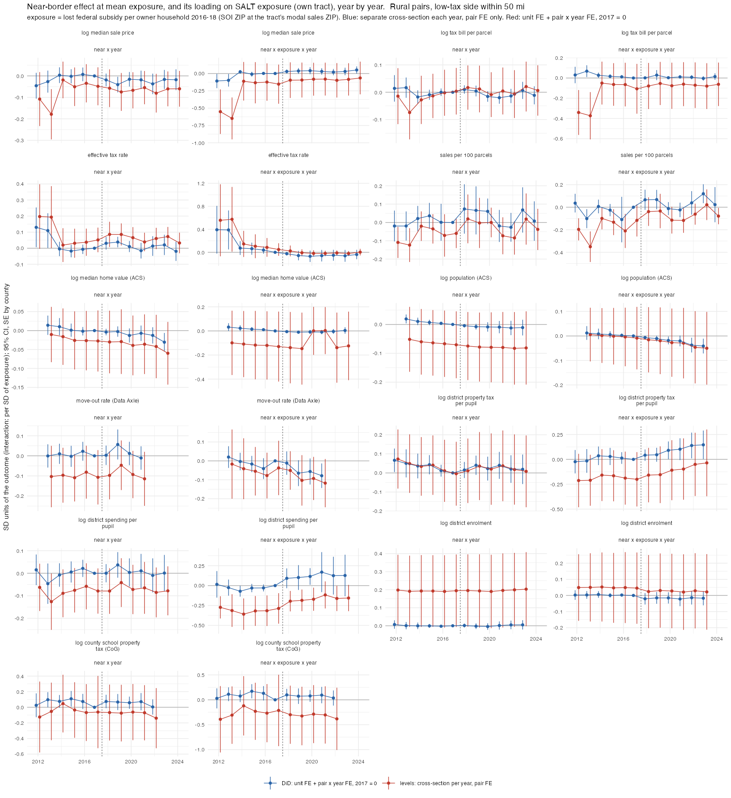

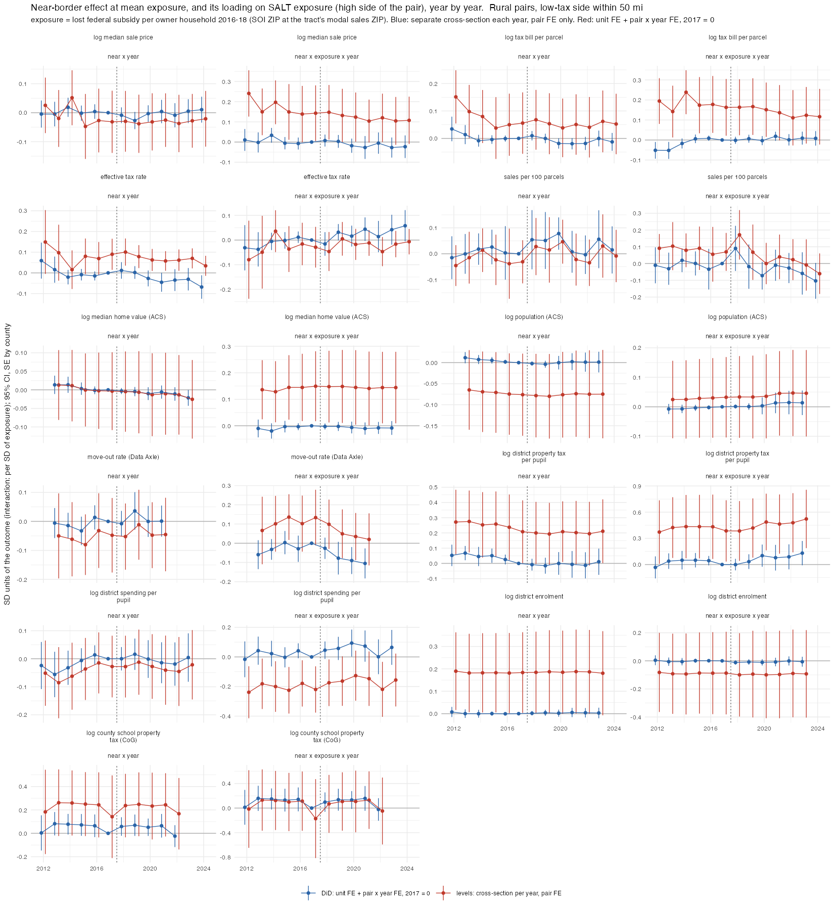

Coverage of the instrument, as an aside (2010 tracts → PUMAs, ACS 2013-17 population; 2,336 PUMAs in the lower 48 + DC):
the rural 45% low-side sample within 50 mi touches 274 PUMAs (11.7%), holds at least half the population of 187 (8.0%)
and 7.7% of the national population; the near tracts (< 10 mi) touch 147 PUMAs (6.3%), hold a quarter or more of the
population of 94 (4.0%) and 2.7% of the national population. With all 59 pairs the low side within 50 mi touches 626
PUMAs (26.8%), half the population of 498 (21.3%), and 20.7% of the population.

**The interaction across cutoffs, samples and exposure forms** (`16_exposure_interaction_grid.R`): near × own-tract
lost subsidy × year with tract (unit) FE + pair × year FE, near × year and exposure × year included, for near < 5 / 10 /
20 mi, all pairs and rural 30 / 45 / 70%, exposure continuous (per SD) or binary (above the median, $658 per owner
household; 34% of rural-45% tracts). Post − pre change of the interaction, SD units of the outcome:

| outcome | sign (share of 24 cells positive) | cells with \|t\| > 1.96 | rural 45%, near < 10 mi, continuous | binary |
|---|---|---|---|---|
| effective tax rate | − (0.04) | 15 | −0.37 (t −2.9) | −0.26 (−2.5) |
| sales per 100 parcels | + (0.96) | 8 | +0.19 (1.7) | +0.10 (0.9) |
| log sale price | + (0.75) | 4 | +0.11 (2.0) | +0.06 (1.3) |
| log home value (ACS) | − (0.08) | 6 | −0.05 (−2.4) | −0.01 (−0.3) |
| log population (ACS) | − (0.12) | 7 | −0.06 (−2.5) | −0.02 (−1.0) |
| log district enrolment | − (0.04) | 12 | −0.04 (−0.8) | −0.06 (−2.3) |
| log district spending per pupil | + (1.00) | 4 | +0.30 (1.5) | +0.19 (1.7) |
| log county school property tax | − (0.04) | 4 | −0.10 (−1.3) | −0.11 (−2.2) |
| log tax bill, district property tax per pupil, move-outs | mixed | 1-5 | ≤ 0.12 | ≤ 0.09 |

Unlike the plain near effect, the interaction has a sign-consistent pattern: after 2017, near-border tracts with higher
SALT exposure show a lower effective rate, more sales and slightly higher prices, fewer people and pupils, lower county
school property tax and higher district spending per pupil than near tracts with lower exposure, relative to the same
exposure contrast inland. 66 of 264 cells are significant (25%), concentrated in the rural 30% and 45% samples with the
continuous form (median |estimate| 0.10-0.16 SD per SD); all pairs and rural 70% give 0.03-0.04, and the binary form
halves the magnitudes. Caveats: the effective-rate interaction was already declining 2012-16 (15), so part of its post −
pre change is trend; population and enrolment are drifts; district spending has wide intervals (t ≤ 1.7); and own
exposure in rural pairs varies on few tracts. It is the one lead in this session's border work worth following.

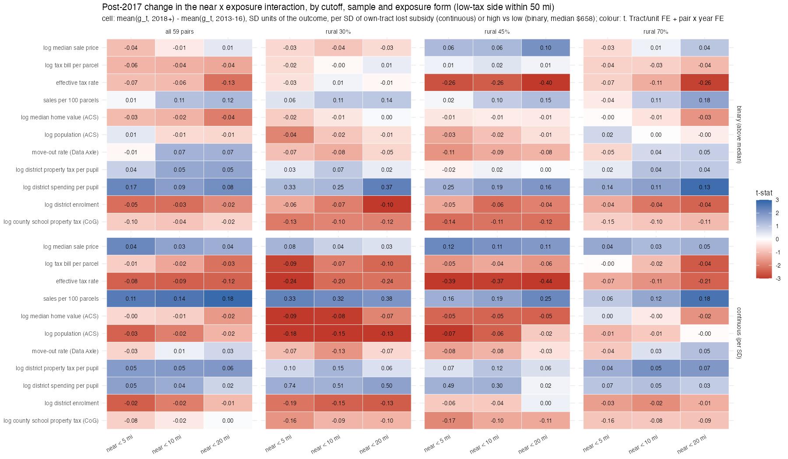

**Event studies with a continuous instrument** (`17_exposure_event_study_continuous.R`): z = −distance / 10 mi (closer
= positive), rural 45% pairs, own lost subsidy per owner household (SD), tract/unit FE + pair × year FE, 2017 = 0. Per
10 mi closer per SD of exposure, mean 2013-16 → mean 2018+ (SE of the post mean):

| outcome | z × exposure × year | z × year (at mean exposure) |
|---|---|---|
| effective tax rate | +0.076 → −0.054 (se 0.028) | +0.015 → +0.013 |
| sales per 100 parcels | −0.023 → +0.023 (0.015) | −0.028 → −0.006 |
| log sale price | −0.010 → +0.026 (0.012) | −0.005 → −0.009 |
| log home value (ACS) | +0.013 → 0.000 (0.006) | +0.005 → −0.004 |
| log population (ACS) | +0.005 → −0.010 (0.003) | +0.004 → −0.004 |
| move-out rate | −0.007 → −0.033 (0.014) | −0.006 → +0.002 |
| log district spending per pupil | −0.003 → +0.034 (0.028) | −0.001 → −0.002 |
| log district enrolment | +0.003 → −0.009 (0.006) | −0.001 → +0.001 |
| log tax bill, district property tax per pupil, county school property tax | within ±0.015 | within ±0.02 |

The continuous version reproduces the near-dummy pattern at about a third of the size per 10 miles (the near dummy
spans ~20 miles of the gradient): the effective-rate interaction falls from +0.08 to −0.05 per 10 mi per SD, sales and
prices rise by +0.02 to +0.04, population −0.015, move-outs −0.03; the main instrument × year term stays within ±0.02
SD throughout. The yearly series show the rate interaction declining steadily from 2012 (+0.15) to 2024 (−0.07) with no
kink at 2017, sales and prices flat to 2017 then up from 2019-20, population a straight drift down from 2015.

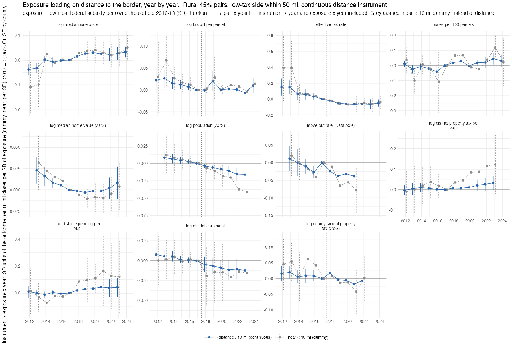

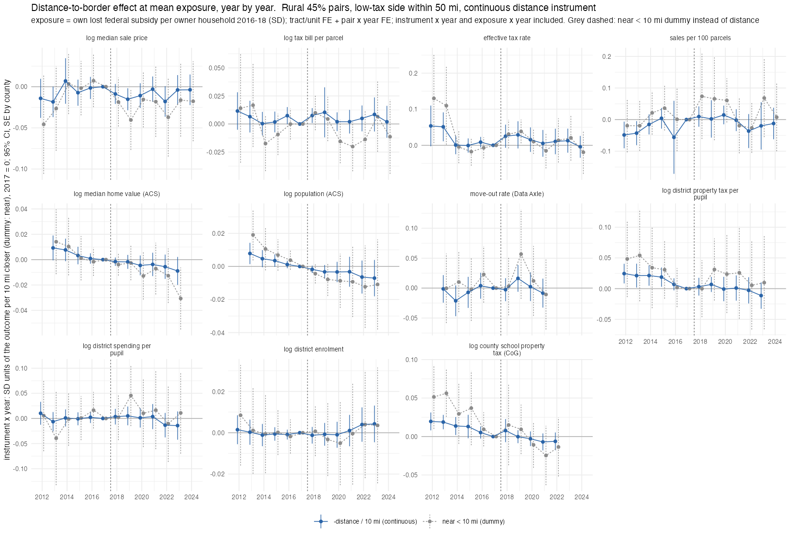

**More district and local-government outcomes, with coverage** (`18_more_local_outcomes.R`; F-33 build widened in
`build/census_finances/04`). Rural 45% low side, 924 districts and 361 counties with ≥ 50% of their population in the sample.
Coverage = share of unit-years with a positive value (logged per pupil / per capita):

| source | outcomes | coverage |
|---|---|---|
| F-33 districts, FY2012-23 (890 districts, 10,625 district-years) | 39: revenue by source, spending by function and object, capital, payments, debt, cash | ≥ 98% for totals, instruction, support functions, salaries, benefits, lunch charges, capital outlay, equipment; 80-92% for IDEA, construction, interest, debt outstanding, cash, activity receipts, payments to other systems, private contributions; 43-62% state special-ed / transportation, tuition, from cities; 24-39% other local taxes, debt issued, state compensatory, payments to private schools; 13-16% charter payments, parent-government contributions; 2% student fees |
| SEDA districts 2012-18 (908 districts) | test scores, SES | 94% / 99%, but the panel ends in 2018: one post year |
| CoG school districts by county, 2012-22 (332 counties, complete yearly) | 7: federal / state revenue, capital, debt, cash, interest | 100% state revenue and capital outlay, 90-92% debt, cash, interest, 72% federal, 59% debt issued |
| CoG all local governments, census years 2012 / 2017 / 2022 (361 counties) | 27: sales and income tax, intergovernmental, enterprise, capital, debt, cash, spending by function, counts of governments | ≥ 98% for most; 82-93% housing, welfare, libraries, debt issued; 56% sales tax, 29% income tax, 29% hospitals; cash & securities 0% in 2022 (not reported) |

Estimates (post − pre in SD units; the census-year panel compares 2022 with 2012):
- *near × year:* 0 of 39 F-33 outcomes significant (median |change| 0.03 SD), 0 of 7 CoG school-district aggregates,
  0 of 26 all-local-government items; SEDA SES +0.04 SD (t 2.4) on one post year. Payments to charter schools +0.15
  SD (t 1.4, 13% coverage), cash & securities of school districts +0.20 (t 1.8) are the largest.
- *near × own exposure × year:* 1 of 39 F-33 (employee benefits +0.15 SD per SD, t 2.2; instruction +0.19, salaries
  +0.13, lunch charges +0.21 and payments to private schools +0.20 at t 1.5-1.8, all positive, consistent with the
  district-spending interaction of 16); CoG school-district state revenue −0.19 (t −2.2); all-local-government
  education spending −0.44 (t −2.8) between 2012 and 2022.

So the wider set of local-public-finance outcomes behaves like the narrow one: nothing moves with proximity alone;
the exposure interaction leans towards higher district spending (benefits, instruction, salaries) near the border in
high-exposure tracts, offset in the county aggregates by lower state revenue and education spending, none of it strong.

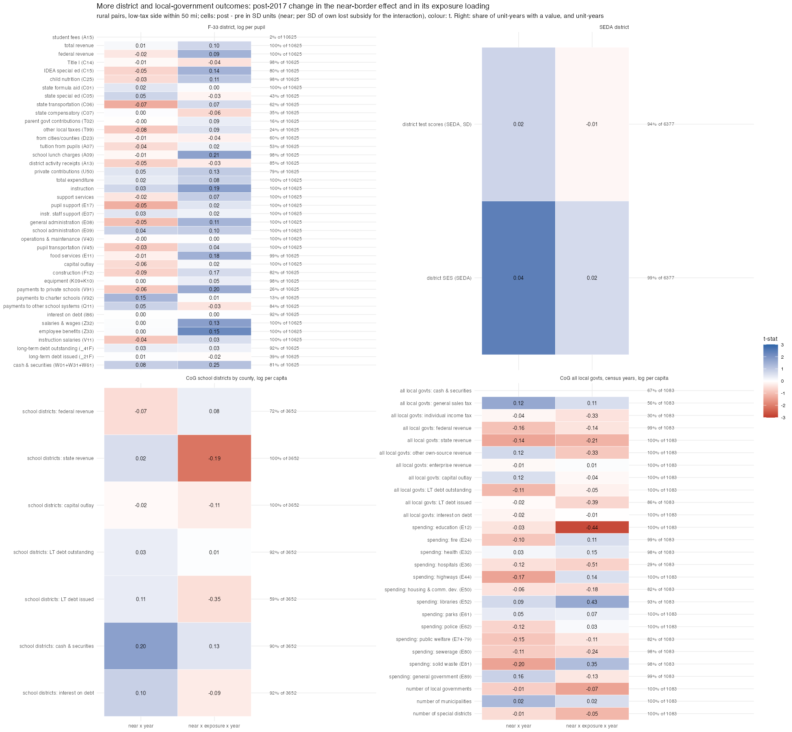

**Exposure as the treatment on all districts and counties** (`19_exposure_only_all_units.R`): no border instrument;
lost subsidy per owner household × year with unit FE + state × year FE, enrolment-weighted (5,720 districts with a
tract-based exposure) or 2016-return-weighted (3,108 counties), SE by county, SD of the outcome per SD of exposure.

| source | cells | significant | share positive | what the yearly series show |
|---|---|---|---|---|
| F-33 districts, 45 outcomes | 45 | 6 | 0.42 | property tax, local / state revenue, spending, salaries, capital, debt all within ±0.03 SD; Title I −0.07 (declining from 2019), child nutrition +0.13 (2021-22 only, the pandemic meal programmes), private contributions −0.14 (a 2012-16 pre-trend), enrolment +0.013 (t 4.6, a straight 2012-23 trend) |
| SEDA, 2012-18 | 2 | 2 | | scores +0.03, SES −0.02 on one post year |
| CoG school districts by county, 10 | 10 | 1 | 0.60 | property tax −0.05 (2012) → 0 → −0.01 (2022): a pre-trend that stops in 2017; expenditure likewise |
| CoG all local governments, census years, 29 | 29 | 18 | 0.93 | per-capita revenue and spending grow faster in high-exposure counties in both halves: expenditure −0.08 (2012) → 0 → +0.05 (2022), property tax −0.05 → 0 → +0.02, education −0.08 → 0 → +0.03, highways −0.06 → +0.04, housing −0.08 → +0.09; the 2017-22 step is smaller than the 2012-17 one for most items |

So with exposure alone, the local-public-finance outcomes show high-exposure places growing faster before and after
2017 at the county-area level (a secular correlation between exposure and growth within states), and nothing at the
district level beyond trends and pandemic programmes. There is no 2017 break in either.

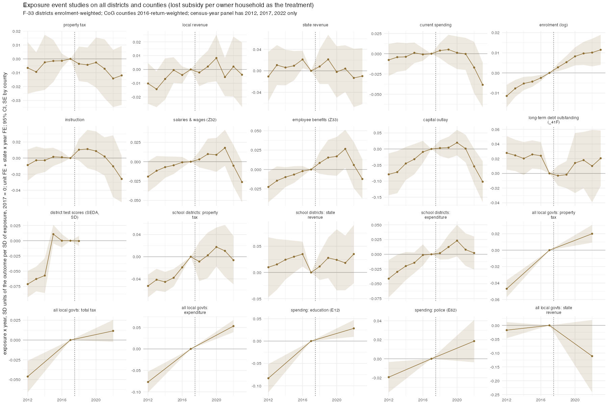

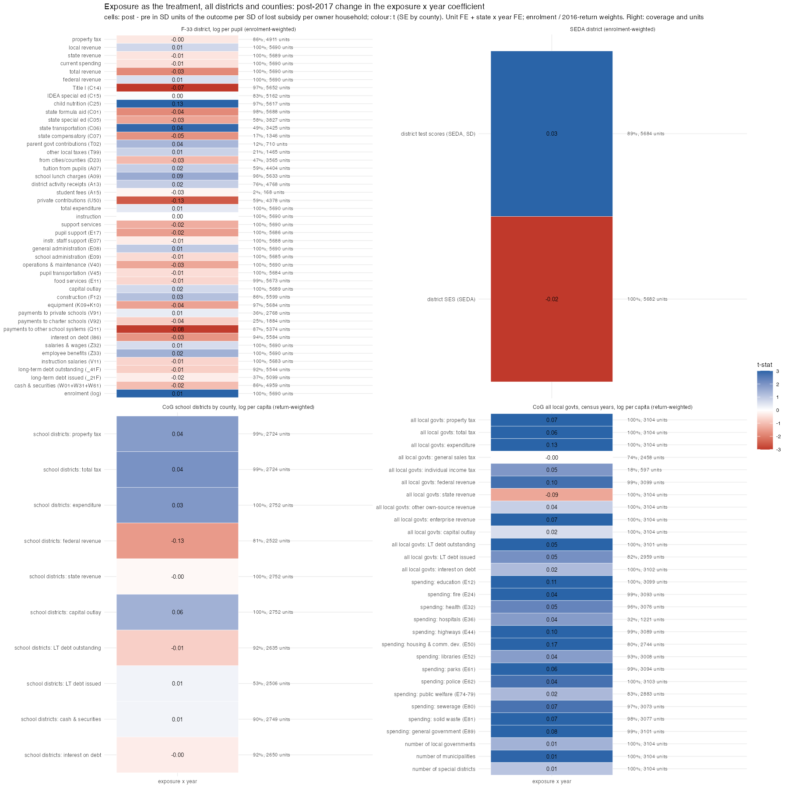

**ZIP → district exposure and fixed-effect variants** (`20_district_exposure_fe_variants.R`; crosswalk `build/geo/08`).
Counts: 27,523 SOI ZIPs in 2016 (27,434 with ≥ 100 returns; only 12,570 "clean", i.e. no censored AGI stub), 33,316
ZCTAs, 12,831 district polygons (12,762 touched by a ZCTA), 13,467 F-33 districts in 2016. The area crosswalk has 68,689
ZCTA × district pieces: 5.4 ZCTAs per district and 2.1 districts per ZCTA on average; 14,621 ZCTAs lie wholly in one
district. Weighting the pieces by area share × 2016 returns, a district draws on 4.8 ZIPs (median 4) and takes a median
68% of its returns from its largest ZIP; 12,678 districts get an exposure (lost subsidy per return mean $340, per owner
household mean $530, SD $663). The ZIP-area measure and the tract-based measure of 19 correlate 0.97 across the 7,130
districts that have both, so the two routes agree; the ZIP route covers 2.2 times as many districts.

Exposure × year on all 12,551 F-33 districts with the ZIP-area exposure per owner household, district FE plus:

| outcome, log per pupil | year | state × year | CBSA × year | county × year |
|---|---|---|---|---|
| property tax | +0.004 (1.1) | +0.007 (1.6) | −0.005 (−1.1) | −0.003 (−0.9) |
| local revenue | +0.005 (1.5) | +0.012 (3.3) | +0.002 (0.5) | +0.003 (0.9) |
| state revenue | +0.017 (3.1) | +0.004 (0.8) | +0.008 (1.5) | +0.005 (1.4) |
| current spending | +0.007 (2.9) | +0.007 (3.3) | +0.004 (2.3) | +0.002 (1.8) |
| salaries | +0.004 (1.5) | +0.009 (4.1) | +0.007 (3.6) | +0.004 (3.1) |
| benefits | +0.005 (1.8) | +0.010 (3.8) | +0.009 (3.7) | +0.005 (3.0) |
| capital outlay, debt | ≤ 0.010 | ≤ 0.007 | ≤ 0.008 | ≤ 0.010 |
| enrolment | −0.003 (−1.1) | +0.007 (4.0) | +0.006 (3.6) | +0.005 (2.8) |

(post − pre in SD units per SD of exposure; t in brackets; 2012 coefficients −0.01 to −0.03, i.e. the same pre-trend as
the post change.) Every estimate is below 0.012 SD per SD of exposure, about 0.3% of spending per pupil per $663 of lost
subsidy, and they shrink as the fixed effects tighten; the t-statistics come from 127,000-137,000 district-years. The
one consistent sign is salaries and benefits per pupil, +0.004 to +0.010 SD under all four sets, on a pre-trend of the
same size. Nothing a cap effect would need.

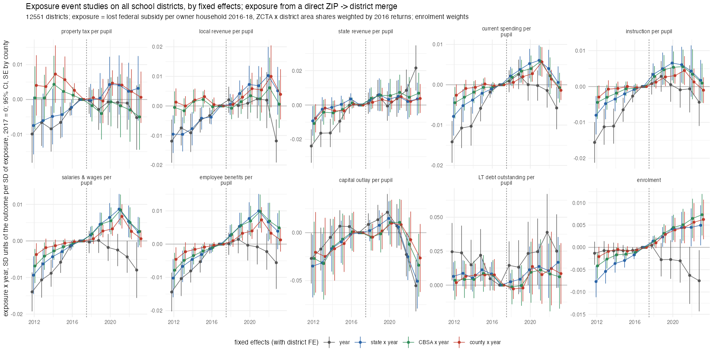

**Two more border designs** (`21_both_sides_and_density.R`), core outcomes (prices, home values, rates, bills, sales,
move-outs, population, district property tax / spending / enrolment, county school property tax) and the extended
local-government set of 18.

*A. Both sides.* Tracts within 50 mi on either side of the ranked pairs; near (< 10 mi) vs inland within the same
pair-side, tract/unit FE + pair × side × year FE. Pair-sides with a metro core (a metro ≥ 0.5m with ≥ 45% of its
population in that side's window) are dropped: 91 of 129 pair-sides stay, 14,195 tracts (5,742 low, 8,453 high), 27
pairs keep both sides. Balance of near vs far within pair-side: on the low side within 0.08 SD for all 8 covariates
(density +0.15); on the high side near tracts are denser (+0.31 SD), poorer (income −0.19), less owner-occupied
(−0.30), less white (−0.30), older housing (−0.31): the high side's near tracts are the urban cores facing the line,
so the high side rests on the tract FE rather than on balance. Post − pre, SD units:

| | near × year, both sides | near × high-side × year | near × exposure × year |
|---|---|---|---|
| core: significant of 11 | 2 (population −0.015, district property tax −0.021, both t −2.2) | 1 (move-outs −0.11, t −2.2) | 0 |
| core: median absolute | 0.017 | 0.022 | 0.012 |
| extended: significant of 75 | 1 (SEDA) | 1 | 3 (SEDA +0.05, two F-33) |

Pooling the high side adds 8,453 tracts and changes nothing: prices +0.017, bills +0.004, rate −0.05, sales +0.05
(all n.s.); the high side's near effect does not differ from the low side's except for move-outs falling more there.

*B. Low side, continuous distance, density control.* All 59 pairs (15,440 tracts, metro pairs included), z = −distance
/ 10 mi, tract FE + pair × year FE, with log density × year as a control; and the rural 45% subset for comparison.

| | all pairs, no control | all pairs, + density | rural 45%, no control | rural 45%, + density |
|---|---|---|---|---|
| core: significant of 11 | 1 | 0 | 0 | 0 |
| core: median absolute (SD per 10 mi) | 0.003 | 0.004 | 0.006 | 0.006 |
| z × exposure, + density: significant of 11 | 7 (median 0.014) | | 7 (median 0.052) | |

The density control does nothing to the main term, which is zero everywhere (all 11 outcomes within ±0.011 SD per
10 mi on all pairs, with the extra power the 15,440 tracts give: standard errors 0.003-0.02). The exposure interaction
is the same pattern as 16 / 17 and survives both the density control and the full sample: on all pairs with density,
sale price +0.022 (t 2.3), sales +0.075 (3.2), effective rate −0.071 (−3.1), home value −0.011 (−2.9), population
−0.016 (−3.3), district enrolment −0.007 (−2.6), per 10 mi closer per SD of exposure; on the rural subset three to
four times larger (rate −0.24, sales +0.10, price +0.065, population −0.03). In the extended set the interaction shows
little (2-4 significant of 75 per spec; all-local-government state revenue −0.17, t −3.0).

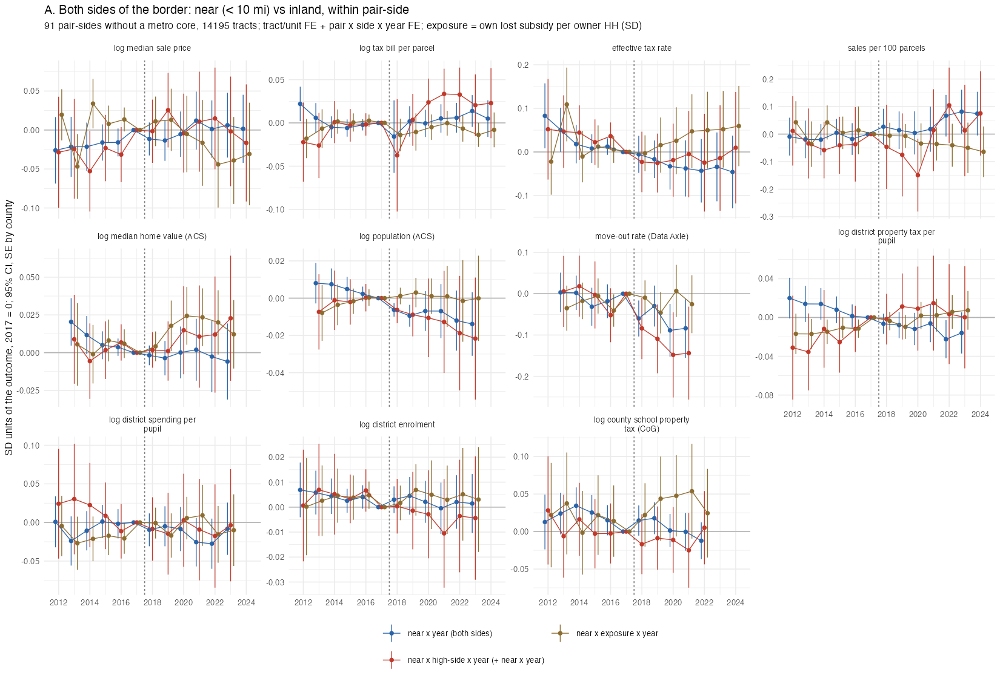

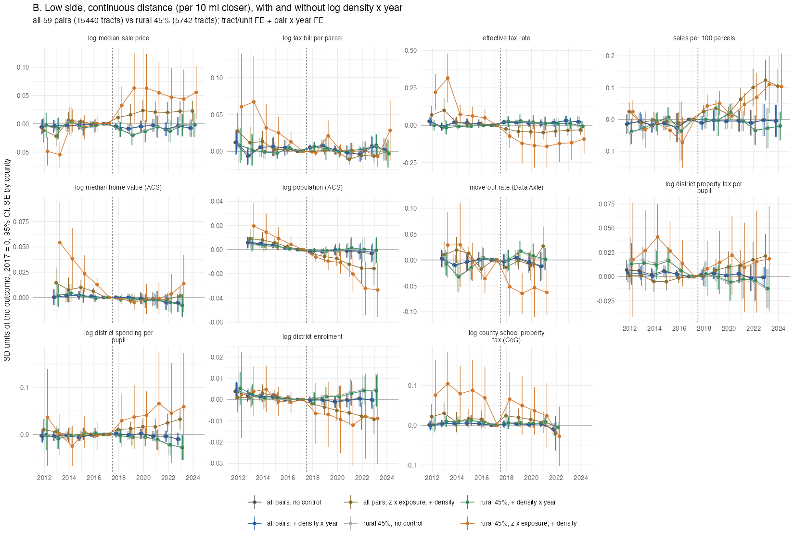

**Zooming in on the density-controlled design** (`22_density_spec_grid.R`): Z × year + Z × E × year + E × year + log
density × year, unit FE + pair × year FE (pair × side × year for both sides), 40 specs = 4 instruments (−distance / 10
mi; near < 5 / 10 / 20 mi) × 2 exposure forms (continuous per SD; above the low-side median, $570) × 5 samples (low side,
all 59 pairs, 15,401 tracts; both sides, all 129 pair-sides, 33,087 tracts; low side below 5,000 per sq mi, 10,439; below
1,000 per sq mi, 4,816; rural 45%, 5,722). Post − pre of the interaction, sign consistency over the 40 specs:

| outcome | share of specs positive | specs with \|t\| > 1.96 | median |
|---|---|---|---|
| effective tax rate | 0.00 | 17 | −0.061 |
| sales per 100 parcels | 0.90 | 11 | +0.067 |
| log district spending per pupil | 0.95 | 13 | +0.048 |
| log district enrolment | 0.07 | 16 | −0.013 |
| log population (ACS) | 0.05 | 11 | −0.015 |
| log sale price | 0.88 | 6 | +0.020 |
| log district property tax per pupil | 0.90 | 4 | +0.038 |
| log home value (ACS) | 0.22 | 8 | −0.007 |
| log tax bill | 0.25 | 5 | −0.009 |
| move-outs; county school property tax | 0.58; 0.05 | 2; 1 | +0.005; −0.031 |

- *Instrument form:* the continuous distance and the near dummies agree in sign; the near < 5 mi dummy gives the
  largest and most often significant interactions (6-7 of 11 on the low side), near < 20 the smallest.
- *Exposure form:* the binary version keeps the signs but halves the magnitudes and the number of significant cells
  (e.g. low side, all pairs, continuous distance: 7 significant continuous vs 4 binary).
- *Both sides:* pooling the high side (33,087 tracts) shrinks the interaction towards zero (median |estimate| 0.004-0.02,
  0-1 significant per spec except near < 5 mi), so the pattern is a low-side pattern: on the high side, near tracts with
  higher exposure do not behave differently.
- *Density thresholds:* dropping tracts above 5,000 or 1,000 per sq mi leaves the low-side pattern in place (4-5
  significant with continuous distance), so it is not the metro cores; the rural 45% subset gives the largest estimates
  (median 0.05-0.11), the density cut below 1,000 per sq mi the same signs at about half the size.
- *Main term:* zero throughout (median |estimate| 0.002-0.04 SD, 0-3 significant of 11 per spec, no sign pattern).

So the one result that holds up across border designs is: on the low-tax side, near-border tracts with higher SALT
exposure saw, relative to inland tracts with the same exposure, a falling effective rate, more sales, slightly higher
prices, more district spending per pupil, and fewer people and pupils after 2017. It is sign-stable across 40
specifications but small (0.02-0.07 SD per SD of exposure), absent on the high side, and the rate series has a
pre-trend. The next step would be to detrend and to look at who the high-exposure near-border tracts are.

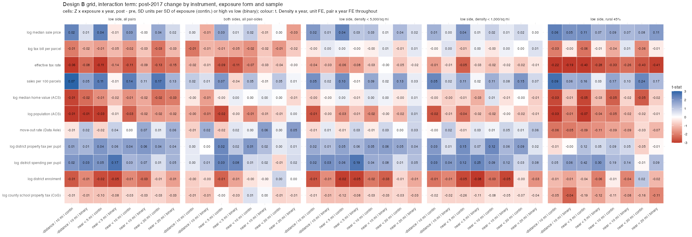

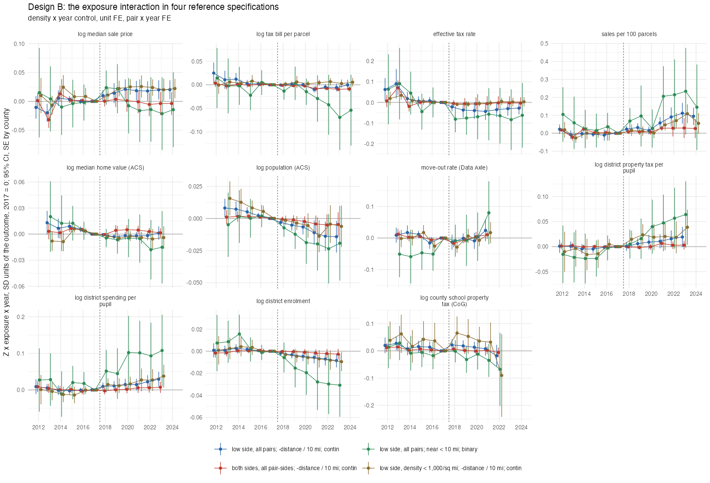

## Balance once density is conditioned on (`23_balance_conditional_on_density.R`)

The density grid (22) carried its result in the Z × exposure term. This checks pre-treatment balance for that design:
every standardised covariate (SD over the low side, all pairs, within 50 mi) on the instrument with pair FE and SE by
county, (i) raw, (ii) with log population density, (iii) as Z + Z × E + E + log density, reporting Z × E; Z is distance
per 10 mi (sign flipped) or near < 10 mi, E the own lost subsidy per owner household, standardised. Samples as in 22
without the both-sides one: all 59 pairs (15,440 tracts), density < 5,000 per sq mi (10,467), < 1,000 (4,842), rural 45%
(5,742, 42 pairs). Holm across the 15 controls.

- *Density changes nothing for the main term.* Density itself is balanced in distance on the low side (0.001-0.03 SD per
  10 mi), so partialling it out leaves the continuous-instrument coefficients where they were: 2-4 of 15 controls at
  p < .05, none after Holm, median |b| 0.02-0.03 SD. The near dummy on all pairs loses a little (|b| > 0.1 on 10 → 8
  controls), the rest stays. What remains is the same set as before: closer tracts have fewer BA+ (−0.06 SD per 10 mi),
  lower district test scores and SES (−0.05 to −0.09), fewer people (−0.05); the rural 45% subset is flat on all of these.
- *The interaction is not balanced.* With E and density controlled, Z × E loads on the exposure-correlated covariates
  everywhere, in SD of the covariate per SD of E per 10 mi closer (all pairs; density < 5,000; < 1,000; rural 45%):

  | covariate | all pairs | < 5,000 | < 1,000 | rural 45% |
  |---|---|---|---|---|
  | log median sale price 2016 | −0.14 (0.05) | −0.11 (0.05) | −0.08 (0.05) | −0.19 (0.08) |
  | log median home value | −0.17 (0.05) | −0.13 (0.05) | −0.10 (0.05) | −0.21 (0.08) |
  | sales per 100 parcels 2016 | −0.12 (0.04) | −0.12 (0.05) | −0.09 (0.05) | −0.24 (0.07) |
  | log median HH income | −0.16 (0.06) | −0.15 (0.06) | −0.14 (0.06) | −0.14 (0.08) |
  | share AGI ≥ $100k | −0.25 (0.08) | −0.24 (0.09) | −0.24 (0.08) | −0.15 (0.10) |
  | itemiser share | −0.23 (0.07) | −0.23 (0.08) | −0.23 (0.08) | −0.18 (0.10) |
  | share BA+ | −0.23 (0.07) | −0.21 (0.07) | −0.17 (0.06) | −0.18 (0.08) |
  | district test scores / SES | −0.21 / −0.22 | −0.17 / −0.17 | −0.19 / −0.17 | −0.30 / −0.24 |
  | effective tax rate | +0.02 (0.02) | −0.03 (0.02) | −0.04 (0.02) | +0.06 (0.04) |

  6-9 of 14 controls at p < .05 (Holm: 6, 2, 9, 1), median |b| 0.09-0.12 SD; with the near dummy the same with
  magnitudes about twice as large (median |b| 0.10-0.20). E itself loads on the same variables with the opposite sign
  (income +0.25 to +0.6 SD, itemisers +0.3 to +0.8), so the reading is: within a pair, the exposure gradient in income,
  education, prices and turnover is flatter near the border than inland. Near-border tracts in high-exposure ZIPs are
  poorer, cheaper and lower-turnover than their exposure predicts; inland high-exposure tracts are the affluent ones.
- *What this means for 22.* The post-2017 pattern there (near × high-exposure: more sales, higher prices, lower rate,
  fewer people, more district spending) sits on tracts that in 2016 had lower prices, lower turnover and lower income
  than the exposure gradient inland. Unit FE absorb the levels, but a catch-up in sales and prices in cheaper near-border
  tracts after 2019 is the kind of differential trend this imbalance predicts, and the rate interaction already trends
  from 2012. The interaction design does not pass a balance test that the main-term design passes; density does not
  help because density is not what differs.
- *Linear vs nonparametric density.* Density enters parametrically throughout (log density × year in 22, a linear log
  density term here; distance is linear or a dummy, not an additively separable nonparametric term). Replacing the linear
  term by within-sample density-decile dummies (`DENS_SPEC=bins`, `_densbins` outputs) moves no coefficient by more than
  0.02 SD: Z × E on share AGI ≥ $100k −0.248 → −0.230 (all pairs), on 2016 prices −0.137 → −0.133; main-term counts
  identical. Density is nearly orthogonal to distance within pairs, so its functional form cannot matter.
- *The high-tax side* (`SIDE=high`: 08 rebuilt for the high side, 70 pairs, 17,751 tracts within 50 mi; rural 45% keyed
  on high-side metro shares, 49 pairs, 8,453 tracts). Continuous distance, controls at 5% / Holm, median |b|, worst:

  | sample | raw | with log density | worst after density |
  |---|---|---|---|
  | all pairs | 8 / 5, 0.058 | 4 / 2, 0.035 | share white −0.08, population −0.08, year built −0.07, district SES −0.07 |
  | density < 5,000 | 4 / 2, 0.018 | 4 / 2, 0.015 | population −0.06 |
  | density < 1,000 | 3 / 1, 0.007 | 3 / 1, 0.008 | population −0.04, year built −0.03 |
  | rural 45% | 8 / 3, 0.054 | 6 / 2, 0.037 | test scores −0.08, SES −0.07, population −0.07, year built −0.07 |

  So the high side is somewhat worse than the low side raw (its border towns are the older, denser, less white ones),
  density explains about half of that on all pairs (owner share and move-outs vanish, the rest shrinks), and the density
  cut below 1,000 per sq mi gives a high-side sample as balanced as the low side's. The rural rule does less on the high
  side than on the low side. The near dummy is bad everywhere on the high side: 10-12 of 15 controls at 5%, median 0.16-0.20
  SD on all pairs and on rural 45%, 0.06 below 1,000 per sq mi; dropping metro pairs does not remove the city cores
  because the high side's border cities sit on the line.
  The Z × exposure interaction is balanced on all pairs (0 of 14 at 5%, median 0.03) but not in the subsamples, and with
  a sign that flips: below 1,000 per sq mi the low-side pattern (income −0.11, AGI ≥ $100k −0.18, itemisers −0.14, BA+
  −0.13, prices −0.12, 10 of 14 at 5%); in rural 45% the opposite (income +0.13, AGI +0.19, BA+ +0.16, prices +0.13, 9 of
  14). The two exposure measures also diverge near the border on the high side (excess SALT per return on Z × E +0.22).

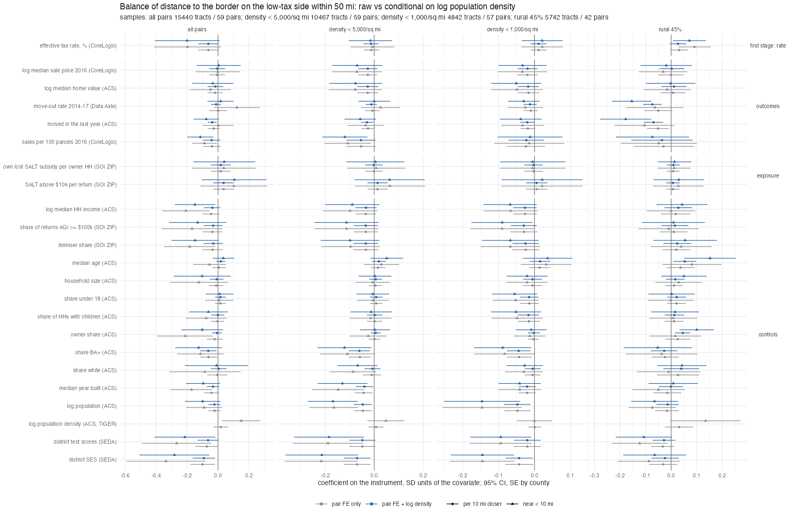

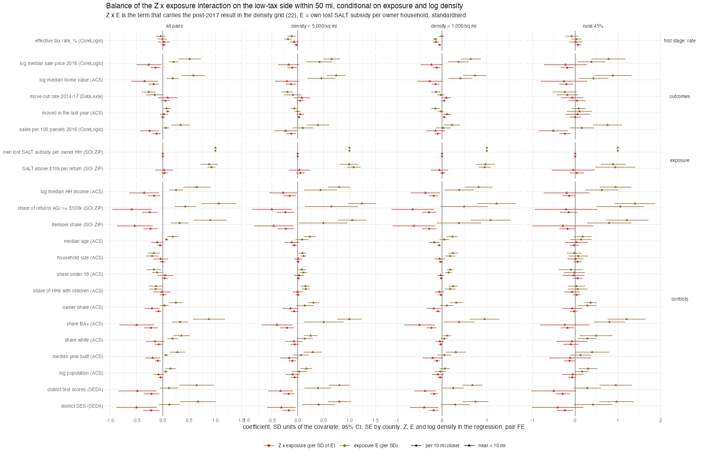

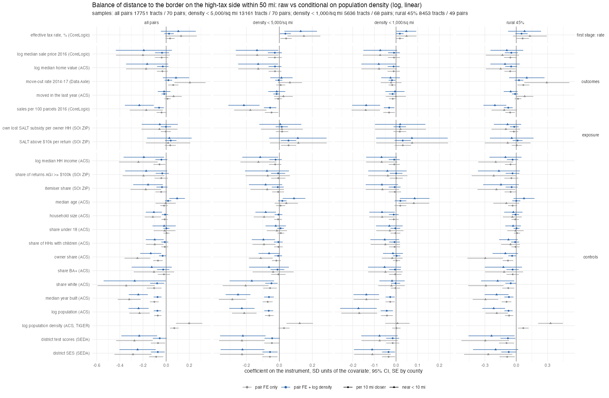

## Does balance improve as the sample gets more rural? (`24_density_cutoff_sweep.R`, `25_density_cutoff_coverage.R`)

The regressions of 23 at density cutoffs from none to 100 per sq mi, both sides, all pairs within 50 mi. Controls at
p < .05 (of 15 raw, 14 given density), median |b| in SD units, worst control, for continuous distance given log density:

| cutoff | low side: tracts, rejections, median, worst | high side: tracts, rejections, median, worst |
|---|---|---|
| none | 15,440; 2; 0.026; district SES −0.09 | 17,751; 4; 0.035; share white −0.08 |
| 5,000 | 10,467; 4; 0.034; district SES −0.07 | 13,161; 4; 0.015; population −0.06 |
| 2,000 | 6,790; 4; 0.030; district SES −0.06 | 8,040; 3; 0.016; population −0.05 |
| 1,000 | 4,842; 3; 0.020; population −0.05 | 5,636; 3; 0.008; population −0.04 |
| 500 | 3,435; 2; 0.016; population −0.04 | 4,025; 3; 0.009; population −0.05 |
| 250 | 2,366; 3; 0.015; population −0.06 | 2,844; 2; 0.008; population −0.05 |
| 100 | 1,271; 2; 0.008; population −0.07 | 1,485; 2; 0.014; population −0.04 |

- *Main term, continuous distance:* yes, monotonically, and on both sides. The socio-economic gaps (district SES, test
  scores, BA+ on the low side; race, year built, SES on the high side) are gone by 1,000 per sq mi; from 500 down the
  only thing left is that tracts nearer the border have fewer people (−0.04 to −0.07 SD per 10 mi), which is a tract
  geometry fact, not a confound. Raw and density-conditioned series are the same below 5,000.
- *Near dummy:* improves too but never gets clean. Low side median 0.15 → 0.05 → 0.03 (none → 1,000 → 100), high side
  0.20 → 0.06 → 0.03 to 0.06; log population −0.15 to −0.23 SD throughout, district SES −0.1 to −0.14 until 500.
- *Z × exposure:* on the low side stays unbalanced (9 of 14 at 5%, median 0.08-0.10, income / itemiser / BA+ −0.2 to
  −0.3) down to 500 per sq mi, then drops to 0-2 rejections at 250 and 100 where only 1,271-2,366 tracts remain; on the
  high side it is balanced at none and 5,000, unbalanced at 2,000-1,000 (10 of 14) and balanced again below 500. The
  near × exposure version is the worst series everywhere (max |b| 0.4-0.9 SD on the low side).
- *Coverage* (25; contiguous US, ACS 2013-17 population, 72,245 tracts, 10,841 unified + elementary districts with a
  tract centroid, F-33 2017 enrolment for 10,725):

  | cutoff | population in such tracts | tracts | districts below D | their population | F-33 pupils |
  |---|---|---|---|---|---|
  | 5,000 | 73% | 73% | 96% | 86% | 88% |
  | 2,000 | 47% | 47% | 87% | 64% | 66% |
  | 1,000 | 35% | 36% | 79% | 48% | 49% |
  | 500 | 27% | 29% | 71% | 37% | 37% |
  | 250 | 21% | 23% | 63% | 26% | 26% |
  | 100 | 13% | 16% | 49% | 15% | 15% |

  Median district density is 109 per sq mi (quartiles 31 and 703). So "below 1,000 per sq mi" is a third of the
  population but four in five school districts and half of all pupils; the 500 cutoff, where the main term is clean on
  both sides, is a quarter of the population and 71% of districts.

- *Who is below 1,000 per sq mi* (`26_rural_district_map.R`): 8,545 of 10,841 districts. Of those, 1,199 have at least
  half their population within 50 mi of a ranked border on the low-tax side (31.6m people, 4.7m pupils) and 1,624 on
  the high-tax side (36.3m, 5.4m); 5,722 are not near a ranked border (84.9m, 12.5m pupils, median density 39) and 2,296
  are above the cutoff (165.9m, 23.6m pupils). The border sample is the eastern half: Pennsylvania (244 districts),
  Ohio (237), New York (166), Illinois (166), Indiana (156), Massachusetts (135), New Jersey (115), Wisconsin (109),
  Missouri (98), Connecticut (97), Tennessee (88), Texas (86), New Hampshire (80); west of the Plains only the
  Oregon-Washington, Nevada and Arizona pairs contribute.

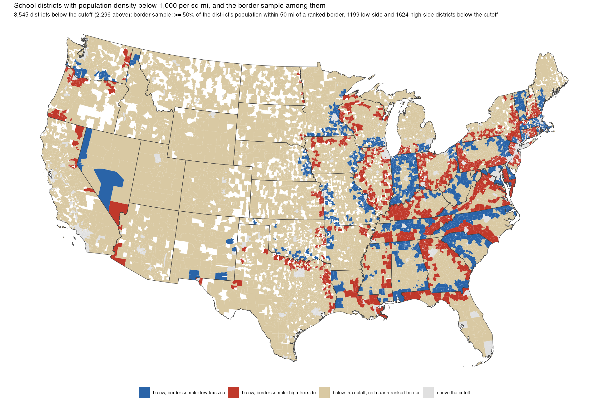

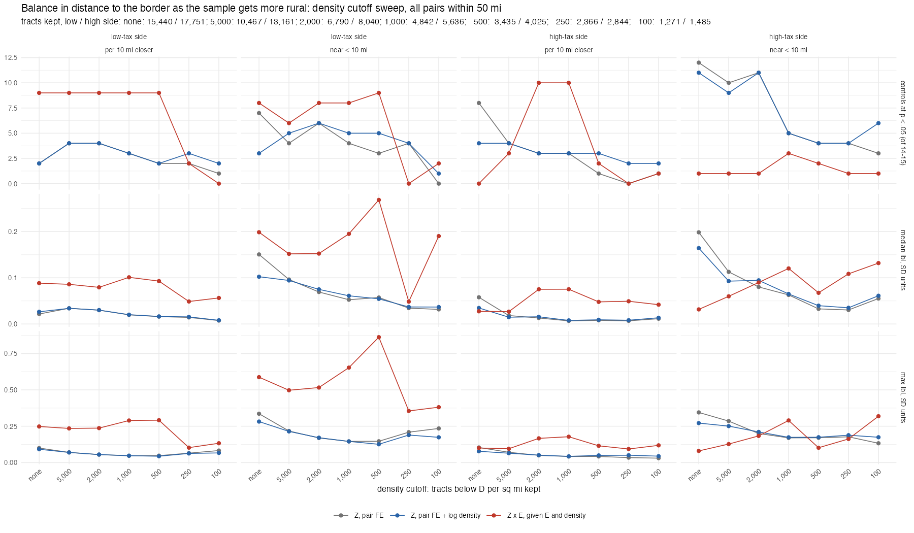

## A pair-level rural rule instead (`27_pair_density_rule.R`)

Pairs ranked by window density (population / land area of all tracts within 50 mi, both sides) and kept below a
threshold, all their tracts included. The sparse end is IA-MN, NH-VT, MI-WI, KY-VA, IL-KY (47-96 per sq mi); the dense
end DC-VA, NJ-NY, DC-MD, DE-NJ, AZ-NV (2,200-9,300); NJ-PA and MA-NH sit at 990. Window density is a land-area
measure: in most pairs the population-weighted mean tract density is 1,000-4,000, and even at the 500 threshold 55% of
the kept tracts are above 1,000 per sq mi. Continuous distance given log density, controls at 5% / median |b| / worst:

| threshold | low side: pairs, tracts, rejections, median, worst | high side: pairs, tracts, rejections, median, worst |
|---|---|---|---|
| none | 59, 15,440; 2; 0.026; district SES −0.09 | 70, 17,751; 4; 0.035; share white −0.08 |
| 2,000 | 56, 13,072; 2; 0.027; district SES −0.09 | 65, 15,472; 4; 0.029; population −0.08 |
| 1,000 | 53, 12,040; 4; 0.032; district SES −0.10 | 62, 14,398; 6; 0.048; district SES −0.09 |
| 500 | 45, 8,274; 8; 0.072; district SES −0.09, BA+ −0.09 | 53, 9,728; 4; 0.030; population −0.07 |
| 250 | 28, 3,560; 7; 0.048; share BA+ −0.08 | 35, 4,762; 12; 0.082; district SES −0.12 |

- *It does not improve balance; on the low side it worsens it.* Dropping dense pairs removes NJ-NY, DC and the
  Connecticut pairs but leaves the river-city pairs (OH-WV, KY-OH, IN-KY, IL-MO, KS-MO, MN-WI) whose windows are sparse
  on average and whose border tracts are the city cores, so the SES / education / test-score gradient in distance is
  if anything sharper. The near dummy stays at a median of 0.1-0.2 SD on both sides at every threshold.
- *The exposure interaction* happens to be balanced on the low side at 1,000 and 500 (0-2 of 14) but turns positive
  (+0.2 on income / itemisers / BA+) on the high side at the same thresholds, as in 24.
- Compared with the tract-level cut (24: by 1,000 per sq mi, 3 rejections and median 0.02 / 0.008 on the low / high
  side; from 500 only population left), the pair-level rule is the wrong unit: what has to go is the dense tract at the
  border, not the pair whose window happens to be sparse on average. A pair rule keyed on the near-border density
  (density of the tracts within 10 mi) or on the population-weighted tract density would be the version to try if a
  pair-level selection is wanted.
- *Population-weighted instead* (`PAIR_DENS=pw`: pairs ranked by the population-weighted mean tract density of the
  window, i.e. the density the average resident lives at; 200-1,000 in the Appalachian and plains pairs, 1,000-4,000
  in most, 6,800-36,500 in NJ-PA, MA-NH, AZ-NV, DC-MD, NJ-NY, DC-VA). Continuous distance given log density:

  | threshold | low side: pairs, tracts, rejections, median, worst | high side: pairs, tracts, rejections, median, worst |
  |---|---|---|
  | 4,000 | 50, 9,919; 8; 0.050; district SES −0.09, BA+ −0.09 | 60, 11,588; 2; 0.019; population −0.06 |
  | 2,000 | 28, 4,069; 7; 0.044; share BA+ −0.09, SES −0.08 | 31, 5,082; 5; 0.035; population −0.08 |
  | 1,000 | 8, 547; 1; 0.024; population −0.09 | 10, 632; 6; 0.056; log income −0.10 |
  | 500 | 2, 75 | 2, 40 |

  Better than the land-area version on the high side, where dropping the ten densest pairs gives 2 rejections and a
  median of 0.02 with 60 pairs, but no help on the low side: at 4,000 and 2,000 the river-city pairs (OH-WV, IN-KY,
  KY-TN, IL-KY, OH-PA, IN-OH) are still in and the SES / education gradient is unchanged at −0.08 to −0.09; the low
  side only balances at 1,000, which is 8 pairs and 547 tracts (IA-MN, NH-VT, KY-VA, IL-KY, AR-OK, AR-MS, AL-TN,
  MD-WV, TN-VA, NC-TN on the high side). The near dummy is unbalanced at every threshold on both sides. A pair rule
  of either kind therefore costs most of the sample before it does what the tract-level cut does at 4,800 tracts.

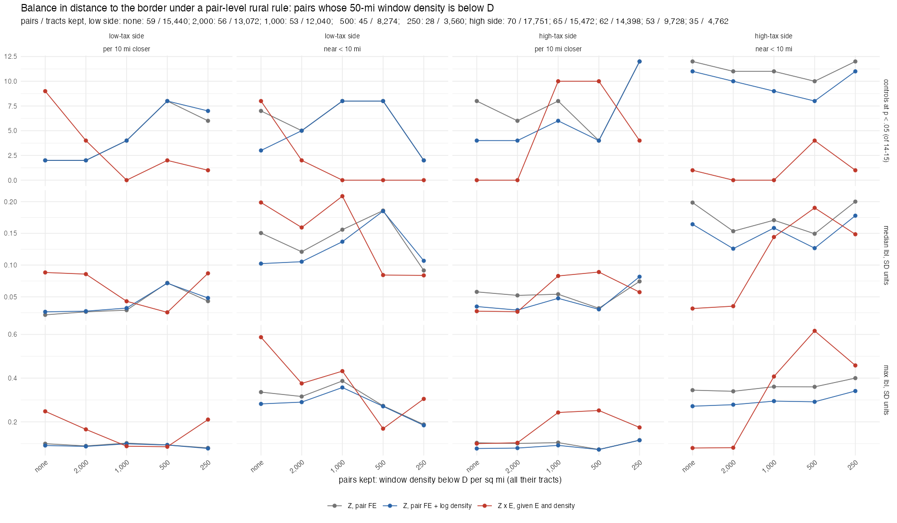

## Districts around border metros by the gap to their cheapest neighbour (`28_metro_district_rate_gap_maps.R`)

Ten windows of ±90 mi around border metros (New York, Philadelphia, Washington, Boston, Chicago, Cincinnati, St. Louis,
Kansas City, Louisville, Portland). District rate = 2016 CoreLogic median effective rate on sold parcels (tract `eff50`),
sales-weighted over the tracts whose centroid lies in the district (1,921 small districts without a tract centroid take
the tract their own centroid falls in); no minimum sales count (a first version required 10 per tract and 30 per district, which greyed out 1-10% more districts per window without changing the summary); 11,386 of 12,831 contiguous-US districts get a rate. Bill / market value was tried
first but is missing in CT, MA, NH and runs 25% above the sales-based rate in NY, so it would fake gaps at state lines.
Colour = own rate − lowest adjacent district's rate (pp), capped at ±1.5; grey = no rate.

| metro | districts | with rate | median rate | median gap | p90 gap | share gap > 0.5 pp | cheapest neighbour across the state line: all / among gap > 0.5 |
|---|---|---|---|---|---|---|---|
| New York | 956 | 951 | 2.44 | 0.57 | 1.76 | 0.55 | 0.08 / 0.12 |
| Philadelphia | 833 | 831 | 2.43 | 0.57 | 1.70 | 0.54 | 0.08 / 0.12 |
| Washington | 167 | 157 | 1.05 | 0.24 | 0.87 | 0.27 | 0.22 / 0.40 |
| Boston | 577 | 569 | 1.67 | 0.29 | 0.88 | 0.28 | 0.10 / 0.21 |
| Chicago | 594 | 565 | 2.39 | 0.34 | 1.26 | 0.35 | 0.06 / 0.15 |
| Cincinnati | 369 | 358 | 1.10 | 0.20 | 0.69 | 0.20 | 0.08 / 0.21 |
| St. Louis | 343 | 266 | 1.94 | 0.28 | 1.18 | 0.35 | 0.07 / 0.19 |
| Kansas City | 278 | 179 | 0.86 | 0.16 | 0.42 | 0.04 | 0.06 / 0.38 |
| Louisville | 255 | 238 | 0.86 | 0.18 | 0.60 | 0.16 | 0.09 / 0.36 |
| Portland | 161 | 157 | 1.05 | 0.16 | 0.47 | 0.08 | 0.08 / 0.23 |

- The big within-metro gaps are in the Northeast and Chicago: half the districts around New York and Philadelphia have a
  neighbour at least 0.5 pp cheaper, and the state line is rarely where the cheapest neighbour is (8-9% of districts,
  13% of those with a large gap). Rate variation there is between adjacent districts of the same state (NJ, PA, NY
  suburbs vs cores, Lake County vs Cook). Around Washington, Kansas City, Louisville and St. Louis, where gaps are
  smaller, the cheapest neighbour sits across the state line in 19-40% of the large-gap cases.
- *Grey districts:* Missouri and Kansas are non-disclosure states (no sale prices in CoreLogic, so no sales-based rate;
  the first version with bill / market value covered them but not New England), which is most of the grey around
  St. Louis and Kansas City; the rest are districts with no 2016 sale at all and a few counties absent from the roll.

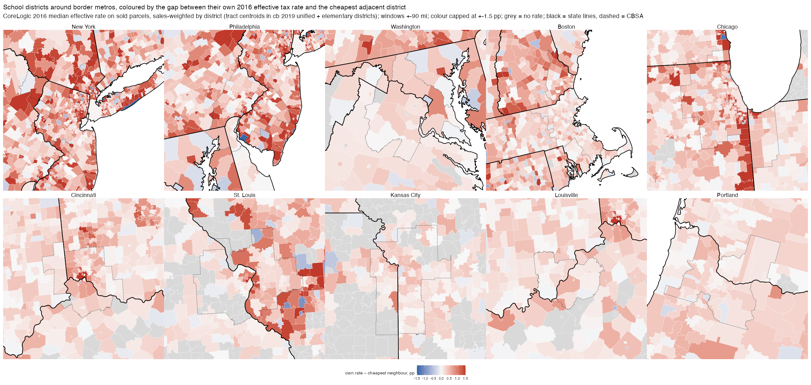

## The density-selected sample: near vs inland over time, competition instrumented by distance, balance (`29_density1000_overview_iv.R`)

Sample: tracts below 1,000 per sq mi within 50 mi of a ranked border, both sides: 10,478 tracts (4,842 low, 5,636 high),
68 pairs. Unit FE + pair × year FE (pair × side × year when pooled), SE by county, 2017 = 0, outcomes in SD units of
2016. Z = distance per 10 mi (sign flipped) or near < 10 mi; every spec run with and without log density × year, and
the two are indistinguishable (density is orthogonal to distance within pairs in this sample).

- *Tax competition* = SD of the 2016 effective rate across sample tracts of both sides within 30 mi of the tract (≥ 5
  neighbours): median 0.27 pp, IQR 0.17-0.42. **First stage** (cross-section, pair FE + density): +0.19 SD per 10 mi
  closer on the low side (t 10.2), +0.14 on the high side (t 9.9); near < 10 mi +0.46 / +0.29 SD (t 9.6 / 8.7). Strong,
  and unchanged without density.
- *Near × year (A):* nothing on the low side (all 11 post − pre within ±0.015 SD per 10 mi, |t| ≤ 1.7; near dummy within
  ±0.05, move-outs +0.04, t 1.3). On the high side a slow decline in ACS home value and population (−0.010 and
  −0.011 SD per 10 mi, t −3.2 / −3.1; near −0.026 / −0.026), district enrolment (−0.005, t −2.7) and county school property tax
  (near −0.044, t −2.9), all trending from 2013 rather than breaking in 2018. Prices, bills, rates, sales, district taxes
  and spending: zero on both sides. (Numbers corrected 2026-10-29: the post − pre table of 29 had been computed on the raw
  coefficients while labelled SD units, and over 2013-16; it now uses the SD-unit series and 2012-16 like 31-33. The
  figures, which always plotted SD units, and every t are unchanged.)
- *IV (B):* exactly identified, so each series is the reduced form divided by the first stage. Per SD of competition:
  low side all within ±0.08 SD and insignificant (rate −0.076, t −1.7; sales +0.05, t 0.5); high side home value −0.074
  (t −3.3) and population −0.088 (t −3.2), enrolment −0.035 (t −2.7), sales +0.12 (t 1.1; near-dummy version +0.29, t 1.8),
  the rest zero. Pooled: home value −0.042 (t −3.0), population −0.051 (t −3.0), enrolment −0.020 (t −2.3), nothing else.
- *Balance (C):* continuous distance: low side 3 of 15 controls at 5% raw and given density (none after Holm), median
  0.02 SD, worst share BA+ −0.06, district SES −0.05; high side 3 (1 Holm), median 0.008, worst population −0.04. Near
  dummy: 4-5 rejections, median 0.07, with population −0.13 / −0.15, year built −0.19 (high side) and district SES
  −0.16 (low side) the gaps. Conditioning on density moves nothing by more than 0.01.

So in the sample where distance is balanced, the border does nothing after 2017 on the low-tax side, and on the high-tax
side the near-border tracts were already losing people and value relative to inland before the cap and kept doing so.
Competition instrumented by distance inherits exactly that: a strong first stage and reduced forms that are zero or
pre-trending.

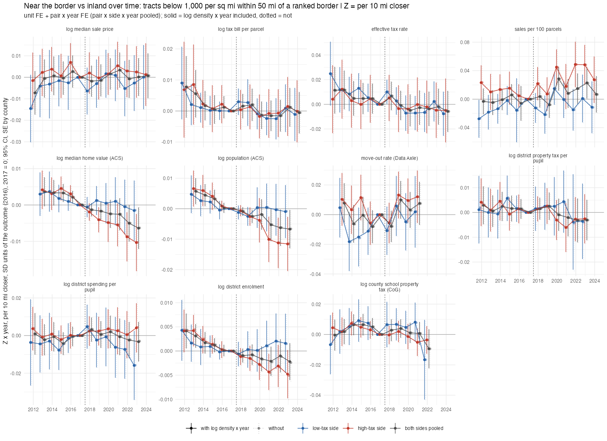

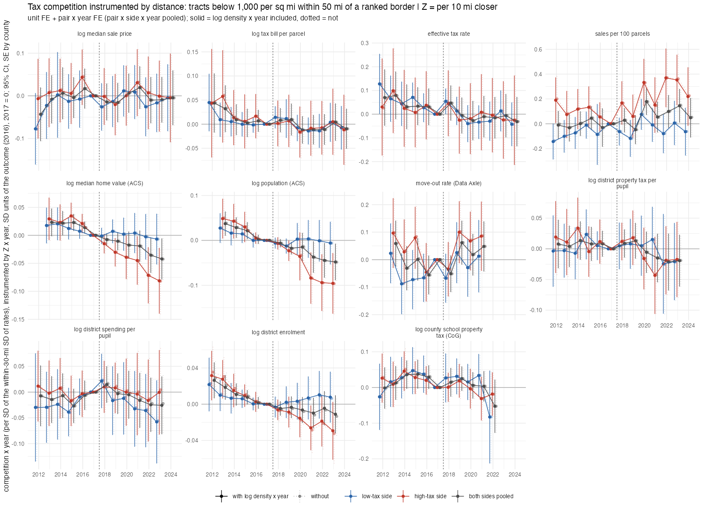

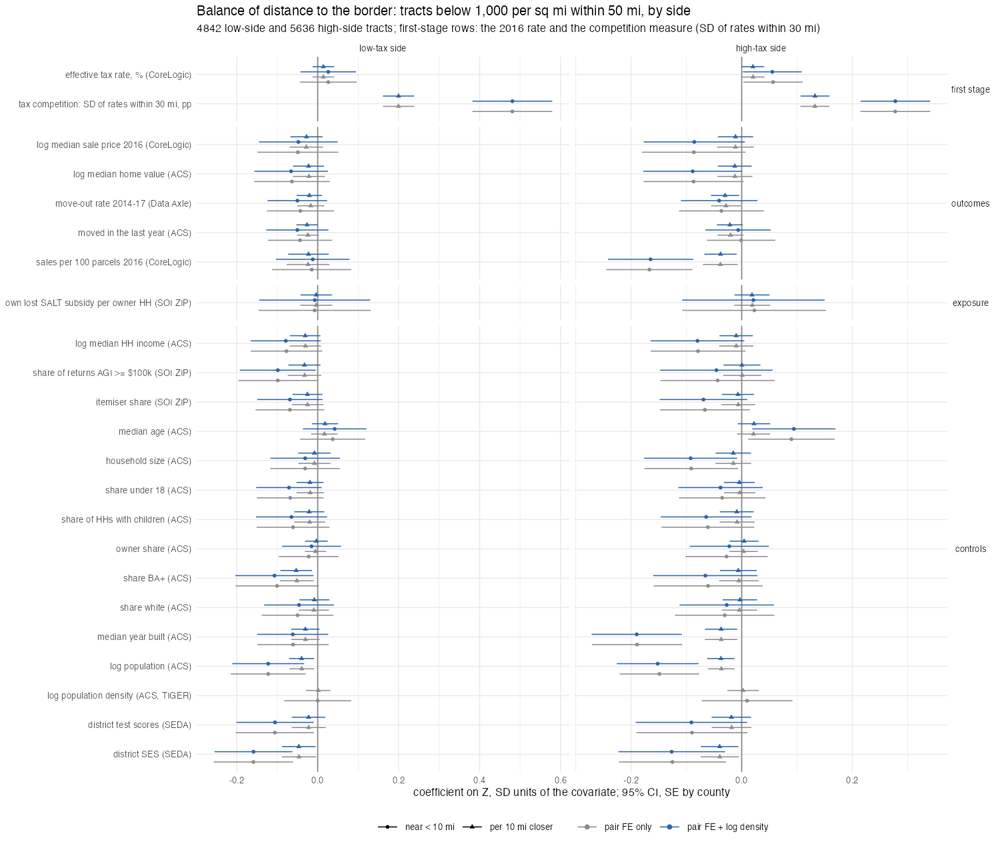

## District outcomes on the density-selected sample (`30_density1000_district_outcomes.R`)

The 75 outcomes of 18 (39 F-33 items log per pupil, SEDA scores and SES, 7 CoG school-district aggregates by county
and 27 CoG all-local-government items in census years) on the sample of 29, as Z × year (per 10 mi closer, log
density × year) and as the competition IV, by side and pooled. Cells with |t| > 1.96 of 75, and median |estimate|:

| sample | near × year | IV |
|---|---|---|
| low-tax side | 2 (0.010) | 1 (0.046) |
| high-tax side | 3 (0.012) | 3 (0.064) |
| both sides pooled | 3 (0.005) | 3 (0.034) |

That is the 3-4 per 75 that chance gives. The cells that do reject are not a pattern: all-local-government long-term debt
and interest on debt down on the low side (−0.08 SD per 10 mi, t −2.5 / −2.0; census years, 2022 − 2012), the number of
special districts and of local governments down on the high side (−0.01, t −2.8 / −2.5) and SEDA district SES up by 0.01
(t 2.6-2.9). Total revenue, property tax, state aid, instruction, salaries, capital outlay, debt issued, test scores: all
within ±0.03 SD per 10 mi with |t| < 1.9 on every side. The IV cells are the same reduced forms divided by the first
stage; the student-fees cell (A15) explodes to ±5-16 because the item is nearly empty and its 2016 SD is tiny.

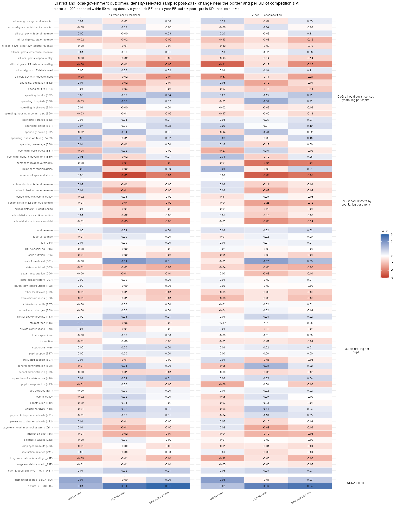

## Distance × SALT exposure × year on the density-selected sample (`31_density1000_exposure_interaction.R`)

The interaction design of 22 on the sample of 29 (10,422 tracts with exposure; median lost subsidy $415 here against
$570 on the full low side): Z × year + Z × E × year + E × year + log density × year, unit FE + pair × year FE. Post − pre
of the interaction per 10 mi closer per SD of exposure, SD units (t):

| outcome | low-tax side | high-tax side | pooled |
|---|---|---|---|
| effective tax rate | −0.012 (−1.6) | −0.019 (−1.7) | −0.017 (−2.3) |
| sales per 100 parcels | +0.035 (2.1) | +0.042 (1.8) | +0.039 (2.5) |
| log sale price | +0.010 (1.4) | +0.012 (1.9) | +0.012 (2.5) |
| log population | −0.013 (−2.6) | −0.016 (−2.8) | −0.016 (−3.9) |
| district enrolment | −0.007 (−2.0) | −0.009 (−2.9) | −0.007 (−3.3) |
| district spending per pupil | +0.022 (2.0) | −0.003 (−0.4) | +0.008 (1.4) |
| district property tax per pupil | +0.023 (1.9) | +0.004 (0.8) | +0.008 (1.8) |

- *Core outcomes:* the c35 pattern reappears on the low side at the c35 magnitudes (rate down, sales and prices up,
  population and pupils down, district tax and spending up), and, unlike in c35 where pooling the high side killed it,
  here the high side shows the same signs for rate, sales, prices, population and enrolment, so the pooled estimates are
  the strongest (4-5 of 11 significant). District spending and property tax per pupil rise only on the low side.
- *The 75 district / local-government outcomes:* 2-3 of 75 significant per sample (chance level), median |estimate|
  0.013-0.019; none of total revenue, state aid, instruction, salaries, capital outlay, debt or test scores on the low
  side moves beyond |t| 1.9. The cells that reject are isolated: hospital spending (+0.57 on the low side, a thin item),
  cash and securities per pupil (+0.10 low), pupil transportation (+0.03 high), SEDA SES (+0.01, t 3-3.7). So the
  spending-per-pupil rise in the core set does not show up in any F-33 component.
- *Timing:* the interaction on district spending per pupil (low side) is flat at 0 ± 0.01 in 2012-16 and rises to
  +0.01 in 2018, +0.02 in 2021-22, +0.03 in 2023; sales and prices rise from 2019-20; population and enrolment drift
  down from 2016. The rate interaction is a steady decline from 2012, as before.
- *Main term:* 0-3 of 11 core and 1-3 of 75 district cells significant, median 0.003-0.011; nothing.

Balance caveat (23 / 36, same sample): near × high-exposure tracts have lower 2016 prices, turnover, income and
education than inland high-exposure tracts (−0.1 to −0.25 SD per SD of E per 10 mi). The interaction is the only
border term that moves anything, and it is the one that fails balance.

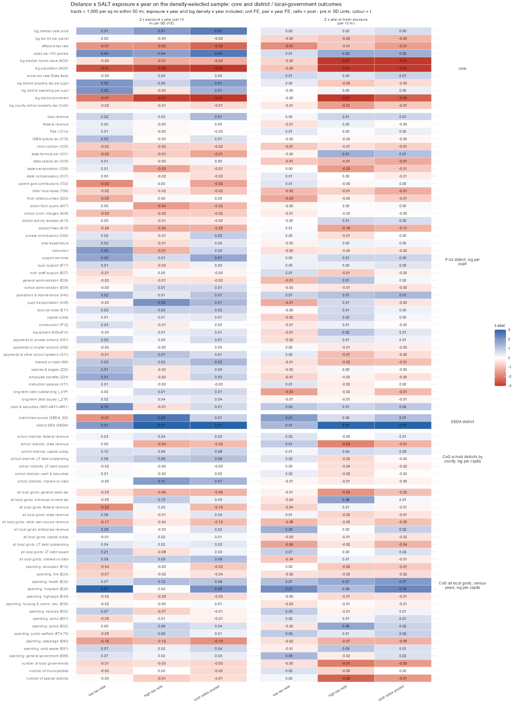

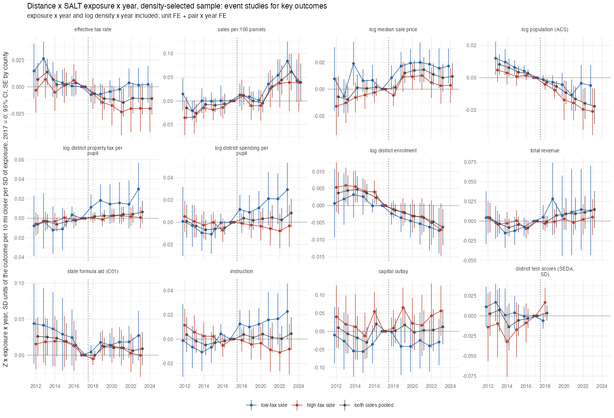

## Household composition and age (`32_composition_outcomes.R`; builds `acs/07-08`, `soi/12`)

Data Axle's household fields are not usable for this (adults only, modelled children count, 44-50% one-person
households against 28% in the CPS, coding breaks in 2013, 2016 and 2018), so two other sources: SOI ZIP files
(individuals and dependents per return, filing-status shares, elderly 60+ share; dependents end in 2018, elderly covers
2015-18 only, "individuals" switches from exemptions to persons on the return in 2018) and new ACS 5-year tract series
2013-2023 (shares under 18, 65+, householders living alone, households with own children, household size, plus median
age). Two designs: the exposure DiD on all units (unit FE + state or county × year FE, 2016-return weights) and the
density-selected border sample (Z × year with density, and Z × exposure × year). Post − pre, SD units of the 2016
cross-section, t in brackets:

| outcome | exposure DiD, county × year (per SD of E) | border Z × year, pooled (per 10 mi) | border Z × E × year, pooled |
|---|---|---|---|
| share under 18 (ACS) | +0.023 (2.6) | +0.002 (0.5) | +0.004 (0.7) |
| share 65+ (ACS) | +0.011 (2.6) | +0.005 (1.4) | −0.021 (−4.6) |
| median age (ACS) | −0.007 (−1.5) | +0.002 (0.6) | −0.001 (−0.2) |
| households with children (ACS) | +0.029 (2.2) | −0.005 (−0.9) | +0.002 (0.3) |
| one-person households (ACS) | −0.018 (−3.0) | +0.009 (1.5) | +0.005 (1.0) |
| household size (ACS) | +0.017 (1.5) | −0.006 (−1.1) | −0.001 (−0.2) |
| individuals per return (SOI) | +0.073 (1.9) | +0.001 (0.3) | −0.024 (−4.0) |
| dependents per return (SOI, to 2018) | +0.044 (2.5) | +0.001 (0.5) | −0.010 (−3.6) |
| joint filers (SOI) | +0.013 (2.3) | −0.004 (−1.2) | −0.020 (−3.8) |
| single filers (SOI) | −0.058 (−2.0) | +0.008 (1.7) | +0.031 (4.0) |
| elderly returns (SOI, 2015-18) | +0.003 (0.8) | 0.000 (0.1) | −0.009 (−2.3) |
| log returns (SOI) | 0.000 (0.2) | −0.002 (−2.0) | −0.003 (−2.4) |

- *Exposure DiD:* high-exposure places are becoming more family-like relative to the rest of their county, with more
  children and households with children, fewer one-person households, more dependents and joint filers, fewer single
  filers, but every one of these series is a straight line from 2012 to 2022 through 2017 (e.g. households with
  children −0.02 in 2012, 0 in 2017, +0.025 in 2022). A decade-long trend, no break. The 65+ share rises to 2018 and is
  flat after; the SOI elderly share is flat to 2018 and +0.004 to +0.01 (t ≤ 1.3) after, if anything the wrong sign for
  elderly out-migration from high-exposure places. Median age drifts down 0.01 SD, not significant. Weights 2016
  returns; state × year gives the same.
- *Border, Z × year:* nothing. All ACS cells within ±0.011 SD per 10 mi, all SOI cells within ±0.008; the only |t| > 2
  are the high-side decline in returns and individuals (−0.004, the population drift of 29) and a 2020 spike in the
  high-side single-filer share.
- *Border, Z × exposure × year:* near-border high-exposure places lose people per return, dependents, joint filers and
  the 65+ share and gain single filers (pooled t 3.5-4.6), on both sides. Each series is a monotone slope from 2012
  (individuals per return +0.02 in 2012, 0 in 2017, −0.015 in 2020; 65+ share +0.02 → −0.02), so again a trend, and the
  term is the one that fails balance (36).

So neither source and neither design gives evidence that composition or age changed with the cap: no post-2018 break
in children, families, singles, elderly or median age, in the exposure DiD or at the border. The ZIP/tract units are
4,401 border ZIPs (2,014 low, 2,387 high) and 10,478 tracts; 27,500 ZIPs and 70,000 tracts nationally.

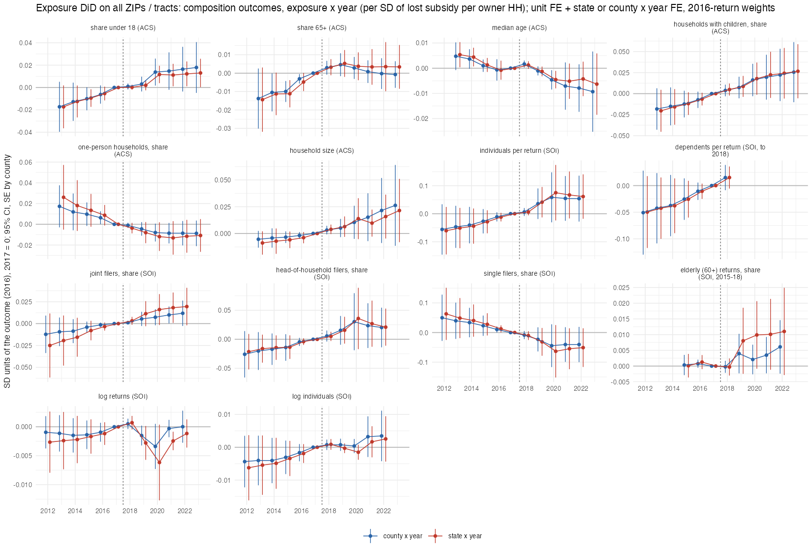

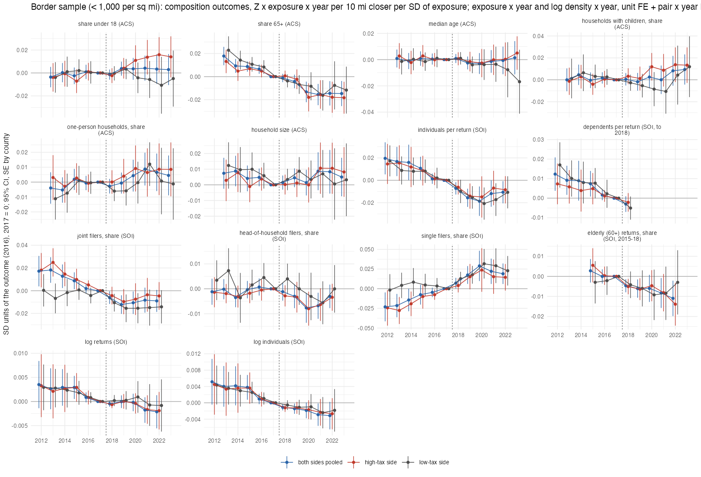

## How
- **Outline:** `iv_tract_side.rds (T = 30, high = 0) + ACS 2013-17 + CoreLogic 2016 tract-year + Data Axle move-outs 2014-17 + SOI 2016 ZIP + SEDA → Y ~ i(bin, ref 0-10) | pair, SE by county; Y ~ dist | pair within 0-W mi; Wald tests of the bin dummies by window`.
- **Choices:** low side = `high == 0` in the ranked pair (side with the lower median of tract medians within 20 mi); all
  distances kept (tracts assigned to their nearest own-state pair, so "whole state" is the part of the state nearest that
  border, up to 398 mi); bins 0-10, 10-20, 20-30, 30-50, 50-100, 100+ mi; reference 0-10; estimates in SD units of the
  covariate over the low-side sample; tracts unweighted (as in 02/03), robustness with weight 1/N_pair and with log
  density (ACS population / TIGER cb 2019 land area) as a control; Data Axle move-outs summed over destination files
  2014-17 and annualised by file cut-off months, tracts with ≥ 200 address-years; CoreLogic tracts with ≥ 50 parcels;
  SOI income = share of returns with AGI ≥ $100k (stubs 5-6) at the tract's modal situs ZIP.
- **Inputs:** `data/built/geo/iv_tract_side.rds` (build/geo/06), `data/built/exposure/exposure_components_{zip,county}.csv` (build/exposure/05), `data/census_finances_test.db` (build/census_finances/02-03), `data/built/census_finances/district_finance.rds` (build/census_finances/04, widened 2026-10-28), `data/built/acs/seda_district_year.rds`, `data/built/corelogic/tract_year.rds`, `data/built/acs/acs_tract_year.rds`, `data/external/acs17_tract_extra.csv` (tidycensus pull
  inside the script, cached; household size B25010, under-18 B09001, mobility B07003, households with children B11005),
  `data/built/corelogic/tract_year.rds` (build/corelogic/10), `data/built/dataaxle/border_moveout/moveout_tract_full.parquet`
  (Bouchet `m_moveout_tract_full.sql`), `data/built/exposure/salt_exposure_tract_zip2016.csv` (build/exposure/02),
  `data/database.db` table `returns_zipcode_agi`, `~/Library/Caches/tigris/cb_2019_us_tract_500k.dbf`. None of the
  data files are in git.
- **Scripts:** `code/designs/border_rd/08_low_side_balance_by_distance.R` → `output/designs/border_rd/c21_low_side_balance.txt`,
  `_table.csv`, `_bins.csv`, `_slopes.csv`, `_joint.csv`, `_robust.csv`, `figures/c21_low_side_balance.png`, and the tract table
  `data/built/geo/low_side_balance_tracts.rds`; `09_low_side_profiles_50mi.R` (CBSA polygons via tigris, cb 2019) →
  `c22_low_side_profiles_50mi.txt`, `.csv`, `_table.csv`, `c22_low_side_metro_pairs.csv`, `figures/c22_low_side_profiles_50mi.png`
  (`METRO_SIDE=high` adds the `_high` versions), `c22_metro_shares_by_pair_side.csv`, `data/built/geo/tract_cbsa_2019.csv`;
  `11_rural_rule_sensitivity.R` → `c24_rural_rule_sensitivity.{txt,csv}`, `c24_straddling_metros.csv`, `figures/c24_rural_rule_sensitivity.png`;
  `12_balance_coefplot.R` → `c25_balance_coefplot_c45.{txt,csv}`, `figures/c25_balance_coefplot_c45.png` (`METRO_SHARE=0.5` for the `_c50` versions; 09 likewise, default now 0.45, the
  30% run kept as `_c30`); `13_near_border_event_study.R` → `c26_near_border_event_study.{txt,csv}`, `_summary.csv`, `c26_near_border_yearly_levels.csv`, `figures/c26_near_border_event_study.png`, `figures/c26_near_border_yearly_levels.png` (panels assembled by `nb_panels.R`);
  `14_null_robustness.R` → `c27_null_robustness.txt`, `c27_null_robustness_grid.csv`, `c27_exposure_interaction.csv` (three measures), `figures/c27_null_robustness_grid.png`, `figures/c27_exposure_interaction_{own,high}.png`;
  `15_near_and_exposure_by_year.R` → `c28_near_and_exposure_by_year.{txt,csv}`, `figures/c28_near_and_exposure_by_year_{own,high}.png`; `16_exposure_interaction_grid.R` → `c29_exposure_interaction_grid.{txt,csv}`, `figures/c29_exposure_interaction_grid.png`; `17_exposure_event_study_continuous.R` → `c30_exposure_event_study_continuous.{txt,csv}`, `figures/c30_exposure_event_study_continuous_{interaction,main}.png`; `18_more_local_outcomes.R` → `c31_more_local_outcomes{,_coverage,_series}.{txt,csv}`, `figures/c31_more_local_outcomes_{tiles,es_f33,es_cog_sd,es_cog_area}.png`; `19_exposure_only_all_units.R` → `c32_exposure_only{,_coverage,_series}.{txt,csv}`, `figures/c32_exposure_only_{tiles,es}.png`; `20_district_exposure_fe_variants.R` → `c33_district_exposure_fe_variants{,_series}.{txt,csv}`, `figures/c33_district_exposure_fe_variants.png`, `data/built/exposure/district_exposure_zip.csv` (crosswalk `data/built/geo/zcta_district_area.csv` from `build/geo/08`); `21_both_sides_and_density.R` → `c34_both_sides{,_series,_balance}.csv`, `c34_density{,_series}.csv`, `c34_extended_outcomes.csv`, `c34_both_sides_and_density.txt`, `figures/c34_{both_sides,density}_es.png`, `figures/c34_{both_sides,density}_extended_tiles.png`; `22_density_spec_grid.R` → `c35_density_spec_grid{,_series}.{txt,csv}`, `figures/c35_density_spec_grid_{interaction,main,es}.png`; `23_balance_conditional_on_density.R` → `c36_balance_conditional_on_density.{txt,csv}`, `figures/c36_balance_conditional_on_density.png`, `figures/c36_balance_interaction.png` (`DENS_SPEC=bins` for the `_densbins` versions, `SIDE=high` for `_high`, after `SIDE=high` on 08 which writes `data/built/geo/high_side_balance_tracts.rds`).; `24_density_cutoff_sweep.R` → `c37_density_cutoff_sweep{,_all}.csv`, `c37_density_cutoff_sweep.txt`, `figures/c37_density_cutoff_sweep.png`; `25_density_cutoff_coverage.R` (tigris tracts and school districts cb 2019, cached) → `c37_density_cutoff_coverage.csv`, `data/built/geo/district_density_2017.csv`. `26_rural_district_map.R` (tigris districts and states cb 2019) → `c38_rural_district_map_1000.txt`, `figures/c38_rural_district_map_1000.png`. `27_pair_density_rule.R` → `c39_pair_density.csv`, `c39_pair_density_rule{,_all}.csv`, `c39_pair_density_rule.txt`, `figures/c39_pair_density_rule.png` (`PAIR_DENS=pw` for the `_pw` versions). `28_metro_district_rate_gap_maps.R` (tigris tracts, districts, CBSAs, states cb 2019) → `c40_metro_district_rate_gap_maps.txt`, `c40_metro_district_rate_gap_summary.csv`, `figures/c40_metro_district_rate_gap_maps.png`, `data/built/geo/district_rate_2016.csv`. `29_density1000_overview_iv.R` → `c41_density1000_overview_iv.txt`, `c41_density1000_{series,post_pre}.csv`, `c41_first_stage.csv`, `c41_balance.csv`, `c41_sample_competition.csv`, `figures/c41_{near_es,iv_es}_{z,near10}.png`, `figures/c41_balance.png`. `30_density1000_district_outcomes.R` → `c42_district_outcomes{,_coverage}.csv`, `c42_district_outcomes.txt`, `figures/c42_district_outcomes_tiles.png`. `31_density1000_exposure_interaction.R` → `c43_exposure_interaction_density1000{,_series}.csv`, `c43_exposure_interaction_density1000.txt`, `figures/c43_exposure_interaction_{tiles,es}.png`. `32_composition_outcomes.R` → `c44_composition_{post_pre,series}.csv`, `c44_composition_outcomes.txt`, `figures/c44_composition_{exposure_did,border_near,border_interaction}.png`; inputs `data/built/soi/zip_composition.csv` (build/soi/12) and `data/built/acs/acs_tract_composition_year.rds` (build/acs/07-08, tidycensus).
- **Check:** 20,473 tracts, 59 pairs; within 50 mi 15,440 tracts, rural subset 4,526 tracts in 40 pairs, rural rate slope −0.038 SD/10 mi (SE 0.014); high-side rule at 30%: 34 pairs, 9,532 tracts, 17 of 21 joint rejections; low-side rule median gap 0.044 SD at 30%, 0.116 at 80%; 50% cutoff near-dummy owner share −0.349 SD (SE 0.137) with NJ-NY, +0.026 (0.051) without; 45% event study: 890 districts, 332 counties, district log property tax per pupil post − pre −0.037 (0.019), tract log sale price −0.006 (0.015); robustness grid 12 of 220 cells |t| > 1.96; CT-NY high-side exposure 15.44 (lost subsidy $3,100 per owner); interaction grid: rural 45%, near < 10 mi, continuous: effective rate −0.372 (t −2.9), 66 of 264 cells significant; owner share 10-20 vs 0-10 = +0.36 SD (SE 0.10), main spec; rejections within 0-30 mi
  12 / 21 (main), 5 / 21 (equal pairs), 7 / 21 (density); 100+ bin log income +0.41 SD; balance given density (23): Z × E on share AGI ≥ $100k −0.248 SD (SE 0.075), all pairs, continuous Z; Holm rejections 6 / 14.

### Side contrast across every outcome of the density-selected design (33, 2026-10-29)
`33_density1000_side_contrast.R` collects the Z × year series of 29 (core 11), the main term of 31 (75 district /
local-government outcomes) and 32 (14 composition outcomes) and shows each on the low-tax side, the high-tax side and
as high minus low (difference of the side coefficients, SE = sqrt of the summed variances; sides are disjoint samples).
Post − pre (mean 2018+ minus mean 2012-16, SD units per 10 mi closer): on the low-tax side 1 of 100 cells has |t| > 1.96
(hospital spending, 3 census points); on the high-tax side 9 of 100 and in the contrast 3 of 100. Every high-side
cell that clears 1.96 is a straight line from 2012-13, not a 2017 break: ACS population and home value −0.010 / −0.011
(t −3), SOI returns and individuals −0.005 (t −4), district enrolment −0.005 (t −2.7), and in the contrast SOI returns and
individuals −0.006 / −0.007 (t −4), plus counts of local governments and special districts on the high side in the census years (−0.007 / −0.018, t −2); the yearly coefficients run +0.004 to +0.007 in 2013 down to −0.010 to −0.012 by 2022-23
with no change of slope at 2017. Sales per 100 parcels on the high side sit +0.02 to +0.05 above the low side in every year,
pre and post alike. Move-out rate, prices, bills, the effective rate, district finance and the composition shares show
nothing on either side or in the contrast. Outputs `c45_side_contrast_{series,post_pre}.csv`, `c45_side_contrast.txt`,
`figures/c45_side_contrast_{core,composition,district}.png`.
The same contrast for the Z × exposure × year term (the coefficient c43 plots; `c45_side_contrast_interaction*`): low side
11 of 100, high side 13, contrast 4 significant. The effective-rate interaction is the one place the sides differ after 2017:
high side −0.019 per 10 mi per SD of E (t −1.7), falling from 0 in 2017 to −0.02 by 2021-24, low side back to 0 after 2018,
contrast −0.023 by 2022 (post − pre −0.006, t −0.5, because the contrast was −0.02 in 2012-13 too). Sales +0.035 / +0.042 on
both sides (t 2.1 / 1.8), prices +0.010 / +0.012, population −0.013 / −0.016 (t −2.6 / −2.8) and enrolment −0.007 / −0.009 on
both sides, so none of these survive in the contrast. District spending and property tax per pupil rise on the low side only
(+0.022 / +0.023, t 2.0 / 1.9), contrast −0.03 by 2023. Composition: share 65+ falls on both sides (−0.023 / −0.019, t −3),
single-filer share rises on both (+0.019 / +0.032), joint filers fall on both; contrasts all within ±0.01. The balance
caveat of 23/36 applies to every interaction cell.

### Without the pair × year effects (34, 2026-10-29)
`34_density1000_fe_variants.R` re-estimates the core 11 outcomes on the density-selected sample with unit FE + year FE
in place of unit FE + pair × year FE, reduced form and interaction model, by side. Main term: little changes. The high-side
drifts get somewhat larger (enrolment −0.012 vs −0.005 SD per 10 mi, t −4.0; home value −0.016 vs −0.010; population
−0.015 vs −0.012), the low side stays within ±0.01, and the contrast is the same to within 0.005 everywhere; the count of
significant cells is 3 on the high side under both FE sets. Interaction term: the one post-2017 pattern of 31 inverts.
With pair × year FE the effective-rate interaction on the high side falls to −0.020 by 2021-24; with year FE only it rises
to +0.022 by 2024, and on the low side to +0.031, so the post − pre goes from −0.019 / −0.012 to +0.003 / +0.016 and the
contrast from −0.006 to −0.013 (t −0.9). District spending per pupil keeps its low-side rise (+0.031 vs +0.022, t 2.1)
and the contrast widens to −0.040 (t −2.4); home value on the high side turns positive (+0.009 vs −0.006); population,
enrolment, sales and prices keep sign and size. Without pair × year effects the near-vs-inland comparison is pooled across
all 68 borders, so shocks that differ across border regions load on Z × E wherever exposed near tracts sit on different
borders than exposed inland tracts. The effective-rate interaction is therefore not robust to the choice, in either
direction, and nothing else in the core set depends on it. Outputs `c46_fe_variants_{series,post_pre}.csv`,
`c46_fe_variants.txt`, `figures/c46_fe_variants_{rf_main,int_main,int_interaction}.png`.

## Open
- The near × own-exposure interaction (16) is the one sign-consistent post-2017 pattern: lower effective rate, more sales,
  slightly higher prices, fewer people near the border in high-exposure tracts. Worth a cleaner test: detrend the
  effective-rate interaction, use exposure terciles, and check the few high-exposure near tracts that drive the rural
  estimates. Balance (23) says the interaction is unbalanced in 2016 prices, turnover, income and
  education (−0.1 to −0.25 SD per SD of E per 10 mi), so any such test needs to show the post-2019 sales and price rise
  is not catch-up in the cheaper near-border tracts of high-exposure ZIPs.
- The same check on the high-tax side, and with pair × distance-bin cells restricted to pairs where the near bin is not a
  metro core (or with CBSA principal-city flags), would say whether the instrument sample in `designs/border_iv` (near × high
  side) inherits the city-vs-suburb comparison.
- The 0-10 bin is a quarter New York City; any near-border design should report results with pairs weighted equally.
