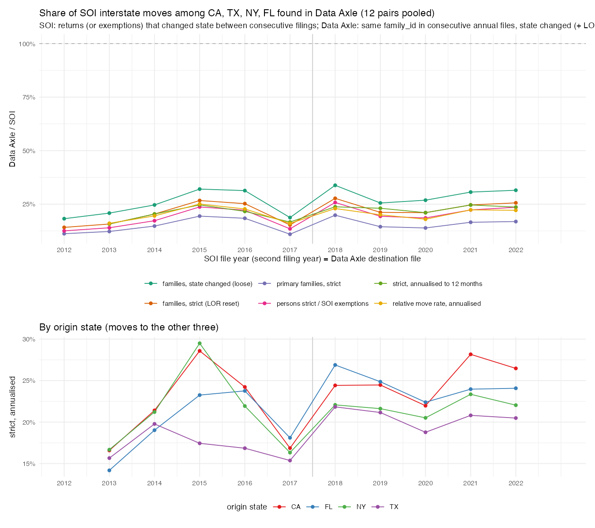
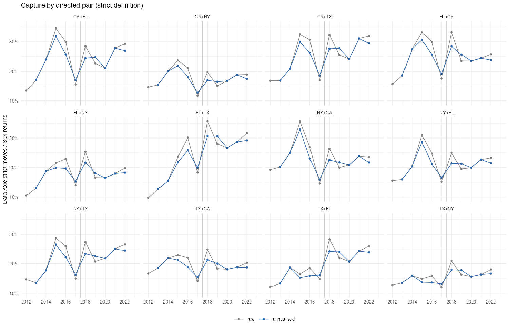

## Answer
Data Axle records **about a fifth to a quarter of the SOI interstate moves** among CA, TX, NY and FL once a move is required to
carry the same `family_id` across the two annual files, and the share has not changed since the SALT cap. Pooled over the 12
directed pairs, full `dataaxle_annual` (2022 from the quarterly replacement):

| SOI file year | DA interval (months) | SOI returns moved | DA families, state changed | DA strict (+ LOR reset) | capture, strict | strict, annualised | primary families, strict | DA persons / SOI exemptions | relative move rate (annualised) |
|---|---|---|---|---|---|---|---|---|---|
| 2012 | – | 239k | 43.6k | 33.9k | 14.2% | – | 11.2% | 12.5% | – |
| 2013 | 12 | 241k | 50.1k | 37.8k | 15.7% | 15.7% | 12.2% | 14.0% | 16.0% |
| 2014 | 12 | 229k | 56.5k | 46.7k | 20.4% | 20.4% | 14.8% | 17.3% | 19.5% |
| 2015 | 13 | 193k | 61.8k | 51.5k | 26.7% | 24.6% | 19.4% | 23.7% | 25.1% |
| 2016 | 14 | 227k | 71.1k | 57.3k | 25.2% | 21.6% | 18.4% | 22.2% | 22.8% |
| 2017 | 11 | 284k | 53.2k | 43.3k | 15.3% | 16.7% | 11.0% | 13.5% | 16.0% |
| 2018 | 14 | 232k | 78.3k | 64.2k | 27.7% | 23.8% | 19.8% | 25.8% | 22.9% |
| 2019 | 11 | 229k | 58.6k | 48.6k | 21.2% | 23.1% | 14.5% | 19.3% | 20.0% |
| 2020 | 12 | 250k | 67.0k | 52.5k | 21.0% | 21.0% | 13.9% | 18.6% | 18.0% |
| 2021 | 12 | 274k | 83.9k | 67.5k | 24.6% | 24.6% | 16.5% | 22.3% | 22.3% |
| 2022 | 13 | 290k | 91.4k | 74.3k | 25.6% | 23.6% | 16.9% | 23.5% | 22.1% |

- **Level:** strict capture 14-28% raw, 16-25% annualised; loose (any state change, no LOR reset) adds about 5 pp; primary families
  only 11-20%. Persons against exemptions give the same share (12-26%), so the families Data Axle does follow are about as large as
  the SOI mover returns (1.3-1.7 persons vs 1.4-2.0 exemptions per return, by pair).
- **Time:** capture rises from 14-16% (2012-13) to 25-27% in 2015 and stays at 21-25% through 2022. The 2017 trough (15%) is a
  joint artefact: the 1617 SOI file codes about 30% too many movers and the 2016→17 Data Axle interval is 11 months. The 2015 and
  2018 peaks are the 13-14-month intervals (2015-04→2016-06, 2017-05→2018-07); annualised, 2018-22 sit at 21-25%, the same band as
  2015-16. Nothing suggests Data Axle captured a larger or smaller share after the SALT cap.
- **Relative move rate** (DA strict moves per same-state family over SOI movers per in-state return) is 16-25%: the Data Axle
  stock of linked families in the four states is comparable to SOI returns, so the gap is in the moves, not in coverage.
- **By origin and pair:** CA, NY and FL origins at 21-28% from 2018, TX at 19-22%; by pair (2013-22 means, annualised) 15-26%,
  highest CA>TX 26%, FL>CA 24%, CA>FL 24%, lowest TX>NY 15%, CA>NY 17%, FL>NY 18%: moves into NY are caught least.
- Consistent with §4.5 of the exploration doc (national interstate strict rate 0.5-0.8% vs ACS 2.1%): a moving family usually
  gets a new `family_id`, so same-id moves miss roughly three in four moves. Linking by name + age would be needed to raise this.

## Recipe
1. Bouchet: `output/validation/dataaxle/soi_vs_dataaxle/da_mig4_full.sql` (`run_sql.sbatch`, 4 cores / 64G, 5 min; job 31310996) →
   `da_mig4_full.csv`: for each consecutive pair of annual files (2011→12 … 2022→23, plus 2021→23), families in the four states in
   both files, by origin × destination state (including same-state stayers): families, primary families, strict (destination
   `length_of_residence` ≤ 1; ≤ 2 for 2021→23), persons (non-null `individual_id_1..5` at destination). 2022 from
   `~/ptax_explore/samples/da_annual_2022_from_quarters` (state is the hive partition). The 1% family-sample version is
   `da_mig4_1pct.sql` (`q.sh`, < 1 s).
2. `code/validation/dataaxle/soi_vs_dataaxle_moves_4states.R` (`DA_FILE=1pct` for the sample): SOI flows from
   `data/SOI/migration_state/stateoutflowYYYY.csv` (files 1112–2122, labelled by the second year), in-state base = non-migrants +
   same-state movers (imputed for 2012–13); Data Axle pair (t, t+1) matched to SOI file t+1; annualised by the file cut-off months
   (2012-03 … 2023-06). Outputs `soi_vs_dataaxle_{pairs,pooled}.csv`, `soi_vs_dataaxle.txt`, the two figures (`_1pct` variants alongside).
