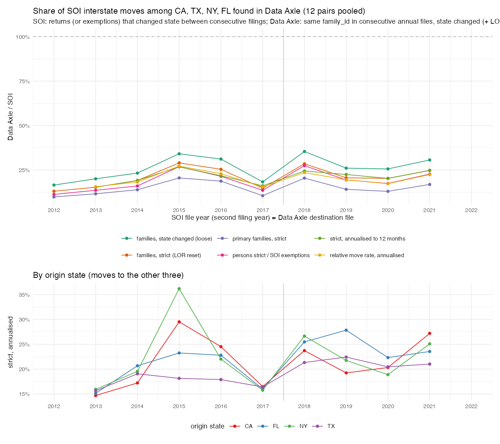
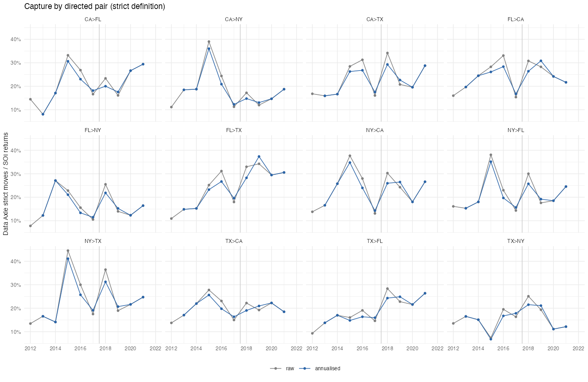

## Answer
Data Axle records **about a fifth to a quarter of the SOI interstate moves** among CA, TX, NY and FL once a move is required to
carry the same `family_id` across the two annual files. Pooled over the 12 directed pairs (1% family sample, scaled):

| SOI file year | DA interval (months) | SOI returns moved | DA families, state changed | DA strict (+ LOR reset) | capture, strict | strict, annualised | primary families, strict | DA persons / SOI exemptions | relative move rate (annualised) |
|---|---|---|---|---|---|---|---|---|---|
| 2012 | – | 239k | 39.6k | 31.3k | 13.1% | – | 9.9% | 11.3% | – |
| 2013 | 12 | 241k | 48.3k | 36.9k | 15.3% | 15.3% | 11.6% | 13.6% | 15.6% |
| 2014 | 12 | 229k | 53.4k | 43.9k | 19.1% | 19.1% | 13.9% | 16.0% | 18.3% |
| 2015 | 13 | 193k | 65.9k | 56.0k | 29.0% | 26.8% | 20.6% | 26.9% | 27.2% |
| 2016 | 14 | 227k | 70.8k | 57.7k | 25.4% | 21.8% | 18.8% | 21.5% | 22.9% |
| 2017 | 11 | 284k | 52.0k | 42.0k | 14.8% | 16.1% | 10.6% | 13.6% | 15.5% |
| 2018 | 14 | 232k | 82.1k | 66.1k | 28.5% | 24.5% | 20.5% | 27.4% | 23.6% |
| 2019 | 11 | 229k | 59.8k | 47.3k | 20.6% | 22.5% | 14.2% | 19.4% | 19.5% |
| 2020 | 12 | 250k | 64.0k | 50.7k | 20.3% | 20.3% | 13.0% | 17.5% | 17.3% |
| 2021 | 12 | 274k | 84.0k | 67.9k | 24.8% | 24.8% | 16.9% | 22.7% | 22.4% |

- **Level:** strict capture 15–29% raw, 15–27% annualised; loose (any state change, no LOR reset) adds about 5 pp; primary families
  only 10–21%. Persons against exemptions give the same share (11–27%), so the families Data Axle does follow are about as large as
  the SOI mover returns (1.3–1.8 persons vs 1.4–2.1 exemptions per return, by pair).
- **Time:** capture rises from 13–15% (2012–13) to 25–29% in 2015 and stays at 20–25% through 2021. The 2017 trough (15%) is a
  joint artefact: the 1617 SOI file codes about 30% too many movers (memory note) and the 2016→17 Data Axle interval is 11 months.
  The 2015 and 2018 peaks are the 13–14-month intervals (2015-04→2016-06, 2017-05→2018-07); annualising flattens them but
  2018 still sits 2–3 pp above 2019–20. Nothing suggests Data Axle captured a larger share after the SALT cap.
- **Relative move rate** (DA strict moves per same-state family over SOI movers per in-state return) is 16–27%: the Data Axle
  stock of linked families in the four states is comparable to SOI returns, so the gap is in the moves, not in coverage.
- **By origin and pair:** no systematic ranking; CA, NY and FL origins all sit at 15–30%, TX a little lower (18–22%); the thinnest
  pairs (TX>NY, CA>NY, FL>NY, 7–18k SOI returns) are noisiest in a 1% sample and run lowest (16–19% on average over 2013–21).
- Consistent with §4.5 of the exploration doc (national interstate strict rate 0.5–0.8% vs ACS 2.1%): a moving family usually
  gets a new `family_id`, so same-id moves miss roughly three in four moves. Linking by name + age would be needed to raise this.

## Recipe
1. Bouchet, 1% family sample `~/ptax_explore/samples/da_fam1pct.parquet`: `output/validation/dataaxle/soi_vs_dataaxle/da_mig4_1pct.sql`
   (via `q.sh`, < 1 s) → `da_mig4_1pct.csv`: for each consecutive pair of annual files (2011→12 … 2020→21, 2021→23), families in the
   four states in both files, by origin × destination state (including same-state stayers): families, primary families, strict
   (destination `length_of_residence` ≤ 1; ≤ 2 for 2021→23), persons (non-null `individual_id_1..5` at destination).
   Full data: `da_mig4_full.sql` (`run_sql.sbatch`, adds 2021→22 and 2022→23 from the quarterly 2022 replacement) → `da_mig4_full.csv`.
2. `code/validation/dataaxle/soi_vs_dataaxle_moves_4states.R` (`DA_FILE=1pct` for the sample): SOI flows from
   `data/SOI/migration_state/stateoutflowYYYY.csv` (files 1112–2122, labelled by the second year), in-state base = non-migrants +
   same-state movers (imputed for 2012–13); Data Axle pair (t, t+1) matched to SOI file t+1; annualised by the file cut-off months
   (2012-03 … 2021-06). Outputs `soi_vs_dataaxle_{pairs,pooled}_1pct.csv`, `soi_vs_dataaxle_1pct.txt`, the two figures.
3. Re-run without `DA_FILE` once `da_mig4_full.csv` is back from Bouchet (job 31310183, 4 cores / 64G, queued at 15:58).
