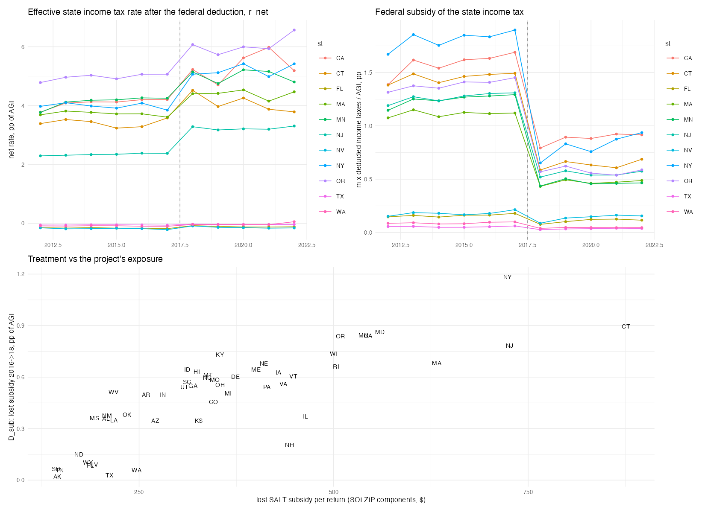
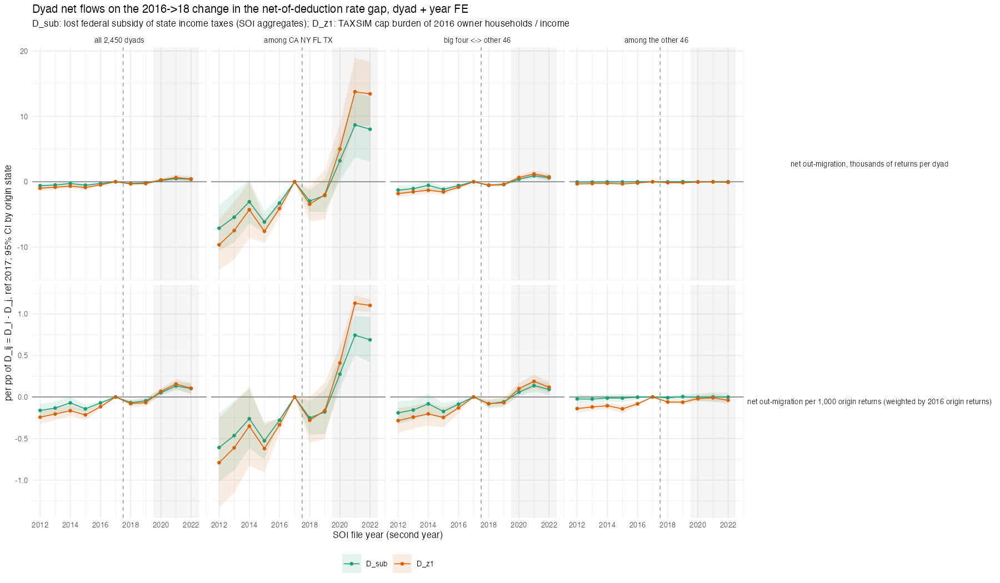

## Answer
Same answer as the state-level and dyad-subset entries: nothing in the 2018-19 files beyond the pre-existing drift, a
jump from the 2020 file, and the whole jump sits in dyads involving CA, NY, FL and TX. Among the other 46 states the
treatment predicts no change in net flows at all.

**Treatment.** r_net(s,t) = state income tax collections / AGI − m × federally deducted state income taxes / AGI, with the
deducted amount from Historic Table 2 (claimed income taxes through TY2017; the limited line 5e amount times the income-tax
share from TY2018) and m = 0.28 / 0.24 (itemisers' federal bracket before and after TCJA). D_sub(s) = the lost federal
subsidy 2016→2018 in pp of AGI: NY 1.18, CT 0.90, MD 0.86, MN 0.84, CA 0.84, OR 0.84 … FL 0.09, WA 0.06, TX 0.03, AK 0.02
(SD 0.26 across states). D_z1 = TAXSIM cap burden of 2016 owner households / income (corr 0.77 with D_sub); D_net adds the
states' own rate changes. For a pair, D_ij = D_i − D_j.

**Dyads** (2,450 directed pairs, 2012-2022 files, net out-migration in thousands of returns, dyad + year FE, SE by origin;
cells: mean 2018-19 and mean 2020-22 minus mean 2013-16, per pp of D_ij):

| sample | 2018-19 | 2020-22 | pre-slope / yr |
|---|---|---|---|
| all 2,450 dyads | +0.18 (0.08) | **+0.74 (0.14)** | +0.10 |
| among CA NY FL TX (12) | +2.0 (1.1) | **+11.1 (2.3)** | +1.1 |
| big four ↔ other 46 (368) | +0.37 (0.11) | **+1.47 (0.19)** | +0.20 |
| among the other 46 (2,070) | +0.02 (0.03) | +0.02 (0.05) | +0.01 |

- **2018-19 is the trend.** Year by year against 2017, all dyads: 2012 −0.60, 2014 −0.26, 2016 −0.26, 2018 −0.25,
  2019 −0.17, 2020 +0.19, 2021 +0.49, 2022 +0.38. The 2018-19 cell is positive only because the 2013-16 mean sits
  below 2017 on a +0.10/yr slope; the two post-cap pre-COVID files are on that line.
- **2020-22 is the big four.** Per pp of D_ij the CA/NY ↔ FL/TX dyads add 11k returns a year (D_ij ≈ 1.1 pp for
  NY→FL, so about 12k returns on a 2017 flow of 45k); the mixed pairs 1.5k; the other 46 among themselves 0.02k (SE
  0.05) on flows of under 1k. Per 1,000 origin returns, weighted by 2016 origin returns: all dyads +0.05 (0.02) in 2018-19 and
  +0.20 (0.03) in 2020-22; big four +0.17 (0.12) / +0.95 (0.12), mixed +0.06 (0.02) / +0.22 (0.03), other 46 +0.01 (0.02) / +0.01 (0.03).
- The TAXSIM-based D_z1 and the constant-m variant give the same shape with larger coefficients (D_z1 2020-22: all
  +1.16, other 46 +0.21 (0.05), still a tenth of the mixed pairs); D_net (adds own-rate changes) the same.
- **States** (state + year FE, SE by state). Totals, net out-migration in thousands of returns per pp of D_s: all 50 +8.6k
  (7.5) in 2018-19 and +36.6k (11.5) in 2020-22; big four +22k (23) / +122k (43); other 46 +1.9k (4.0) / +0.7k (7.3). Rate
  (pp of returns, 2016-return weights): all 50 +0.18 (0.19) / +0.89 (0.25); big four +0.15 (0.31) / +1.16 (0.40); other 46
  +0.15 (0.30) / +0.07 (0.54).

So fixing the treatment at the policy change removes the mechanical doubling in Diop & Green's regressor but not the
timing or the geography: the response is a 2020+ acceleration of CA/NY → FL/TX and CA/NY → everywhere, and states with
the same lost subsidy outside the four (CT, MD, MN, OR at 0.84-0.90 pp) show no relative change in net flows with anyone.

## How
- **Outline:** `Historic Table 2 (build/soi/11 panel + A18460 from the raw 2018-22 csv) + STC collections / AGI
  (build/exposure/07) -> r_net(s,t), D_sub = m16 dd16 - m18 dd18 -> dyads (build/soi/10): D_ij = D_i - D_j ->
  feols(net ~ i(y, D_ij, ref 2017) | dyad + y, cluster ~o)`; states as in 17.
- **Choices:** income taxes only (the cap also hits property taxes; D_z1 covers both); m statutory, not estimated;
  2016 → 2018 change (TY2017 is the last pre-cap year, but the 2016 value avoids the 1617 file); reference 2017;
  samples all / among big four / mixed / among other 46; outcomes are totals (thousands of returns) or rates weighted by 2016 returns
  (dyads: origin returns), never unweighted rates; two-way SEs in the csv.
- **Script:** `code/designs/exposure_did/19_net_rate_change_dyads.R` → `output/designs/exposure_did/c19_net_rate_change_{rates,treat,dyads,states}.csv`,
  `c19_net_rate_change.txt`, `figures/c19_net_rate_change_{rates,dyads}.png`.
