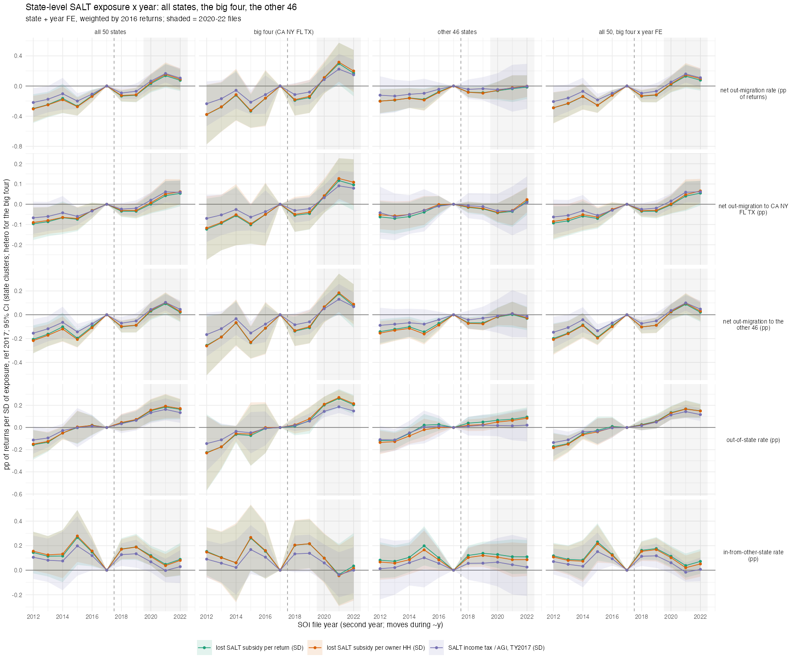

## Answer
Yes. In `y_st ~ exposure × year | state + year` (50 states, 2016-return weights, SE by state), net out-migration rises with
SALT exposure only from the 2020 file on, and only because of the four big states. Lost SALT subsidy per return, pp of
returns per SD of exposure; cells: mean 2018-19 minus mean 2013-16 (SE) | mean 2020-22 minus mean 2013-16 (SE) | same two as
deviations from the 2012-17 linear pre-trend.

| net out-migration rate | 2018-19 | 2020-22 | vs trend 2018-19 | vs trend 2020-22 |
|---|---|---|---|---|
| all 50 states | +0.07 (0.04) | **+0.28 (0.07)** | −0.14 | −0.06 |
| big four (CA NY FL TX; hetero SE) | +0.05 (0.10) | **+0.42 (0.14)** | −0.19 | +0.03 |
| other 46 states | +0.07 (0.04) | +0.11 (0.08) | −0.10 | −0.15 |
| all 50, big four × year FE | +0.06 (0.05) | +0.26 (0.07) | −0.15 | −0.06 |

| by destination group, 2020-22 minus 2013-16 | to CA NY FL TX | to the other 46 |
|---|---|---|
| big four origins | +0.16 (0.06) | +0.26 (0.08) |
| other 46 origins | +0.02 (0.03) | +0.09 (0.05) |

- **2018-19: nothing anywhere.** Relative to the 2013-16 mean every sample is at +0.05 to +0.07 pp per SD, and relative
  to the pre-trend (+0.04 to +0.06 pp per SD per year through the 2010s in every sample) the 2018-19 files sit *below*
  the line. The year-by-year coefficients for 2018 and 2019 are −0.13 and −0.12 against the 2017 reference, which is the
  inflated 1617 file.
- **2020-22: the big four.** Among the four, net out-migration rises by 0.42 pp of returns per SD of exposure (CA is
  +1.1 SD, NY +2.3, FL −1.1, TX −0.9), 1.6 pp per SD above the 46-state figure; the CA/NY-vs-FL/TX dummy gives +1.14 pp
  (0.35). Among the other 46, 2020-22 is +0.11 (0.08) and 0.15 pp *below* their own pre-trend. Pooling all 50 gives the
  0.28 that the earlier state-level results report; absorbing big-four × year effects leaves 0.26 because the weights
  (CA, NY, FL, TX are 4 of the 5 largest states) keep the four in.
- **Where the big four's extra outflow goes:** 0.16 pp to the other three big states (CA/NY → FL/TX) and 0.26 pp to the
  46. The 46 states' own net flows to the big four do not respond (+0.02), so the result is not high-exposure states
  everywhere feeding FL and TX; it is the two big high-exposure states losing more returns to everyone from 2020.
- **Gross flows:** the out-of-state rate rises in both groups (big four +0.30, other 46 +0.11 in 2020-22; the 46's is on
  trend); in-migration falls with exposure in the big four only (−0.11, SE 0.12). Raw net out-migration rates: CA 0.5 →
  0.9-1.05 pp (2018-19 → 2020-22), NY 0.9-1.0 → 1.3-1.8, FL −0.7 → −1.0 to −1.5, TX −0.4 to −0.5 → −0.6 to −0.8.
- Exposure measures agree: per return, per owner HH and Diop & Green's SALT/AGI at TY2017 give the same picture
  (big four 2020-22: 0.42 / 0.43 / 0.29; other 46: 0.11 / 0.13 / 0.07).

## How
- **Outline:** `SOI state{out,in}flow 1112-2122 -> state-year out, in, non-migrants (base = non-migrants + out) +
  dyads (build/soi/10) -> net to big four / other 46 -> feols(y ~ i(y, E, ref = 2017) | s + y, weights 2016 base,
  cluster ~s; hetero for the 4-state sample)`; E standardised over the 50 states.
- **Choices:** year = second file year (moves during ~y); reference 2017 as in the project (the 1617 artefact
  inflates it, hence the trend-adjusted columns); exposure fixed (2016 components, TY2017 SALT/AGI); AK and HI drop from
  the per-owner spec (no owner count); DC excluded.
- **Script:** `code/designs/exposure_did/17_state_did_big_four.R` → `output/designs/exposure_did/c17_state_did_big_four{,_series}.csv`,
  `.txt`, `figures/c17_state_did_big_four.png`.
- Related: `notebook/2026-10-27-diop-green-table7-replication` (dyad subsets), `2026-10-27-diop-green-reconciliation`.
