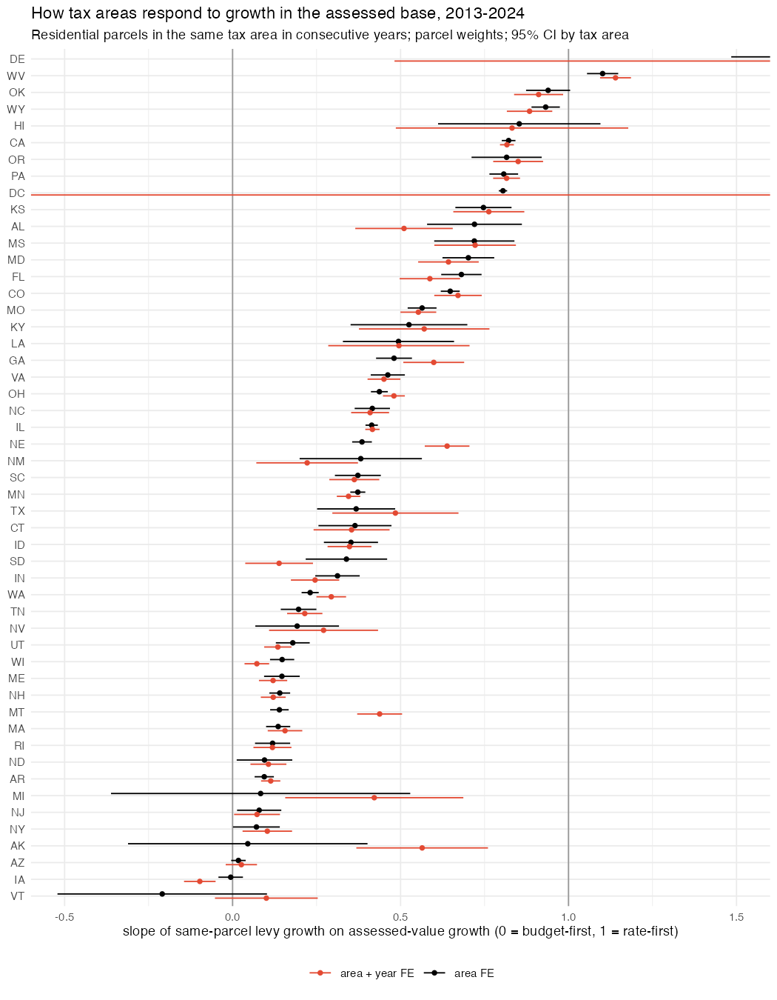

## Answer
Yes. Regressing a tax area's levy growth on its assessed-value (AV) growth, both measured on the same parcels in
consecutive years, gives a slope near 0 where the levy is fixed and the rate adjusts (budget-first) and near 1 where
the rate is fixed and revenue follows the base (rate-first). The state ranking matches what state law predicts.

| | slope (area FE, parcel weights) |
|---|---|
| National, 78k tax areas, 2013–2024 | 0.34 (SE 0.01) |
| Budget-first end | IA −0.01, AZ 0.02, NY 0.07, NJ 0.08, MI 0.08, MA 0.14, NH 0.14, WI 0.15, WA 0.23 |
| Middle | TX 0.37, MN 0.37, IL 0.41, NC 0.42, OH 0.44, VA 0.46, GA 0.48, MO 0.56 |
| Rate-first end | FL 0.68, MD 0.70, PA 0.81, OR 0.82, CA 0.82, OK 0.94, WY 0.93, WV 1.10 |

- Levy-limit states (NY's 2% tax cap, NJ's 2% cap, MA's Proposition 2½, WA's 1% levy limit, AZ, WI) sit near 0.
  California and Oregon, where the rate is set by constitution and AV growth is capped, sit near 0.8. The remaining 0.2
  there plausibly comes from voter-approved bond rates, which adjust to raise fixed debt service.
- Texas (no-new-revenue rate) and Illinois (levy limits only in some counties) come out mixed, as expected.
- Adding year fixed effects or removing state × year means barely moves the state slopes. Exceptions are states with few
  areas or little AV variation (AK, MI, MT, NE, DC, DE).
- Per tax area, with at least six usable years: 24% of parcels sit in budget-first areas (slope < 1/3), 19% mixed,
  18% rate-first (> 2/3). The rest are imprecise (SE > 0.33, 21%) or have no AV variation (18%). The no-variation group is
  large in PA (68%), OR (76%), NY and NJ (about half): places that rarely reassess, where the test cannot speak.

## How
- **Outline:** `cl.tax 2012–2024 residential (pic 10/11/21/22), bill > 0, AV > 0, one row per clip -> tax area
  (tax_area_code, else tax_rate_area_code, else situs city) x year: all parcels, and parcels in the same area in t-1 and t
  -> g_levy = log(sum bill_t / sum bill_t-1), g_av = log(sum AV_t / sum AV_t-1) on those parcels -> per-area OLS and
  state pooled feols(g_levy ~ g_av | area, weights n_st, cluster area)`.
- **Choices:** same parcels only, so new construction and roll churn are excluded and the levy is never divided by AV
  (no division bias). Area-years kept if ≥ 30 stable parcels, stable parcels ≥ 70% of the area, |growth| < 0.7 (this
  drops the year after a missing county-year). The city fallback is used only where ≥ 90% of a county's parcels lack a tax-area
  code (MA, RI, MI towns). Per-area regime needs ≥ 6 years and SD of g_av ≥ 0.01. Cut-offs 1/3 and 2/3.
- **Caveats:** the bill sums all overlying levies (school, county, city, special districts), so the slope describes the
  stack of governments, not the school district alone. Error in area AV growth attenuates the slope towards 0, i.e.
  towards budget-first. Mid-year AV appeals and lags between assessment and rate setting are ignored.
- **Inputs:** SOM job 3944304 (4c/96G, 8 min, 77 GB peak) → `~/ptax_explore/levyreg/levy_area_YYYY.parquet`, copied to
  `data/built/corelogic/levyreg/` (94 MB).
- **Scripts:** `code/build/corelogic/som/n_levy_regime{.sbatch,_head.sql,_year.sql}`, `code/build/corelogic/13_levy_regime.R`
  → `data/built/corelogic/levy_regime_area.parquet` (per-area slope and regime), `output/build/corelogic/levy_regime_*`.
- **Check:** 741,006 area-years in 78,084 areas; national pooled slope 0.344 (0.008); CA 0.822, NY 0.071, TX 0.368.

## Open
- Use the per-area regime to split the SALT designs: a cap-induced price fall should lower bills in rate-first areas and
  raise the nominal rate in budget-first areas.
- For school districts alone, put the F-33 property tax over CoreLogic AV summed to the district.
